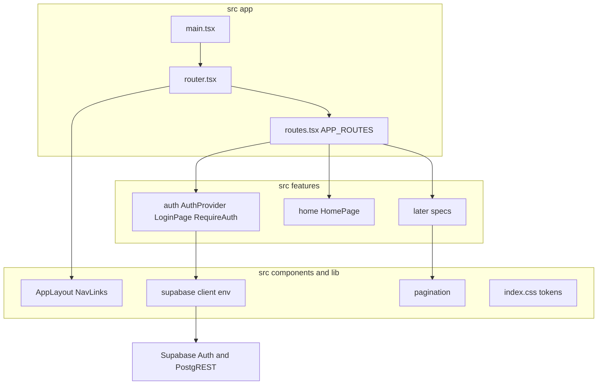
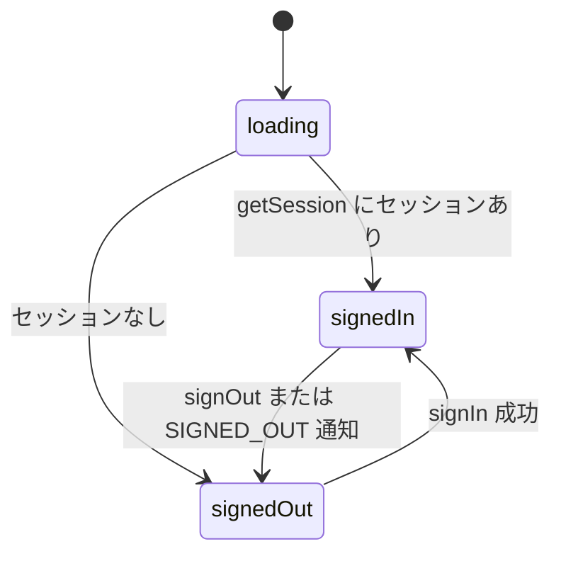
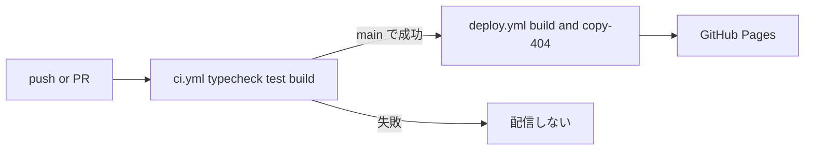

# Design Document

## Overview

**Purpose**: 後続のすべての spec が共通で使う実行基盤（ビルド、サブパス配信、認証、Supabase 接続、共通レイアウト、テーマトークン、ページング、品質ゲート）を提供する。

**Users**: 所有者本人がログインして空のホーム画面に到達する。後続 spec の開発者は `src/features/<domain>/` に Page と `api.ts` を追加し、ルート登録表に1行足すだけで画面を組み込める。

**Impact**: greenfield のリポジトリに、アプリの雛形、ローカル Supabase、CI／デプロイのワークフローを新設する。

### Goals

- ログイン済みの所有者だけが保護された画面を開ける
- ビルド時の `base` と Router の `basename` が常に一致し、GitHub Pages のサブパスで深いリンクが動く
- 正誤色・警告色を含むテーマトークンと、全件取得のページングを共有契約として固定する
- push／PR ごとの品質ゲートと、main 反映後の自動デプロイ

### Non-Goals

- 業務テーブル、RLS 付きの業務スキーマ、業務画面（subject-catalog 以降が所有）
- 新規登録画面、パスワード再設定画面、テーマの手動切替
- 本番 DB に対する E2E

## Boundary Commitments

### This Spec Owns

- ビルド・開発設定（`package.json` の scripts、`tsconfig`、`vite.config.ts`、Vitest／Playwright 設定）
- ルート登録表 `APP_ROUTES` と、その型 `AppRoute`（後続 spec が追加する唯一の拡張点）
- Supabase client の単一インスタンスと環境変数の検証
- 認証状態 `AuthProvider`／`useAuth`、ログイン画面、保護ルート `RequireAuth`
- 共通レイアウト `AppLayout` とナビゲーション
- テーマトークン（`--c-correct`、`--c-incorrect`、`--c-warn` ほか）と共通 class
- `fetchAllPages` のページング契約
- ローカル Supabase の設定（登録無効化、所有者アカウントの seed）
- CI とデプロイのワークフロー

### Out of Boundary

- 業務データのスキーマ、migration、RLS ポリシー（本 spec では業務 migration を作らない）
- 各 feature の Page の中身、`api.ts`、純粋ロジック
- Supabase Cloud プロジェクトの作成と Auth 設定の操作（デプロイ前の確認項目として記載するのみ）

### Allowed Dependencies

- npm パッケージ: react、react-dom、react-router、@supabase/supabase-js、lucide-react、tailwindcss、@tailwindcss/vite、vite、@vitejs/plugin-react、typescript、vitest、jsdom、@testing-library/react、@testing-library/jest-dom、@testing-library/user-event、@playwright/test、supabase（CLI）
- 外部サービス: Supabase Auth（ローカル／Cloud）、GitHub Actions、GitHub Pages
- 依存方向: `src/app` → `src/features` → `src/components`／`src/lib`。`src/lib` と `src/components` は `src/features` と `src/app` を import しない（`AppLayout` はルート一覧を props で受け取る）

### Revalidation Triggers

- `AppRoute` 型、`APP_ROUTES` の構造、ナビゲーション区分（`learn`／`manage`）の変更
- テーマトークン名・意味の変更（特に正誤色）
- `fetchAllPages` のシグネチャや失敗時の振る舞いの変更
- `useAuth` の返す状態の変更、環境変数名の変更
- `base` の決定規則の変更

## Architecture

### Architecture Pattern & Boundary Map



**Architecture Integration**:

- Selected pattern: クライアント SPA + feature-first（structure.md に準拠）
- Domain/feature boundaries: 認証は `src/features/auth`、ルート合成は `src/app`、共有契約は `src/lib`
- New components rationale: 各コンポーネントは要件の1領域に対応し、仮想的な将来要件のための層は持たない
- Steering compliance: `@` alias、named export、barrel なし、`snake_case` → `camelCase` 変換は各 feature の `api.ts`

### Technology Stack

| Layer | Choice / Version | Role in Feature | Notes |
| ------- | ------------------ | ----------------- | ------- |
| Frontend | React 19、React Router 7、Vite 7、TypeScript 5.9 | SPA、ルーティング、ビルド | `createBrowserRouter` |
| UI | Tailwind CSS 4、lucide-react | トークンとユーティリティ、アイコン | `@tailwindcss/vite` |
| Data / Auth | Supabase JS 2、Supabase Auth、PostgreSQL 17 | セッション、PostgREST | ローカルは Supabase CLI |
| Test | Vitest 3（jsdom）、Testing Library、Playwright | ユニット、E2E | E2E は直列 |
| Infrastructure | Node.js 24、GitHub Actions、GitHub Pages | CI、配信 | `actions/deploy-pages` |

## File Structure Plan

### Directory Structure

```text
package.json                 # scripts: dev, build, preview, typecheck, test, test:e2e, db:start, db:stop, db:reset
tsconfig.json                # strict, noUncheckedIndexedAccess, noUnused*, paths @/* -> src/*
tsconfig.node.json           # 設定ファイル用
vite.config.ts               # base 決定、@ alias、react と tailwind プラグイン、Vitest 設定
playwright.config.ts         # workers: 1、webServer: npm run dev、projects: mobile と desktop
index.html                   # エントリ HTML
.env.example                 # VITE_SUPABASE_URL、VITE_SUPABASE_PUBLISHABLE_KEY の雛形
.gitignore                   # dist、test-results、.env.local、出力 JSON など
scripts/
└── copy-404.mjs             # ビルド後に dist/index.html を dist/404.html へ複製
src/
├── main.tsx                 # 環境変数検証、createRoot、AuthProvider、RouterProvider
├── index.css                # Tailwind 読み込み、テーマトークン、共通 class
├── vite-env.d.ts            # ImportMetaEnv の型
├── app/
│   ├── routes.tsx           # AppRoute 型と APP_ROUTES（後続 spec の拡張点）
│   ├── router.tsx           # createAppRouter: basename 同期、保護・公開・404 の合成
│   ├── EnvErrorPage.tsx     # 設定不足の表示
│   └── NotFoundPage.tsx     # 存在しない URL の表示とホームへの導線
├── features/
│   ├── auth/
│   │   ├── AuthProvider.tsx # セッション購読、useAuth
│   │   ├── RequireAuth.tsx  # 保護ルートのガード
│   │   ├── LoginPage.tsx    # ログインフォーム
│   │   ├── api.ts           # signIn、signOut、エラーの日本語化
│   │   ├── api.test.ts      # toAuthErrorMessage
│   │   ├── redirect.ts      # 遷移先の保存と検証（純粋関数）
│   │   └── redirect.test.ts
│   └── home/
│       └── HomePage.tsx     # 空のホーム画面
├── components/
│   ├── AppLayout.tsx        # ヘッダー、PC サイドナビ、モバイル下部ナビ、Outlet
│   └── NavLinks.tsx         # 区分ごとの導線描画と現在位置表示
├── lib/
│   ├── env.ts               # parseEnv（純粋関数）
│   ├── env.test.ts
│   ├── supabase.ts          # createClient の単一インスタンス
│   ├── pagination.ts        # fetchAllPages
│   ├── pagination.test.ts
│   ├── basePath.ts          # resolveBase（vite.config と共有する純粋関数）
│   └── basePath.test.ts
└── test/
    └── setup.ts             # jest-dom matcher の登録
supabase/
├── config.toml              # [auth] enable_signup = false、site_url
├── migrations/              # 空（後続 spec が追加）
└── seed.sql                 # ローカル所有者アカウント（auth.users、auth.identities）
e2e/
├── auth.spec.ts             # ログイン、誤認証、ログアウト、セッション復元、登録不可、保護ルート
└── layout.spec.ts           # モバイル幅・PC 幅の導線、深いリンク、404、フォーカス
.github/workflows/
├── ci.yml                   # push／PR: npm ci、typecheck、test、build、成果物検査
└── deploy.yml               # main の CI 成功後: build、Pages へデプロイ
```

コンポーネントテスト（`RequireAuth.test.tsx`、`LoginPage.test.tsx`、`NavLinks.test.tsx`）は各コンポーネントの隣に置く。

### Modified Files

- なし（greenfield）。

## System Flows

### 認証とルートガード



- `loading` 中、`RequireAuth` は読み込み表示のみを描画する（4.2）。
- `signedOut` で保護ルートにいる場合、`/login?redirect=<元のパス>` へ置換遷移する（4.1、4.4）。
- `signedIn` で `/login` を開いた場合は `redirect` またはホームへ遷移する（3.1、4.3）。

### デプロイ



`deploy.yml` は `workflow_run`（`ci.yml` の `completed`、`branches: [main]`）で起動し、`github.event.workflow_run.conclusion == 'success'` のときだけジョブを実行する（8.2、8.3）。

## Requirements Traceability

| Requirement | Summary | Components | Interfaces | Flows |
| ------------- | --------- | ------------ | ------------ | ------- |
| 1.1 | 1コマンドの各操作 | package.json scripts | — | — |
| 1.2 | 静的成果物のビルド | vite.config.ts、copy-404.mjs | `build` script | デプロイ |
| 1.3 | 型・未使用検査 | tsconfig.json | `typecheck` script | — |
| 1.4 | feature の追加で組み込み | routes.tsx | `AppRoute` | — |
| 1.5 | 公開キーのみ | env.ts、supabase.ts | `AppEnv` | — |
| 1.6 | 欠けた設定の表示 | env.ts、main.tsx、EnvErrorPage | `parseEnv` | — |
| 2.1 | サブパス解決 | basePath.ts、vite.config.ts、router.tsx | `resolveBase` | — |
| 2.2 | 開発時ルート | basePath.ts | `resolveBase` | — |
| 2.3 | 深いリンク・再読み込み | copy-404.mjs、router.tsx | — | デプロイ |
| 2.4 | 404 表示 | NotFoundPage | — | — |
| 3.1 | ログインと遷移 | LoginPage、api.ts、redirect.ts | `signIn`、`resolveRedirect` | 認証 |
| 3.2 | 誤認証のエラー | LoginPage、api.ts | `toAuthErrorMessage` | — |
| 3.3 | 通信障害のエラー | api.ts | `toAuthErrorMessage` | — |
| 3.4 | 二重送信防止 | LoginPage | — | — |
| 3.5 | ログアウト | AppLayout、api.ts | `signOut` | 認証 |
| 3.6 | セッション復元 | AuthProvider | `useAuth` | 認証 |
| 3.7 | 登録導線なし | LoginPage、config.toml | — | — |
| 3.8 | 登録不可 | config.toml、デプロイ前確認 | — | — |
| 4.1 | 未ログインのリダイレクト | RequireAuth、redirect.ts | `buildLoginPath` | 認証 |
| 4.2 | 確認中の非表示 | RequireAuth | `AuthState` | 認証 |
| 4.3 | ログイン済みで login | LoginPage | — | 認証 |
| 4.4 | 失効・他タブ | AuthProvider、RequireAuth | `onAuthStateChange` | 認証 |
| 4.5 | 既定で保護 | router.tsx | `AppRoute.public` | — |
| 5.1 | 空のホーム | HomePage、AppLayout | — | — |
| 5.2 | 区分とログアウト | AppLayout、NavLinks | `NavGroup` | — |
| 5.3 | モバイル下部導線 | AppLayout、NavLinks | — | — |
| 5.4 | PC 常時表示 | AppLayout、NavLinks | — | — |
| 5.5 | 現在位置の識別 | NavLinks | `aria-current` | — |
| 5.6 | 未実装の導線非表示 | routes.tsx、NavLinks | `AppRoute.nav` | — |
| 6.1 | トークン集約 | index.css | トークン一覧 | — |
| 6.2 | 正誤色と警告色 | index.css | `--c-correct` ほか | — |
| 6.3 | ライト／ダーク | index.css | — | — |
| 6.4 | コントラスト | index.css | — | — |
| 6.5 | 選択・正誤の独立表現 | index.css | `.choice-selected`、`.mark-correct` ほか | — |
| 6.6 | フォーカスと 44px | index.css | `.focus-ring`、`.tap-target` | — |
| 7.1 | 1,000 件ずつ取得 | pagination.ts | `fetchAllPages` | — |
| 7.2 | 欠落・重複なし | pagination.ts | `fetchAllPages` | — |
| 7.3 | 失敗時は全体失敗 | pagination.ts | `fetchAllPages` | — |
| 7.4 | 0 件 | pagination.ts | `fetchAllPages` | — |
| 8.1 | CI の品質ゲート | ci.yml | — | デプロイ |
| 8.2 | main で配信 | deploy.yml | — | デプロイ |
| 8.3 | 失敗時は配信なし | deploy.yml | — | デプロイ |
| 8.4 | 秘密情報なし | ci.yml、deploy.yml | — | — |
| 8.5 | ローカル E2E | playwright.config.ts、e2e/*、seed.sql | — | — |
| 8.6 | 隣接ユニットテスト | vite.config.ts（test）、src/test/setup.ts | — | — |

## Components and Interfaces

| Component | Domain/Layer | Intent | Req Coverage | Key Dependencies | Contracts |
| ----------- | -------------- | -------- | -------------- | ------------------ | ----------- |
| routes.tsx / router.tsx | app | ルート登録と合成 | 1.4, 2.1, 2.4, 4.5, 5.6 | RequireAuth (P0), AppLayout (P0) | State |
| EnvErrorPage / NotFoundPage | app | 設定不足、404 | 1.6, 2.4 | — | — |
| env.ts / supabase.ts | lib | 接続設定と client | 1.5, 1.6 | supabase-js (P0) | Service |
| basePath.ts | lib | base の決定 | 2.1, 2.2 | — | Service |
| pagination.ts | lib | 全件取得 | 7.1–7.4 | — | Service |
| AuthProvider | features/auth | セッション状態 | 3.6, 4.2, 4.4 | supabase.ts (P0) | State |
| api.ts (auth) | features/auth | 認証操作とエラー変換 | 3.1–3.3, 3.5 | supabase.ts (P0) | Service |
| redirect.ts | features/auth | 遷移先の保存・検証 | 3.1, 4.1 | — | Service |
| RequireAuth | features/auth | 保護ルート | 4.1, 4.2, 4.4 | AuthProvider (P0) | — |
| LoginPage | features/auth | ログイン UI | 3.1–3.4, 3.7, 4.3 | api.ts (P0) | — |
| HomePage | features/home | 空のホーム | 5.1 | — | — |
| AppLayout / NavLinks | components | 共通レイアウト | 3.5, 5.1–5.6 | ルート一覧 props (P0) | — |
| index.css | theme | トークン | 6.1–6.6 | Tailwind (P0) | — |
| ci.yml / deploy.yml | infra | 品質ゲートと配信 | 8.1–8.4 | GitHub Actions (P0) | Batch |
| e2e / seed.sql / config.toml | test | 経路検証、登録無効化 | 3.7, 3.8, 8.5 | ローカル Supabase (P0) | — |

### app

#### routes.tsx / router.tsx

##### Responsibilities & Constraints

- `APP_ROUTES` は後続 spec が行を追加する唯一の拡張点。`public: true` でない限り、`RequireAuth` 配下かつ `AppLayout` 内に配置される（4.5）。
- `nav` を持つルートだけが導線に現れる（5.6）。
- `basename` は `import.meta.env.BASE_URL` の末尾 `/` を除いた値（ルート配信時は `/`）とする（2.1、2.2）。
- `*` は `NotFoundPage`（2.4）。`/login` は公開ルートで、`AppLayout` の外に置く。描画時例外は `errorElement` で「問題が発生しました」とホームへの導線を表示する。

##### State / 型

```typescript
import type { LucideIcon } from 'lucide-react';
import type { ReactElement } from 'react';

export type NavGroup = 'learn' | 'manage';

export type AppRoute = {
  path: string;              // basename からの相対。例: 'quiz'
  element: ReactElement;
  public?: boolean;          // 既定 false（保護）
  nav?: {
    label: string;           // 日本語の表示名
    group: NavGroup;         // learn: 出題・統計、manage: カタログ・入出力
    icon: LucideIcon;
    order: number;           // 区分内の表示順
  };
};

export const APP_ROUTES: readonly AppRoute[];
export function createAppRouter(routes: readonly AppRoute[]): ReturnType<typeof createBrowserRouter>;
```

本 spec が登録する行はホーム（`path: ''`、nav なし。ヘッダーのアプリ名がホームへのリンク）とログイン（`path: 'login'`、`public: true`）だけである。

### lib

#### env.ts / supabase.ts

```typescript
export type AppEnv = { supabaseUrl: string; supabasePublishableKey: string };
export type EnvResult = { ok: true; env: AppEnv } | { ok: false; missing: string[] };

export function parseEnv(raw: Record<string, string | undefined>): EnvResult;
export const supabase: SupabaseClient; // supabase.ts。parseEnv 成功を前提に生成
```

- 読む変数は `VITE_SUPABASE_URL`、`VITE_SUPABASE_PUBLISHABLE_KEY` だけ（1.5）。空文字は欠けとみなす。
- `main.tsx` は `parseEnv(import.meta.env)` が失敗したら、アプリを描画せず `EnvErrorPage` で「設定が不足しています: VITE_SUPABASE_URL」のように欠けた変数名を列挙する（1.6）。`supabase.ts` を含むアプリ本体は検証成功後に動的 import し、モジュール読み込み時の例外を避ける。

#### basePath.ts

```typescript
export const DEFAULT_REPOSITORY_NAME = 'ai-question-study';
export function resolveBase(input: { command: 'build' | 'serve'; repository?: string }): string;
```

- `serve` は `/`（2.2）。`build` は `GITHUB_REPOSITORY`（`owner/name`）の `name` を使い `/<name>/`、未設定時は `/ai-question-study/`（2.1）。
- `vite.config.ts` から相対 import して使う（Node 側から読むため、ブラウザ依存を持たない）。

#### pagination.ts

```typescript
export const PAGE_SIZE = 1000;

export type PageResult<T> = { data: T[] | null; error: { message: string } | null };

export function fetchAllPages<T>(
  fetchPage: (from: number, to: number) => PromiseLike<PageResult<T>>,
  context: string, // 例: 「問題一覧の取得」
): Promise<T[]>;
```

- Preconditions: `fetchPage` は安定した一意の順序（例: `created_at, id`）を指定したクエリに `.range(from, to)` を適用して返す。順序の指定は呼び出し側の責任とする。
- Postconditions: `(0, 999)`、`(1000, 1999)` … と順に呼び、取得件数が `PAGE_SIZE` 未満になった時点で終了し、連結結果を返す（7.1、7.2）。0 件は `[]`（7.4）。
- 失敗時: `error` が返るか `fetchPage` が reject した時点で中断し、`{context}に失敗しました: {message}` の `Error` を投げる。部分結果は返さない（7.3）。

### features/auth

#### AuthProvider

```typescript
export type AuthState =
  | { status: 'loading' }
  | { status: 'signedIn'; userId: string; email: string }
  | { status: 'signedOut' };

export function AuthProvider(props: { children: ReactNode }): ReactElement;
export function useAuth(): AuthState;
```

- 初回に `supabase.auth.getSession()` で復元し（3.6）、`onAuthStateChange` を購読して `SIGNED_IN`／`TOKEN_REFRESHED`／`SIGNED_OUT` を反映する（4.4）。アンマウント時に購読を解除する。

#### api.ts（auth）

```typescript
export type SignInInput = { email: string; password: string };
export function signIn(input: SignInInput): Promise<void>;  // 失敗時は日本語の Error
export function signOut(): Promise<void>;                    // 失敗時は日本語の Error
export function toAuthErrorMessage(error: { status?: number; code?: string; message: string }): string;
```

- `code === 'invalid_credentials'` または status 400 →「メールアドレスまたはパスワードが正しくありません」（3.2）。
- それ以外（ネットワーク失敗・5xx など）→「ログインできませんでした。通信状況を確認して再度お試しください」（3.3）。
- 登録 API（`signUp`）は公開しない（3.7）。

#### redirect.ts

```typescript
export function buildLoginPath(currentPath: string): string;      // '/login?redirect=<encoded>'
export function resolveRedirect(param: string | null): string;    // 検証済みの遷移先、既定 '/'
```

- `resolveRedirect` は `/` で始まり `//` で始まらないアプリ内パスだけを許可し、それ以外と `/login` は `/` を返す（オープンリダイレクト防止）。

#### RequireAuth / LoginPage

- `RequireAuth`: `loading` は読み込み表示（`role="status"`）、`signedOut` は `<Navigate replace to={buildLoginPath(pathname + search + hash)} />`、`signedIn` は `<Outlet />`。
- `LoginPage`: メール・パスワード欄（`autocomplete` 指定、`label` 付き）。送信中は送信ボタンを `disabled` にし「ログイン中…」を表示する（3.4）。エラーは `role="alert"` で表示し、入力値を保持する（3.2、3.3）。`signedIn` 状態では `resolveRedirect` の遷移先へ置換遷移する（3.1、4.3）。登録リンクは置かない（3.7）。

### features/home

#### HomePage

- 見出し「ホーム」のみの空画面（5.1）。後続 spec が内容を追加する。

### components

#### AppLayout / NavLinks

```typescript
export type NavItem = { path: string; label: string; group: NavGroup; icon: LucideIcon; order: number };
export function AppLayout(props: { navItems: readonly NavItem[]; onSignOut: () => Promise<void> }): ReactElement;
export function NavLinks(props: { items: readonly NavItem[]; variant: 'sidebar' | 'bottom' | 'menu' }): ReactElement;
```

- `router.tsx` が `APP_ROUTES` から `NavItem[]` を作り、`signOut` とともに props で渡す（共通 UI は業務データを取得しない）。
- PC 幅（Tailwind `lg` 以上）: 左サイドナビに `learn`、`manage` の順で見出し付きで全導線を表示し、ヘッダー右にログアウトボタンを置く（5.2、5.4）。
- モバイル幅（`lg` 未満）: 画面下部に固定の `learn` 導線バー（各 44px 以上）。`manage` 導線とログアウトはヘッダーのメニューボタンから開くパネルに置く（5.2、5.3）。各要素は `min-w-0` と折り返しで横スクロールを防ぐ。
- `NavLinks` は React Router の `NavLink` を使い、現在位置に `aria-current="page"` と、太字＋下線（下部バーは上ボーダー）を付ける（5.5）。
- ログアウト押下で `onSignOut` を呼び、成功後 `/login` へ遷移する。失敗時は `role="alert"` で日本語のエラーを表示する（3.5）。
- 導線が0件の区分は見出しごと表示しない。下部バーも `learn` が0件なら表示しない（5.6）。

### theme

#### index.css

| トークン | 用途 | ライト | ダーク |
| ---------- | ------ | -------- | -------- |
| `--c-bg` / `--c-surface` | 背景 / 面 | `#ffffff` / `#f5f5f4` | `#0c0a09` / `#1c1917` |
| `--c-text` / `--c-text-muted` | 本文 / 補助 | `#1c1917` / `#57534e` | `#f5f5f4` / `#a8a29e` |
| `--c-border` | 枠線 | `#d6d3d1` | `#44403c` |
| `--c-primary` | 主操作・フォーカス | `#4f46e5` | `#a5b4fc` |
| `--c-correct` | 正解（赤） | `#c81e1e` | `#f87171` |
| `--c-incorrect` | 不正解（青） | `#1d4ed8` | `#60a5fa` |
| `--c-warn` | エラー・危険操作 | `#b45309` | `#fbbf24` |

- ダークは `@media (prefers-color-scheme: dark)` の `:root` 上書き（6.3）。本文・正誤色・警告色とも、`--c-bg` と `--c-surface` の両方に対し WCAG AA（4.5:1）以上となる値にする。表の値は初期案で、実装時にコントラストを計算し、満たさなければ調整する（6.4）。
- `--c-warn` は橙系とし、正解の赤と区別する（6.2）。正誤表示に `--c-warn` を使わない。
- Tailwind 4 の `@theme inline` で `--color-correct: var(--c-correct)` などを公開し、`text-correct`、`border-incorrect` などで参照する（6.1）。
- 共通 class（6.5、6.6）:
  - `.focus-ring`: `:focus-visible` で `--c-primary` の 2px outline と offset
  - `.tap-target`: `min-height: 44px; min-width: 44px`
  - `.choice-selected`: 太い枠線（選択状態。正誤とは別の形状の差）
  - `.mark-correct` / `.mark-incorrect`: 正誤色の印と薄い背景。印のアイコン（○／×）は利用側が併置する

## Data Models

業務データモデルは持たない。認証は Supabase Auth の `auth.users` を利用し、後続 spec は `auth.uid()` を `owner_id` の参照先として使う。

ローカル seed（`supabase/seed.sql`）は所有者アカウント（`owner@example.com` と E2E 用の固定パスワード）を `auth.users` と `auth.identities` に挿入する。この値はローカル専用で、本番には適用しない。seed.sql は spec ごとにコメントで区切った節に追記し、他 spec の節を書き換えない。

## Error Handling

### Error Strategy

- 認証操作: `api.ts` で Supabase のエラーを日本語メッセージに変換して `Error` を投げる。画面は `role="alert"` で表示し、操作を再試行可能に保つ。
- 設定不足: `EnvErrorPage` が欠けている変数名を列挙する。
- ページング: 文脈付きの `Error` を投げ、部分結果を返さない。
- 未知の URL と描画時例外: `NotFoundPage` と `errorElement`。

### Monitoring

個人用途のため外部監視は持たない。開発時はブラウザのコンソールに元のエラーを `console.error` で残す。

## Testing Strategy

### Unit Tests

- `basePath.test.ts`: `serve` は `/`、`build` は `owner/name` から `/name/`、未設定時は既定値（2.1、2.2）
- `env.test.ts`: 両方ありで成功、片方・両方欠けや空文字で欠けた名前を列挙（1.5、1.6）
- `pagination.test.ts`: 0 件、999 件（1回）、1,000 件（2回目が 0 件）、2,500 件の連結で欠落・重複なし、`from/to` の値、2ページ目のエラーと reject で文脈付き例外かつ部分結果なし（7.1〜7.4）
- `redirect.test.ts`: 通常パスの往復、`//evil`・`https://...`・`null`・`/login` は `/`（3.1、4.1）
- `api.test.ts`: `toAuthErrorMessage` の誤認証・通信失敗の文言（3.2、3.3）

### Component Tests（Vitest + Testing Library）

- `RequireAuth.test.tsx`: `loading` で子を描画しない、`signedOut` で `/login?redirect=` へ（4.1、4.2）
- `LoginPage.test.tsx`: 送信中の `disabled`、エラー表示で入力保持、登録リンクが存在しない（3.2、3.4、3.7）
- `NavLinks.test.tsx`: 渡した項目だけ表示、空区分の非表示、現在位置の `aria-current`（5.5、5.6）

### E2E Tests（Playwright、ローカル Supabase、直列）

- `auth.spec.ts`: seed アカウントでログイン → ホーム、誤パスワードでエラーと入力保持、保護 URL 直開き → ログイン → 元の URL、再読み込みでセッション維持、ログアウト → ログイン画面、別タブでのログアウトで保護画面から退出、ログイン済みで `/login` → ホーム、`signUp` が失敗しログインもできないこと（3.1〜3.8、4.1〜4.4）
- `layout.spec.ts`: モバイル（390×844）でメニュー内のログアウトと横スクロールなし、PC（1280×800）でサイドナビとログアウト常時表示、存在しない URL で 404 とホーム導線、深いリンクの再読み込み、Tab でフォーカス表示（2.3、2.4、5.1〜5.4、6.6）

### Build Check

- `ci.yml` で `npm run build` 後、`dist/404.html` が `dist/index.html` と同一で、資産参照が `/<リポジトリ名>/` 始まりであることを確認する（1.2、2.1、2.3）

## Security Considerations

- ブラウザと Actions に渡すのは公開前提の URL と publishable key だけ。Actions では repository variables（`vars.VITE_SUPABASE_URL`、`vars.VITE_SUPABASE_PUBLISHABLE_KEY`）として渡し、`service_role` は登録しない（1.5、8.4）。
- 登録無効化: ローカルは `config.toml` の `[auth] enable_signup = false`。Supabase Cloud は Auth 設定で新規登録を無効にし、所有者アカウントはダッシュボードから作成する。この確認をデプロイ手順に含める（3.7、3.8）。
- 遷移先はアプリ内パスに限定する（`resolveRedirect`）。
- ワークフローの権限は最小にする（CI は `contents: read`、デプロイは `pages: write`、`id-token: write`）。
