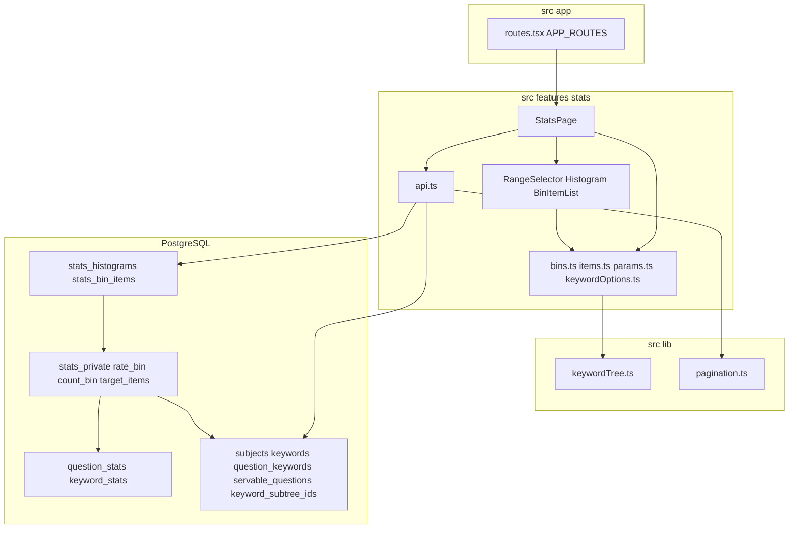
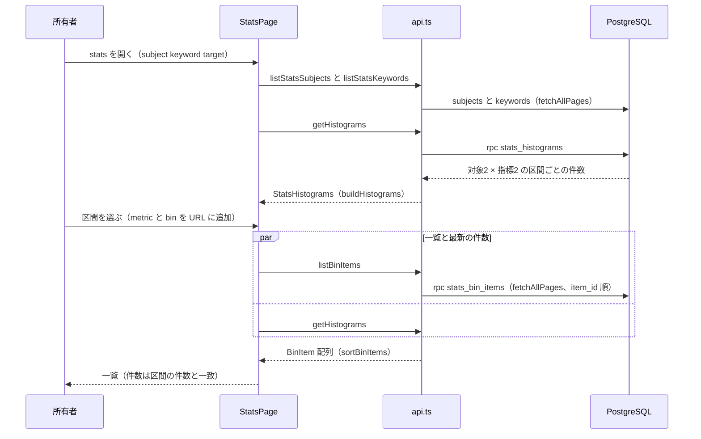

# Design Document

## Overview

**Purpose**: 所有者が科目とキーワード範囲を選び、設問ごと・キーワードごとの正答率と出題回数の分布をヒストグラムで確認し、区間に含まれる設問・キーワードの一覧へ掘り下げられる「学習統計」を提供する。

**Users**: 所有者は主にスマートフォンで統計画面を開き、弱い設問・キーワードを把握する。PC でも同じ操作で使える。

**Impact**: quiz-session の集計ビューを読むビン分けの migration と `src/features/stats/` を追加し、`APP_ROUTES` に学習区分の行を1つ足す。上流のテーブル・ビュー・関数・TS は変更しない。

### Goals

- 4つのヒストグラム（設問・キーワード × 正答率・出題回数）の件数を DB 側で数え、対象が何件でも欠落なく表示する
- 区間への振り分けを1か所で定義し、区間の件数と掘り下げの一覧の件数を一致させる
- 390px 幅で横スクロールなく読め、区間を 44px 以上のボタンとして選べる

### Non-Goals

- 設問ごと・キーワードごとの正答数・出題数・正答率の計算（quiz-session の `question_stats`、`keyword_stats`）
- 統計・集計値の出力（question-exchange）、問題・キーワードの編集（subject-catalog）
- 期間指定、推移グラフ、定着率（`retention`）の分布
- 範囲選択部品の共通化（quiz の `KeywordRangePicker` は流用しない）

## Boundary Commitments

### This Spec Owns

- 区間の定義（正答率の10区間と「未出題」、出題回数の2倍ごとの区間）と、区間番号の意味
- 内部 SQL 関数 `stats_private.rate_bin`、`stats_private.count_bin`、`stats_private.target_items`
- RPC `public.stats_histograms`、`public.stats_bin_items` と、複合型 `public.stats_histogram_row`、`public.stats_bin_item`
- `src/features/stats/` の型、純粋関数（ラベル、ヒストグラムの組み立て、一覧の並び、URL 変換、キーワードの選択肢）、API、画面
- `APP_ROUTES` に追加する `stats` の行

### Out of Boundary

- `question_stats`、`keyword_stats` の列・意味・除外条件（quiz-session。本 spec は読むだけ）
- `servable_questions`、`keyword_subtree_ids`、`keywordTree.ts`、`subjects`・`keywords` テーブルの定義（subject-catalog）
- `AppRoute`、`fetchAllPages`、`AppLayout`、テーマトークン、共通 class、`supabase` client（app-foundation）
- 問題編集画面の挙動（subject-catalog。本 spec はそのルートへ遷移するだけ）

### Allowed Dependencies

- app-foundation: `APP_ROUTES`／`AppRoute`（行の追加のみ、`nav.group = 'learn'`）、`fetchAllPages`、`supabase`（`@/lib/supabase`）、テーマトークン `--c-bg`、`--c-surface`、`--c-text`、`--c-text-muted`、`--c-border`、`--c-primary`、共通 class `.focus-ring`、`.tap-target`
- subject-catalog: テーブル `subjects`、`keywords`、`question_keywords`（読み取りのみ）、ビュー `servable_questions`（問題文の取得）、SQL 関数 `keyword_subtree_ids`、TS の `buildKeywordTree`、`keywordPath`、型 `KeywordNode`（`@/lib/keywordTree`）、型 `Subject`、`Keyword`（`@/features/catalog/types`）、ルート `catalog/:subjectId/questions/:questionId`（リンク先としてのみ）
- quiz-session: ビュー `public.question_stats`、`public.keyword_stats`（読み取りのみ）
- npm パッケージ: 上流が導入済みのもののみ（追加なし。チャートライブラリを使わない）
- 依存方向: `src/features/stats` → `src/lib`／`src/components`／`@/features/catalog/types`。`@/features/quiz` の TS は import しない。他の feature は stats を import しない

### Revalidation Triggers

- 区間の境界・区間番号の意味の変更（SQL の `rate_bin`／`count_bin` と TS の `binLabel` を同時に変える）
- `stats_histograms`、`stats_bin_items` の引数・返り値の変更
- 上流の `question_stats`、`keyword_stats` の列名・型・意味（`correct_rate` の null、除外条件、部分木の重複除去）の変更
- 上流の `quiz.write_via_rpc`（直接書き込み拒否の GUC）の名称・値の変更（本 spec の seed がローカル専用で依存する）
- 上流の `keyword_subtree_ids` の返り値、`servable_questions` の条件、問題編集ルートの path の変更
- `AppRoute` の `nav.group` の値の変更

## Architecture

### Architecture Pattern & Boundary Map



**Architecture Integration**:

- Selected pattern: クライアント SPA + feature-first。区間への振り分けと件数の集計は DB（不変関数と RPC）、ラベル・棒の長さ・並び順・URL 変換は TS の純粋関数
- Domain/feature boundaries: 画面・API・純粋関数は `src/features/stats`、ビン分けは本 spec の migration。集計値は quiz-session のビューを読むだけ
- Existing patterns preserved: `APP_ROUTES` への行追加、`fetchAllPages`、`api.ts` での `snake_case` → `camelCase` 変換、日本語の `Error`、`*_private` スキーマによる内部関数の隠蔽、RPC は `SECURITY INVOKER` と `search_path = ''`
- New components rationale: 各部品は要件の1領域（範囲選択、ヒストグラム、掘り下げ）に対応する
- Steering compliance: 件数・集計は DB 側、全行の取得は `fetchAllPages`、ビン分けは副作用のない関数、統計画面はモバイル優先、正誤色・警告色を正誤以外に使わない

### Technology Stack

| Layer | Choice / Version | Role in Feature | Notes |
| ------- | ------------------ | ----------------- | ------- |
| Frontend | React 19、React Router 7、TypeScript 5.9 | 統計画面、URL 検索パラメータでの状態保持 | `useSearchParams` |
| UI | Tailwind CSS 4、lucide-react | 横棒ヒストグラム（HTML のボタン列）、導線アイコン `BarChart3` | チャートライブラリなし |
| Data | Supabase JS 2、PostgreSQL 17 | ビン分けの不変関数、RPC | `width_bucket` |
| Test | Vitest 3、Testing Library、Playwright | 純粋関数、部品、E2E・SQL | ローカル Supabase、直列 |

## File Structure Plan

### Directory Structure

```text
supabase/migrations/
└── 20261106000000_stats_functions.sql   # stats_private スキーマ、rate_bin、count_bin、target_items、複合型、stats_histograms、stats_bin_items、権限
src/features/stats/
├── types.ts                             # StatsTarget、StatsMetric、HistogramBin、Histogram、StatsHistograms、BinItem
├── bins.ts                              # UNATTEMPTED_BIN、binLabel、buildHistograms、barRatio（純粋関数）
├── bins.test.ts
├── items.ts                             # sortBinItems、formatRate、stemExcerpt（純粋関数）
├── items.test.ts
├── params.ts                            # StatsView と URL 検索パラメータの相互変換
├── params.test.ts
├── keywordOptions.ts                    # キーワード木を字下げ付きの選択肢へ平坦化
├── keywordOptions.test.ts
├── api.ts                               # Supabase 呼び出し、行変換、日本語エラー
├── api.test.ts                          # 行変換とエラー変換
├── StatsPage.tsx                        # 範囲・表示切り替え・取得・掘り下げのオーケストレーション
├── RangeSelector.tsx                    # 科目とキーワード範囲の select
├── Histogram.tsx                        # 横棒ヒストグラム（区間ごとのボタン）
├── Histogram.test.tsx
├── BinItemList.tsx                      # 区間の設問・キーワード一覧
└── BinItemList.test.tsx
e2e/
├── stats.spec.ts                        # 導線、範囲選択、ヒストグラム、掘り下げ、レスポンシブ、エラー
└── stats-db.spec.ts                     # 区間の境界、件数の一致、RLS、権限、大量データ
```

### Modified Files

- `src/app/routes.tsx` — `{ path: 'stats', element: <StatsPage />, nav: { label: '統計', group: 'learn', icon: BarChart3, order: 2 } }` を追加する
- `supabase/seed.sql` — E2E 用に「統計検証」科目（キーワード3階層、出題対象・無効・削除の問題、境界値の正答率と出題回数になる解答履歴、問題が紐づかないキーワード）を追加する。解答履歴は quiz-session の直接書き込み拒否を通すため、`begin` から `commit` までのトランザクション内で `select set_config('quiz.write_via_rpc', 'on', true)` を実行してから挿入する（ローカル専用）

## System Flows

### 表示と掘り下げ



- 状態は URL 検索パラメータ（`subject`、`keyword`、`target`、`metric`、`bin`）を正とし、再読み込みで復元する（1.5、3.9）。
- 一覧を取得するときにヒストグラムも同時に取り直し、同じ時点の値で件数を表示する（5.5、6.3）。
- 範囲や対象を変えると `metric`、`bin` を URL から外し、一覧を閉じる（5.7）。

## Requirements Traceability

| Requirement | Summary | Components | Interfaces | Flows |
| ------------- | --------- | ------------ | ------------ | ------- |
| 1.1 | 学習区分の導線 | routes.tsx | `AppRoute.nav.group = 'learn'` | — |
| 1.2 | 科目一覧 | RangeSelector、api.ts | `listStatsSubjects` | 表示と掘り下げ |
| 1.3 | キーワード範囲の選択 | RangeSelector、keywordOptions.ts | `toKeywordOptions` | — |
| 1.4 | 範囲変更で再表示 | StatsPage、params.ts | `toStatsParams` | 表示と掘り下げ |
| 1.5 | URL で復元 | params.ts、StatsPage | `parseStatsParams` | 表示と掘り下げ |
| 1.6 | 未ログインの誘導 | routes.tsx | 保護ルート（`public` なし） | — |
| 1.7 | 科目なし | StatsPage | 空表示 | — |
| 2.1 | 設問の正答率分布 | stats_histograms、rate_bin、Histogram | `metric = correct_rate` | 表示と掘り下げ |
| 2.2 | 設問の出題回数分布 | stats_histograms、count_bin、Histogram | `metric = attempt_count` | 表示と掘り下げ |
| 2.3 | 設問の範囲 | target_items | `keyword_subtree_ids` | — |
| 2.4 | 無効・削除の除外 | target_items | `question_stats`（出題対象のみ） | — |
| 2.5 | 未出題は別表示 | rate_bin、bins.ts、Histogram | `UNATTEMPTED_BIN` | — |
| 2.6 | 対象数 | bins.ts、StatsPage | `Histogram.total` | — |
| 2.7 | 対象なし | StatsPage | `total = 0` | — |
| 3.1 | キーワードの正答率分布 | stats_histograms、Histogram | `target = keyword` | 表示と掘り下げ |
| 3.2 | キーワードの出題回数分布 | stats_histograms、Histogram | `target = keyword` | 表示と掘り下げ |
| 3.3 | 部分木の重複なし集計 | target_items | `keyword_stats` | — |
| 3.4 | キーワードの範囲 | target_items | `keyword_subtree_ids` | — |
| 3.5 | 問題なしの除外 | target_items | `question_count > 0` | — |
| 3.6 | 未出題は別表示 | rate_bin、Histogram | `UNATTEMPTED_BIN` | — |
| 3.7 | 対象数 | bins.ts、StatsPage | `Histogram.total` | — |
| 3.8 | 対象なし | StatsPage | `total = 0` | — |
| 3.9 | 範囲を保って切り替え | StatsPage、params.ts | `target` | — |
| 4.1 | 正答率の10区間 | rate_bin、bins.ts | `binLabel` | — |
| 4.2 | 出題回数の2倍区間 | count_bin、stats_histograms、bins.ts | `binLabel` | — |
| 4.3 | ちょうど1区間・合計一致 | rate_bin、count_bin、target_items、bins.ts | `buildHistograms` | — |
| 4.4 | 0件の区間も表示 | stats_histograms、bins.ts | 区間の補完 | — |
| 4.5 | ラベルと件数 | Histogram、bins.ts | `binLabel` | — |
| 5.1 | 区間の一覧 | stats_bin_items、BinItemList、StatsPage | `listBinItems` | 表示と掘り下げ |
| 5.2 | 設問の行 | BinItemList、items.ts | `stemExcerpt`、`formatRate` | — |
| 5.3 | キーワードの行 | BinItemList | `keywordPath` | — |
| 5.4 | 弱い順の並び | items.ts | `sortBinItems` | — |
| 5.5 | 件数一致 | stats_bin_items、StatsPage | 同じ `target_items`、同時再取得 | 表示と掘り下げ |
| 5.6 | 編集画面へ | BinItemList | `catalog/:subjectId/questions/:questionId` | — |
| 5.7 | 一覧を閉じる | StatsPage、params.ts | `selected` の除去 | — |
| 5.8 | 0件は選べない | Histogram | `disabled` | — |
| 5.9 | 未出題の表示 | items.ts | `formatRate` | — |
| 6.1 | 区間件数の欠落なし | stats_histograms | DB 側の集計 | — |
| 6.2 | 一覧の欠落なし | api.ts、stats_bin_items | `fetchAllPages`、`item_id` 順 | — |
| 6.3 | 最新の解答を反映 | StatsPage、ビュー | 保存しない集計、表示ごとの取得 | 表示と掘り下げ |
| 6.4 | 部分取得を表示しない | api.ts | `fetchAllPages` の失敗 | — |
| 7.1 | 横スクロールなし | StatsPage、Histogram、BinItemList | 1列レイアウト | — |
| 7.2 | キーボード操作 | RangeSelector、Histogram、BinItemList | `.focus-ring` | — |
| 7.3 | 44px | Histogram | `.tap-target` | — |
| 7.4 | 文字と支援技術 | Histogram | `aria-label`、`aria-pressed` | — |
| 7.5 | 両テーマとコントラスト | Histogram | `--c-primary`、`--c-text-muted` | — |
| 7.6 | 失敗と再試行 | StatsPage、api.ts | `toStatsErrorMessage` | — |
| 7.7 | 読み込み中 | StatsPage | `role="status"` | — |

## Components and Interfaces

| Component | Domain/Layer | Intent | Req Coverage | Key Dependencies | Contracts |
| ----------- | -------------- | -------- | -------------- | ------------------ | ----------- |
| stats_functions migration | DB | 区間の振り分け、件数、一覧 | 2.1–2.5, 3.1–3.6, 4.1–4.4, 5.1, 5.5, 6.1–6.3 | `question_stats` (P0)、`keyword_stats` (P0)、`keyword_subtree_ids` (P0) | API |
| types.ts | stats | ドメイン型 | 2.1, 3.1 | — | — |
| bins.ts | stats | ラベル、ヒストグラムの組み立て、棒の比率 | 2.5, 2.6, 3.6, 3.7, 4.1–4.5 | types.ts (P0) | Service |
| items.ts | stats | 一覧の並びと表示値 | 5.2, 5.4, 5.9 | types.ts (P0) | Service |
| params.ts | stats | 表示状態の URL 表現 | 1.4, 1.5, 3.9, 5.7 | types.ts (P0) | Service |
| keywordOptions.ts | stats | キーワードの選択肢 | 1.3 | keywordTree.ts (P0) | Service |
| api.ts | stats | DB 呼び出しと変換 | 1.2, 5.1, 6.2, 6.4, 7.6 | supabase (P0)、pagination (P0)、bins.ts (P0) | Service |
| StatsPage | stats UI | オーケストレーション | 1.4, 1.5, 1.7, 2.6, 2.7, 3.7–3.9, 5.1, 5.5, 5.7, 6.3, 7.1, 7.6, 7.7 | api.ts (P0)、params.ts (P0)、items.ts (P0) | State |
| RangeSelector | stats UI | 科目と範囲の選択 | 1.2, 1.3, 7.2 | keywordOptions.ts (P0) | — |
| Histogram | stats UI | 横棒ヒストグラム | 2.1, 2.2, 3.1, 3.2, 4.4, 4.5, 5.8, 7.1–7.5 | bins.ts (P0) | — |
| BinItemList | stats UI | 掘り下げの一覧 | 5.2, 5.3, 5.6, 5.9, 7.1, 7.2 | items.ts (P0)、keywordTree.ts (P0) | — |
| routes.tsx（変更） | app | 導線と保護 | 1.1, 1.6 | APP_ROUTES (P0) | — |

### DB

#### stats_functions migration

| Field | Detail |
| ------- | -------- |
| Intent | quiz-session の集計値を区間に振り分け、区間ごとの件数と区間内の一覧を返す |
| Requirements | 2.1–2.5, 3.1–3.6, 4.1–4.4, 5.1, 5.5, 6.1–6.3 |

##### Responsibilities & Constraints

- `stats_private` スキーマを作り、`authenticated` に `usage` を付与し、`anon` と `public` には与えない。`supabase/config.toml` の `[api] schemas` に追加しない（クライアントから直接呼べない）。
- すべての関数は `security invoker`、`set search_path = ''`、スキーマ修飾付き。`public` の RPC は `authenticated` に `execute` を付与し、`anon` と `public` から取り消す。`stats_private` の関数は RPC から呼ぶため `authenticated` に `execute` を付与する。
- 集計値は `question_stats`、`keyword_stats` の列をそのまま使い、`answers` を直接読まない。ビューは `security_invoker` のため、RLS により所有者の行だけが対象になる。書き込みは一切行わない。

**Contracts**: API [x]

| 関数 | Request | Response | Errors（例外メッセージ） |
| ------ | --------- | ---------- | -------------------------- |
| `stats_private.rate_bin(p_correct integer, p_attempt integer)` | 正答数・出題数（0 以上） | `integer`。`p_attempt = 0` は `-1`（未出題）、それ以外は `least(9, (p_correct * 10) / p_attempt)`（整数除算） | — |
| `stats_private.count_bin(p_attempt integer)` | 出題数 | `integer`。`p_attempt <= 0` は `0`、それ以外は `width_bucket(p_attempt, array[1, 2, 4, …, 1073741824])`（`2^0`〜`2^30` の31要素） | — |
| `stats_private.target_items(p_target text, p_subject_id uuid, p_keyword_id uuid)` | `p_keyword_id` が null なら科目全体 | `table (item_id uuid, attempt_count integer, correct_count integer, correct_rate double precision, question_count integer)` | — |
| `public.stats_histograms(p_subject_id uuid, p_keyword_id uuid)` | 同上 | `setof public.stats_histogram_row`（`target text, metric text, bin integer, item_count integer`） | — |
| `public.stats_bin_items(p_target text, p_metric text, p_bin integer, p_subject_id uuid, p_keyword_id uuid)` | 区間を1つ指定 | `setof public.stats_bin_item`（`item_id uuid, attempt_count integer, correct_count integer, correct_rate double precision, question_count integer, stem text`）、`order by item_id` | `invalid_stats_target`、`invalid_stats_metric` |

- `rate_bin`、`count_bin` は `language sql immutable`。区間番号の意味は次のとおり（4.1、4.2）。

| 指標 | 区間番号 | 範囲 |
| ------ | ---------- | ------ |
| `correct_rate` | `-1` | 未出題（出題数 0） |
| `correct_rate` | `k`（0〜8） | `k*10`% 以上 `(k+1)*10`% 未満 |
| `correct_rate` | `9` | 90% 以上 100% 以下 |
| `attempt_count` | `0` | 0回 |
| `attempt_count` | `k`（1 以上） | `2^(k-1)` 回以上 `2^k - 1` 回以下 |

- 正答率の区間は、ビューの `correct_rate`（浮動小数）ではなく `correct_count`、`attempt_count` の整数から求め、境界での丸め誤差を避ける。値そのものはビューの値であり、再計算ではない。
- `target_items`（`language sql stable`）（2.3、2.4、3.3〜3.5）:
  - `p_target = 'question'`: `question_stats qs` のうち `qs.subject_id = p_subject_id`。`p_keyword_id` があれば `exists (select 1 from public.question_keywords qk where qk.question_id = qs.question_id and qk.keyword_id in (select public.keyword_subtree_ids(p_keyword_id)))`。`question_count` は null。
  - `p_target = 'keyword'`: `keyword_stats ks` のうち `ks.subject_id = p_subject_id and ks.question_count > 0`。`p_keyword_id` があれば `ks.keyword_id in (select public.keyword_subtree_ids(p_keyword_id))`。
  - その他の `p_target` は0行（検査は `stats_bin_items` が行う）。
  - `question_stats` は出題対象の問題だけを含み、`keyword_stats` は部分木の問題を重複なく数えるため、無効・削除の除外と重複除去は上流の定義に従う。
- `stats_histograms`（`language sql stable`）（2.1、2.2、3.1、3.2、4.3、4.4、6.1）: `target` の `'question'`、`'keyword'` それぞれについて、
  - `metric = 'correct_rate'`: `generate_series(-1, 9)` の各区間に、`rate_bin(correct_count, attempt_count)` が一致する件数を左外部結合で数える（0件の区間も1行）。
  - `metric = 'attempt_count'`: `generate_series(0, coalesce(max(count_bin(attempt_count)), 0))` の各区間に同様に数える。
  - 返る行は対象ごとに最大 11 + 32 行で、1,000 行上限に達しない。
- `stats_bin_items`（`language plpgsql stable`）（5.1、5.5、6.2）: `p_target` が `question`／`keyword` でなければ `invalid_stats_target`、`p_metric` が `correct_rate`／`attempt_count` でなければ `invalid_stats_metric`。`target_items` のうち指定した指標の区間番号が `p_bin` に一致する行を返す。`question` は `servable_questions` と結合して `stem` を付け、`keyword` は `stem` を null にする。件数の集計と同じ関数で振り分けるため、一覧の件数は区間の件数と一致する。
- 複合型 `public.stats_histogram_row`、`public.stats_bin_item` は同じ migration で定義する。

##### Implementation Notes

- Validation: 境界値（正答率 0/1、9/10、99/100、10/10、出題数 0、1、2、3、4、7、8、2^30）を SQL から検証する。
- Risks: `keyword_stats` の評価コスト。性能は quiz-session の方針（閉包テーブルの追加）に従う。

### stats

#### types.ts

```typescript
export type StatsTarget = 'question' | 'keyword';
export type StatsMetric = 'correctRate' | 'attemptCount';

export type HistogramBin = { bin: number; label: string; count: number };
export type Histogram = {
  metric: StatsMetric;
  bins: HistogramBin[];          // 区間の昇順（correctRate は 0〜9、attemptCount は 0〜最大）
  unattempted: number | null;    // correctRate のみ。attemptCount は null
  total: number;                 // 区間の件数の合計 + unattempted
};
export type StatsHistograms = Record<StatsTarget, Record<StatsMetric, Histogram>>;

export type BinItem = {
  itemId: string;
  attemptCount: number;
  correctCount: number;
  correctRate: number | null;    // 出題数 0 は null
  questionCount: number | null;  // keyword のみ
  stem: string | null;           // question のみ
};
```

- DB の `metric` 値（`correct_rate`／`attempt_count`）と TS の `StatsMetric` の変換は `api.ts` で行う。

#### bins.ts

```typescript
export const UNATTEMPTED_BIN = -1;
export type HistogramRow = { target: StatsTarget; metric: StatsMetric; bin: number; itemCount: number };

export function binLabel(metric: StatsMetric, bin: number): string;
export function binAccessibleLabel(metric: StatsMetric, bin: number): string;
export function buildHistograms(rows: readonly HistogramRow[]): StatsHistograms;
export function barRatio(count: number, maxCount: number): number; // 0〜1
```

- `binLabel`（4.1、4.2、4.5）: `correctRate` は `-1` →「未出題」、`0`〜`8` →「0〜10%」…「80〜90%」、`9` →「90〜100%」。`attemptCount` は `0` →「0回」、`1` →「1回」、`k >= 2` →「{2^(k-1)}〜{2^k-1}回」。
- `binAccessibleLabel`: 支援技術向けに境界を明示する（例: 「正答率 60%以上70%未満」「正答率 90%以上100%以下」「出題 4回以上7回以下」）（7.4）。
- `buildHistograms`（2.5、2.6、3.6、3.7、4.3、4.4）: 行を対象・指標ごとにまとめ、`correctRate` の `-1` を `unattempted` に分け、欠けた区間を 0 件で補い、`total` を合計する。入力を変更しない。
- `barRatio`: `maxCount` が 0 なら 0。件数が 1 以上なら `max(0.02, count / maxCount)` とし、0 件と見分けられるようにする。

#### items.ts

```typescript
export function sortBinItems(items: readonly BinItem[]): BinItem[];
export function formatRate(item: Pick<BinItem, 'attemptCount' | 'correctRate'>): string; // '未出題' または '67%'
export function stemExcerpt(stem: string): string;                                       // 先頭 80 文字、超過は '…'
```

- `sortBinItems`（5.4）: `correctRate` の昇順（null を先頭）、同値は `attemptCount` の降順、さらに `itemId` の昇順。新しい配列を返す。
- `formatRate`（5.9）: 出題数 0 は「未出題」、それ以外は四捨五入した百分率。

#### params.ts

```typescript
export type StatsView = {
  subjectId: string | null;
  keywordId: string | null;      // null は科目全体
  target: StatsTarget;           // 既定 'question'
  selected: { metric: StatsMetric; bin: number } | null;
};
export function parseStatsParams(params: URLSearchParams): StatsView;
export function toStatsParams(view: StatsView): URLSearchParams; // subject、keyword、target、metric、bin
```

- UUID 形式でない `subject`／`keyword` は null、未知の `target` は `'question'`、`metric` と `bin` の片方だけ・未知の metric・整数でない bin は `selected = null` にする（1.5）。

#### keywordOptions.ts

```typescript
export type KeywordOption = { id: string; label: string; depth: number };
export function toKeywordOptions(nodes: readonly KeywordNode[]): KeywordOption[];
```

- `buildKeywordTree` の結果を深さ優先（兄弟は木の順）で平坦化し、`label` を「深さ × 全角空白2文字の字下げ＋名前」にする（1.3）。

#### api.ts

```typescript
export function listStatsSubjects(): Promise<Subject[]>;                         // deleted_at is null、name, id 順
export function listStatsKeywords(subjectId: string): Promise<Keyword[]>;        // fetchAllPages、sort_order, id 順
export function getHistograms(subjectId: string, keywordId: string | null): Promise<StatsHistograms>;
export function listBinItems(input: {
  subjectId: string; keywordId: string | null; target: StatsTarget; metric: StatsMetric; bin: number;
}): Promise<BinItem[]>;                                                          // fetchAllPages、item_id 順
export function toStatsErrorMessage(context: string, error: { message: string }): string;
```

- `getHistograms` は `rpc('stats_histograms')` の行を変換し、`buildHistograms` に渡す。
- `listBinItems` は `fetchAllPages((from, to) => supabase.rpc('stats_bin_items', …).order('item_id').range(from, to), '区間の一覧の取得')` で取得し、部分結果を返さない（6.2、6.4）。
- 失敗は「{context}に失敗しました: {message}」の `Error`（7.6）。

### stats UI

#### StatsPage

- URL `stats`。`parseStatsParams` で状態を読み、変更は `setSearchParams` で書く（1.4、1.5）。
- 科目一覧を取得し、0 件なら「科目がありません。カタログで科目を作成してください」を表示してヒストグラムを描画しない（1.7）。`subjectId` が null か一覧にないときは、先頭の科目を選んだ URL に置き換える。
- 科目が決まるとキーワードとヒストグラムを `Promise.all` で取得する。取得中は `role="status"` の「読み込み中…」（7.7）、失敗は `role="alert"` と「再試行」（7.6）。
- 上から `RangeSelector`、対象の切り替え（「設問」「キーワード」の2ボタン、`aria-pressed`、`.tap-target`）、対象数（「対象 N 問」「対象 N キーワード」）、正答率と出題回数の2つの `Histogram`、選択中の区間の `BinItemList` を1列（最大幅 `40rem`、中央寄せ）で並べる（2.6、3.7、3.9、7.1）。
- 対象数が 0 なら、ヒストグラムの代わりに「この範囲には対象の設問がありません」／「この範囲には対象のキーワードがありません」を表示する（2.7、3.8）。
- 区間の選択で `selected` を URL に入れ、`listBinItems` と `getHistograms` を `Promise.all` で取得し、一覧は `sortBinItems` で並べる（5.1、5.4、5.5、6.3）。範囲・科目・対象を変えると `selected` を外す。一覧の「閉じる」も `selected` を外す（5.7）。
- 画面を開くたび・範囲を変えるたびに取得し、結果をキャッシュしない（6.3）。

#### RangeSelector

- 科目の `<select>`（`label`「科目」）と範囲の `<select>`（`label`「範囲」、先頭は「科目全体」、続いて `toKeywordOptions`）を縦に並べる（1.2、1.3）。両方とも幅 100%、`.focus-ring`、高さ 44px 以上（7.2）。

#### Histogram

```typescript
export function Histogram(props: {
  title: string;                                  // 「正答率の分布」「出題回数の分布」
  histogram: Histogram;
  unit: string;                                   // 「問」「キーワード」
  selectedBin: number | null;
  onSelect: (bin: number) => void;
}): ReactElement;
```

- 見出しと、区間ごとの `<button type="button">` の縦の列（横棒ヒストグラム）。各行は左にラベル（固定幅 `6.5rem`、折り返し可）、中央に棒（トラックは `--c-border`、棒は `--c-primary`、幅は `barRatio` の百分率）、右に件数（数値、等幅数字）を置く（4.4、4.5、7.1）。
- `correctRate` は区間の列の後に区切り線と「未出題」の行を置き、棒は `--c-text-muted` で塗る（2.5、3.6）。
- 各行は `.tap-target`、`.focus-ring`、`aria-label`（`binAccessibleLabel` と件数。例: 「正答率 60%以上70%未満: 12問」）、`aria-pressed`（選択中）を持つ。件数 0 の行は `disabled`（5.8、7.2〜7.4）。選択中の行は `--c-text` の 2px 枠と太字で示す（色だけに頼らない）。
- 色は `--c-primary`、`--c-text-muted`、`--c-border`、`--c-text` だけを使い、`--c-correct`、`--c-incorrect`、`--c-warn` を使わない。ライト／ダークの値は app-foundation のトークンに従う（7.5）。

#### BinItemList

```typescript
export function BinItemList(props: {
  target: StatsTarget;
  title: string;                                  // 例: 「正答率 0〜10% の設問」
  items: readonly BinItem[];                      // sortBinItems 済み
  subjectId: string;
  keywords: readonly KeywordNode[];
  onClose: () => void;
}): ReactElement;
```

- 見出しに区間と件数（`items.length`）を表示し、「閉じる」ボタンを置く（5.5、5.7）。
- 設問の行: `stemExcerpt`、「正答 X / 出題 Y（formatRate）」。行全体を `Link` にして `catalog/{subjectId}/questions/{itemId}` へ遷移する（5.2、5.6、5.9）。
- キーワードの行: `keywordPath` を「 / 」で連結した階層パス、「問題 N 問」、「正答 X / 出題 Y（formatRate）」（5.3、5.9）。
- 各行は `min-w-0` と折り返しで横スクロールを防ぎ、リンクと「閉じる」は `.focus-ring` と 44px 以上の高さを持つ（7.1、7.2）。

#### routes.tsx（変更）

- `{ path: 'stats', element: <StatsPage />, nav: { label: '統計', group: 'learn', icon: BarChart3, order: 2 } }` を追加する。`public` を指定しないため保護ルートになり、未ログインはログインへ誘導される（1.1、1.6）。

## Data Models

### Domain Model

- 本 spec は永続データを持たない。対象（設問／キーワード）× 指標（正答率／出題回数）× 区間番号 → 件数という読み取り専用の投影だけを持つ。
- 不変条件: 各対象・各指標について、区間の件数（正答率は未出題を含む）の合計は `target_items` の件数に等しい。`stats_bin_items` の件数は同じ時点の `stats_histograms` の該当区間の件数に等しい。

### Data Contracts & Integration

- RPC の行は `api.ts` で `camelCase` の型へ変換する。`metric` は `correct_rate` ↔ `correctRate`、`attempt_count` ↔ `attemptCount`。
- URL 検索パラメータ: `subject`（UUID）、`keyword`（UUID、省略で科目全体）、`target`（`question`／`keyword`）、`metric`（`correctRate`／`attemptCount`）、`bin`（整数）。

## Error Handling

### Error Strategy

- 科目・キーワード・ヒストグラム・一覧の取得失敗: `role="alert"` で「{context}に失敗しました: {message}」を表示し、「再試行」で同じ取得をやり直す（7.6）。一覧の取得は `fetchAllPages` が途中で失敗した時点で全体を失敗とし、部分的な一覧を表示しない（6.4）。
- URL の不正な値: `parseStatsParams` で既定値に戻し、エラーにしない（1.5）。
- `invalid_stats_target`／`invalid_stats_metric`: UI からは発生しない。発生した場合は上と同じ表示になる。

### Monitoring

個人用途のため外部監視は持たない。元のエラーを `console.error` に残す。

## Testing Strategy

### Unit Tests

- `bins.test.ts`: `binLabel` と `binAccessibleLabel` の全分岐（未出題、0〜10%、90〜100%、0回、1回、2〜3回、512〜1023回）、`buildHistograms` で欠けた区間の 0 件補完・未出題の分離・`total` の一致・入力不変、`barRatio` の 0 件と最小比率（2.5、2.6、3.6、3.7、4.1〜4.5）
- `items.test.ts`: `sortBinItems` の未出題先頭・正答率昇順・出題数降順・ID での決定性、`formatRate` の「未出題」と四捨五入、`stemExcerpt` の 80 文字（5.2、5.4、5.9）
- `params.test.ts`: URL の往復、不正な UUID・未知の target・片方だけの metric/bin の扱い（1.4、1.5、3.9、5.7）
- `keywordOptions.test.ts`: 3階層の木の深さ優先の順と字下げ、空配列（1.3）
- `api.test.ts`: RPC 行の変換（`correct_rate` の null、`metric` の変換）、`toStatsErrorMessage`（6.4、7.6）

### Component Tests

- `Histogram.test.tsx`: 全区間のラベルと件数の表示、0 件の区間が `disabled`、選択で `onSelect` と `aria-pressed`、`aria-label` に範囲と件数、未出題の行が区切りの後にある、`correct`／`incorrect`／`warn` 系の class を使わない（2.5、4.4、4.5、5.8、7.4、7.5）
- `BinItemList.test.tsx`: 設問の行の冒頭・成績・編集画面へのリンク、キーワードの行の階層パスと問題数、「未出題」表示、件数の見出し、閉じる（5.2、5.3、5.6、5.7、5.9）

### E2E Tests（Playwright、ローカル Supabase、直列）

- `stats.spec.ts`:
  - 学習区分に「統計」の導線があり、未ログインでは `stats` からログインへ誘導される。科目が0件のアカウント（`other@example.com`）では科目がない表示になる（1.1、1.6、1.7）
  - 「統計検証」科目で、設問の正答率・出題回数のヒストグラムの各区間の件数が seed の期待値と一致し、無効・削除の問題を含まず、未出題が別に表示され、対象数が表示される（2.1〜2.6、4.1〜4.5）
  - 途中ノードを範囲に選ぶと、配下に紐づく設問だけに絞られる。対象のない範囲で「対象の設問がありません」になる。キーワードに切り替えると範囲が保たれ、範囲のキーワード（自身と配下）だけが対象になり、問題が紐づかないキーワードを含まない（1.2〜1.4、2.7、3.1〜3.9）
  - 区間を選ぶと一覧の件数が区間の件数と一致し、弱い順に並び、設問の行から問題の編集画面に移る。閉じる・別の区間を選ぶと前の一覧が消える。0 件の区間は選べない。URL を開き直すと同じ表示に戻る（1.5、5.1〜5.9）
  - 大量データ用科目（1,050 問）で、設問の未出題が 1,050 件と表示され、その区間の一覧が 1,050 行で重複がない（6.1、6.2）
  - 統計の取得をネットワーク遮断で失敗させると、エラーと再試行が表示され、再試行で表示される。一覧の2ページ目の取得だけを失敗させると、部分的な一覧が表示されない。取得中に読み込み中が表示される（6.4、7.6、7.7）
  - モバイル（390×844）で横スクロールなし、区間の行が 44px 以上、Tab で範囲・切り替え・区間・一覧に到達でき、フォーカスが見える。ダークテーマ（`colorScheme: 'dark'`）で表示される（7.1〜7.5）
  - 出題セッションで1問解答した後に統計を開くと、該当区間の件数に反映されている（6.3）
- `stats-db.spec.ts`:
  - SQL で `rate_bin`、`count_bin` の境界値（0/1、9/10、99/100、10/10、出題数 0、1、2、3、4、7、8、2^30）を確認する（4.1、4.2）
  - 各対象・指標で `stats_histograms` の件数合計が `target_items` の件数に等しく、`stats_bin_items` の件数が各区間の件数に等しい（4.3、5.5）
  - `other@example.com` のセッションで所有者の科目を指定すると、全区間が 0 件で一覧が空（RLS）
  - クライアントから `schema('stats_private')` の関数が呼べない。`anon` から RPC が呼べない。不正な target・metric が `invalid_stats_target`／`invalid_stats_metric` で拒否される
  - 1,200 キーワードの科目で `stats_histograms` のキーワードの件数合計が、`keyword_stats` の `question_count > 0` の件数と一致する（3.5、6.1）

## Security Considerations

- RPC とビューはすべて呼び出し元の権限で評価され、基になるテーブルの RLS により所有者の行だけを数える。
- 内部関数は PostgREST が公開しない `stats_private` に置く。本 spec の関数は書き込みを一切行わない。

## Performance & Scalability

- ヒストグラムは DB 側の `group by` で区間ごとの件数だけを返し、行数は対象と指標あたり最大 32 行に収まる。
- 一覧は `item_id` 順の `fetchAllPages` で 1,000 件ずつ取得する。
- 集計の性能は quiz-session のビューと index に依存する。測定で問題が出た場合は quiz-session の方針（閉包テーブル）で対処し、本 spec の契約は変えない。
