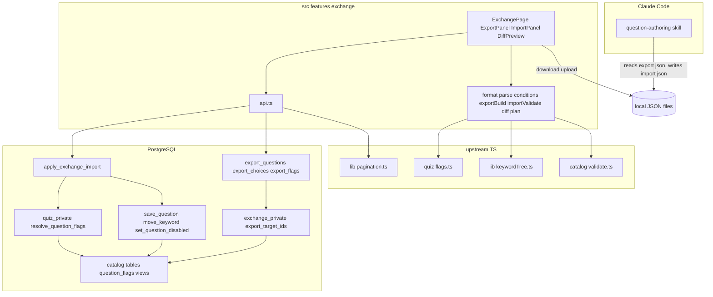
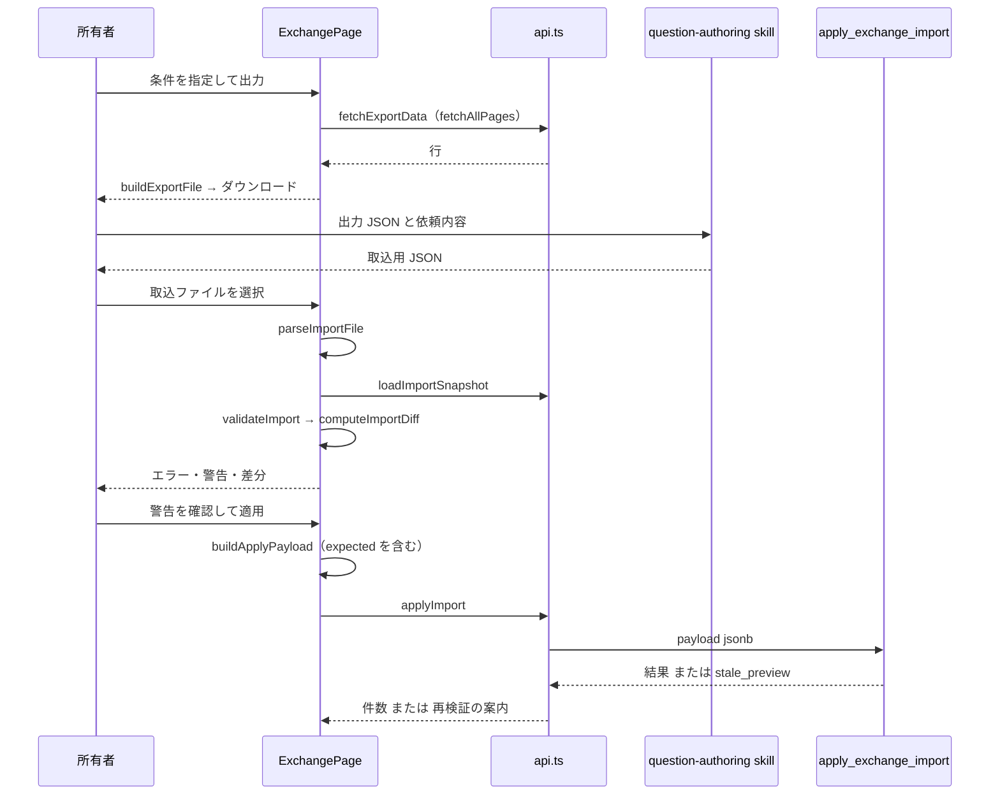
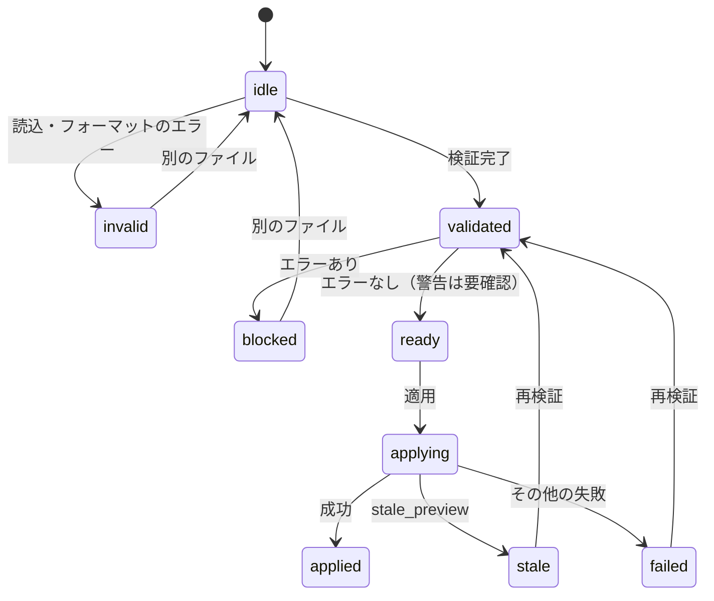
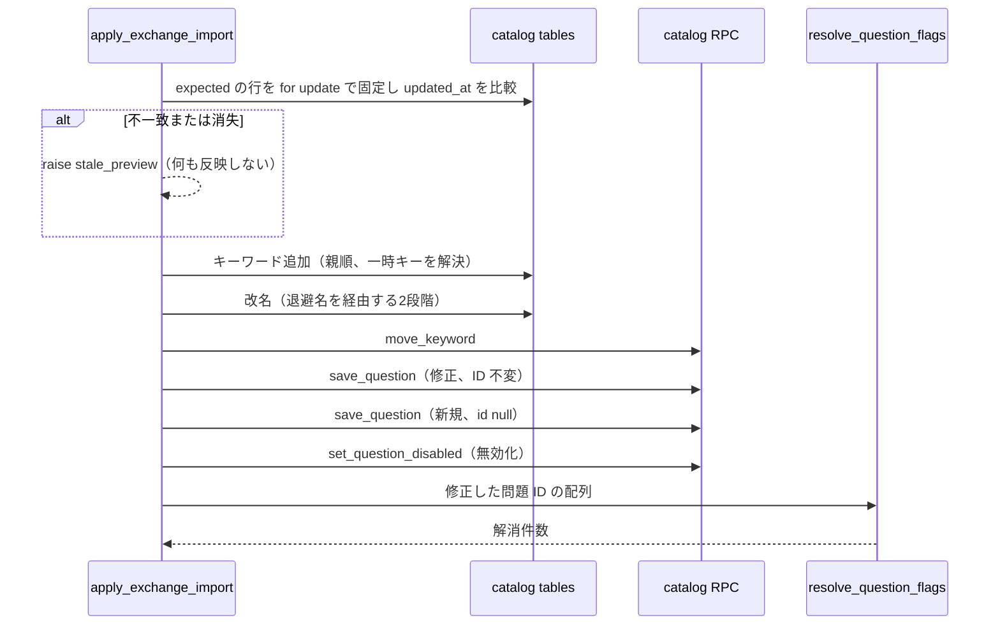

# Design Document

## Overview

**Purpose**: 所有者が条件付きで既存の学習対象・問題・フラグ・集計値を交換用 JSON として出力し、問題生成 skill が作った取込用 JSON を検証・差分プレビューしてから原子的に取り込める「問題の入出力」を提供する。交換用 JSON フォーマットと問題生成 skill もこの spec が所有する。

**Users**: 所有者は PC（モバイル対応あり）の入出力画面で出力・取込を行い、Claude Code で問題生成 skill を実行する。

**Impact**: subject-catalog と quiz-session の上に、出力・取込用の migration、`src/features/exchange/`、`.claude/skills/question-authoring/` を追加し、`APP_ROUTES` に管理区分の行を足す。上流のテーブル・ビュー・関数・TS モジュールは変更しない。

### Goals

- 出力が条件（科目、部分木、フラグ、統計、無効の問題を含めるか）で絞り込まれ、1,000 件を超えても欠落・重複しない
- 取込が「検証 → 差分プレビュー → 適用」の順で行われ、不正なファイルやプレビュー後の変更があれば何も反映しない
- 取込で実際に内容が変わった問題のフラグだけが、同じトランザクションで解消済みになる
- 交換フォーマットの型・検証・文書・例が1つの正本から一致し、skill がそれに従って取込用 JSON を書く

### Non-Goals

- アプリからの LLM 呼び出し、キーワードの削除、取込による問題の削除・有効化
- 作問ルールの定義と検証関数、無効化・削除の意味（subject-catalog）
- フラグの入力・状態遷移・集計の計算（quiz-session）、統計画面（learning-stats）

## Boundary Commitments

### This Spec Owns

- 交換用 JSON フォーマット（`ai-question-study/export`、`ai-question-study/import`、`version: 1`）の型・定数・検証（`src/features/exchange/format.ts`、`parse.ts`）と、その英語のフォーマット文書・例（`.claude/skills/question-authoring/references/`）
- 出力の条件と内容の定義、出力 RPC `export_questions`、`export_choices`、`export_flags` と内部関数 `exchange_private.export_target_ids`
- 取込の参照検証・差分計算・適用ペイロード生成の純粋関数（`importValidate.ts`、`diff.ts`、`plan.ts`）
- 取込 RPC `apply_exchange_import` と、その中での競合検出（`stale_preview`）・一時キーの解決
- 「修正された問題」の判定（要件 8.2）と、`quiz_private.resolve_question_flags` に渡す問題 ID の決定
- 注意: `quiz_private.resolve_question_flags` は `quiz.write_via_rpc` をトランザクションの終わりまで有効にする。取込 RPC はこの呼び出しの後に quiz-session のテーブルへ書き込まない。
- 入出力画面（`ExchangePage` 以下）と、`APP_ROUTES` に追加する行
- 問題生成 skill `.claude/skills/question-authoring/`

### Out of Boundary

- subject-catalog のテーブル・`servable_questions`・`keyword_subtree_ids`・`save_question`・`move_keyword`・`set_question_disabled`・`validateQuestion`・`QuestionInput`・`keywordTree.ts` の定義と変更（呼び出しのみ）
- quiz-session の `question_flags`・`question_stats`・`keyword_stats`・`QUESTION_FLAGS`・`resolve_question_flags` の定義と変更（参照と呼び出しのみ）。`question_flags` への直接の書き込み
- app-foundation の `AppRoute`、`fetchAllPages`、`AppLayout`、テーマトークンの変更
- 作問原則とフラグの表の本文（`product.md` が正本。skill は実行時に読む）

### Allowed Dependencies

- app-foundation: `APP_ROUTES`（行の追加のみ）、`fetchAllPages`／`PAGE_SIZE`、`supabase`、`useAuth`、`.focus-ring`、`.tap-target`、`.mark-correct`、`--c-correct`、`--c-warn`
- subject-catalog: `@/features/catalog/validate`（`validateQuestion`、`ValidationIssue`）、`@/features/catalog/types`（`QuestionInput`、`QuestionKind`）、`@/lib/keywordTree`、テーブルの `select`、RPC `save_question`・`move_keyword`・`set_question_disabled`・`keyword_subtree_ids`、ビュー `servable_questions`
- quiz-session: `@/features/quiz/flags`（`QUESTION_FLAGS`、`QuestionFlagId`、`QuestionFlagStatus`）、`question_flags`・`question_stats`・`keyword_stats` の `select`、`quiz_private.resolve_question_flags`
- npm パッケージ: 既存のもののみ（追加なし）
- 依存方向: `src/features/exchange` → catalog・quiz の上記モジュール、`src/lib`、`src/components`。catalog と quiz は exchange を import しない

### Revalidation Triggers

- 交換フォーマットの項目・意味の変更、`version` の更新（skill の文書・例・`parse.ts` を同時に更新する）
- 上流の `save_question` の payload 形式、`move_keyword`・`set_question_disabled`・`resolve_question_flags` の引数・返り値・権限の変更
- `questions`・`keywords` の `updated_at` の更新規則の変更（競合検出の前提）
- `validateQuestion` の規則・重大度の変更、`QUESTION_FLAGS` の識別子の変更、`question_stats`・`keyword_stats` の列の変更
- 「修正された問題」の判定範囲の変更（フラグ解消の意味が変わる）

## Architecture

### Architecture Pattern & Boundary Map



**Architecture Integration**:

- Selected pattern: クライアント SPA + feature-first。検証・差分は純粋関数、適用は単一トランザクションの RPC が上流 RPC を呼ぶ
- Existing patterns preserved: `APP_ROUTES` への行追加、`fetchAllPages`、`api.ts` の `snake_case` → `camelCase` 変換、日本語の `Error`、`SECURITY INVOKER` と `search_path = ''`、非公開スキーマの内部関数
- Steering compliance: 交換用 JSON はバージョン付きで出力と取込が型を共有、既存は安定 ID・新規は一時キー、不正なファイルは一部も適用しない

### Technology Stack

| Layer | Choice / Version | Role in Feature | Notes |
| ------- | ------------------ | ----------------- | ------- |
| Frontend | React 19、React Router 7、TypeScript 5.9 | 入出力画面、離脱確認 | `useBlocker`、`Blob` と `URL.createObjectURL` でダウンロード、`File.text()` で読み込み |
| Data | Supabase JS 2、PostgreSQL 17 | 出力 RPC、取込 RPC | `range` 付きの RPC を `fetchAllPages` で取得 |
| Skill | Claude Code skill（Markdown） | 取込用 JSON の生成 | Read／Write／Glob のみ |
| Test | Vitest 3、Testing Library、Playwright | 純粋関数、コンポーネント、E2E | ローカル Supabase、直列 |

## File Structure Plan

### Directory Structure

```text
supabase/migrations/
├── 20261106000000_exchange_export.sql   # exchange_private スキーマ、export_target_ids、export_* RPC と行型、権限
└── 20261106000100_exchange_import.sql   # apply_exchange_import、権限
src/features/exchange/
├── format.ts                 # 交換フォーマットの型、EXCHANGE_FORMAT、EXCHANGE_VERSION、KeywordRef
├── parse.ts                  # parseImportFile、parseExportFile（unknown → 型付きの値 + FormatIssue[]）
├── parse.test.ts
├── conditions.ts             # ExportConditions、validateConditions、toExportFilter、条件の既定値
├── conditions.test.ts
├── exportBuild.ts            # buildExportFile（行 → ExportFileV1、整合性検査）、exportFileName
├── exportBuild.test.ts
├── importValidate.ts         # validateImport（参照・循環・兄弟名・一時キー・重複・作問ルール）
├── importValidate.test.ts
├── diff.ts                   # computeImportDiff（変更なしの判定、項目別の差分、解消予定のフラグ）
├── diff.test.ts
├── plan.ts                   # buildApplyPayload（適用対象と expected の生成、キーワード追加の親順ソート）
├── plan.test.ts
├── formatDoc.test.ts         # skill のフォーマット文書・例と format.ts／parse.ts の照合
├── api.ts                    # 出力の取得、取込スナップショットの取得、適用、エラー変換
├── api.test.ts
├── ExchangePage.tsx          # 「出力」「取込」タブ、離脱確認
├── ExportPanel.tsx           # 科目・範囲・条件の指定、件数、ダウンロード
├── KeywordScopePicker.tsx    # 範囲のキーワードを1つ選ぶ木（未選択 = 科目全体）
├── ImportPanel.tsx           # ファイル選択、検証、プレビュー、警告確認、適用、結果
├── IssueList.tsx             # 検証のエラー・警告を該当箇所付きで表示
├── DiffPreview.tsx           # 件数、キーワードと問題の差分、解消予定のフラグ
└── ExchangeConfirmDialog.tsx # 破棄・離脱の確認（exchange 内のみで使用）
.claude/skills/question-authoring/
├── SKILL.md                  # 手順、フラグ別の対処方針、自己点検、報告（英語）
└── references/
    ├── exchange-format.md    # 交換フォーマットの定義（英語）
    └── example-import.json   # 取込用 JSON の例（内容は日本語）
e2e/
└── exchange.spec.ts          # 出力・取込・競合・フラグ解消・RLS・レスポンシブ
```

コンポーネントテスト（`DiffPreview.test.tsx`、`ImportPanel.test.tsx`、`ExportPanel.test.tsx`）は各コンポーネントの隣に置く。

### Modified Files

- `src/app/routes.tsx` — `{ path: 'exchange', element: <ExchangePage />, nav: { label: '入出力', group: 'manage', icon: ArrowLeftRight, order: 2 } }` を追加する（10.1）
- `.gitignore` — 出力・生成した JSON の置き場 `exchange-data/` を追加する（生成物をソースとして扱わない）

## System Flows

### 出力から取込まで



### 取込の状態



### 適用 RPC の内部順序



## Requirements Traceability

| Requirement | Summary | Components | Interfaces | Flows |
| ------------- | --------- | ------------ | ------------ | ------- |
| 1.1 | 科目の選択 | ExportPanel、api.ts | `listExportSubjects` | 出力から取込まで |
| 1.2 | キーワードの木 | KeywordScopePicker | `buildKeywordTree` | — |
| 1.3 | 部分木で絞り込み | export_target_ids | `keyword_subtree_ids` | — |
| 1.4 | 科目全体 | export_target_ids | `p_keyword_id is null` | — |
| 1.5 | フラグ条件 | conditions.ts、export_target_ids | `ExportConditions.flag` | — |
| 1.6 | 統計条件 | conditions.ts、export_target_ids | `correctRate`、`attemptCount`、`attempted` | — |
| 1.7 | 条件の AND | export_target_ids | — | — |
| 1.8 | 件数の表示 | ExportPanel、api.ts | `countExportQuestions` | — |
| 1.9 | 0件と階層のみの出力 | ExportPanel、exportBuild.ts | `questions: []` | — |
| 1.10 | 範囲の逆転 | conditions.ts | `validateConditions` | — |
| 2.1 | ファイルのダウンロード | ExportPanel、exportBuild.ts | `ExportFileV1` | 出力から取込まで |
| 2.2 | キーワード階層の全体 | exportBuild.ts | `ExportKeyword.path` | — |
| 2.3 | 問題と選択肢 | export_questions、export_choices | `ExportQuestion` | — |
| 2.4 | 未解消のフラグ | export_flags | `status = 'open'` | — |
| 2.5 | 集計値 | export_questions、api.ts | `question_stats`、`keyword_stats` | — |
| 2.6 | 既定で無効を除外 | export_target_ids | `includeDisabled = false` | — |
| 2.7 | 無効を含める | export_target_ids、exportBuild.ts | `status`、`disabledReason` | — |
| 2.8 | 削除・外された選択肢の除外 | export_target_ids、export_choices | `deleted_at`、`removed_at` | — |
| 2.9 | 欠落・重複なし | api.ts、exportBuild.ts | `fetchAllPages`、整合性検査 | — |
| 2.10 | 失敗時は作らない | api.ts、ExportPanel | 日本語 `Error`、再試行 | — |
| 2.11 | ファイル名 | exportBuild.ts | `exportFileName` | — |
| 3.1 | 種類とバージョン | format.ts、parse.ts | `format`、`version` | — |
| 3.2 | 取込の操作 | format.ts | `ImportFileV1` | — |
| 3.3 | 安定 ID と新規 | format.ts | `id`、ID なし | — |
| 3.4 | 一時キー | format.ts、importValidate.ts | `KeywordRef`、`tempKey` | — |
| 3.5 | 選択肢の全体 | format.ts | `ImportQuestionUpdate.choices` | — |
| 3.6 | 選択肢の更新・追加・外し | diff.ts、save_question | `ImportChoice.id` | 適用 RPC の内部順序 |
| 3.7 | 削除・有効化を表現しない | format.ts、parse.ts | 未知の操作はエラー | — |
| 3.8 | 科目と出力日時 | format.ts | `subjectId`、`basedOnExportedAt` | — |
| 3.9 | フォーマット文書 | exchange-format.md、formatDoc.test.ts | — | — |
| 4.1 | 適用せず検証 | ImportPanel、parse.ts、importValidate.ts | — | 取込の状態 |
| 4.2 | JSON・種類・バージョン | parse.ts | `FormatIssue` | 取込の状態 |
| 4.3 | 必須・型・未知の操作 | parse.ts | `FormatIssue.path` | — |
| 4.4 | 参照先の存在 | importValidate.ts、api.ts | `loadImportSnapshot` | — |
| 4.5 | 選択肢の所属 | importValidate.ts | `choice_not_in_question` | — |
| 4.6 | 循環 | importValidate.ts | `keywordSubtreeIds` | — |
| 4.7 | 兄弟名の重複 | importValidate.ts | `duplicate_sibling` | — |
| 4.8 | 一時キーの重複・未定義 | importValidate.ts | `temp_key_*` | — |
| 4.9 | 操作の重複 | importValidate.ts | `duplicate_target` | — |
| 4.10 | 作問ルールの検証 | importValidate.ts | `validateQuestion` | — |
| 4.11 | エラーで適用不可 | ImportPanel | `blocked` | 取込の状態 |
| 4.12 | 削除済みの問題 | importValidate.ts | `question_deleted` | — |
| 4.13 | 無効の問題の修正 | importValidate.ts | `edit_disabled` 警告 | — |
| 5.1 | 件数 | DiffPreview、diff.ts | `ImportDiff.counts` | — |
| 5.2 | 項目別の差分 | DiffPreview、diff.ts | `QuestionChange` | — |
| 5.3 | 新規の内容と階層パス | DiffPreview | `keywordPath` | — |
| 5.4 | キーワードの変更 | DiffPreview、diff.ts | `KeywordChange` | — |
| 5.5 | 無効化と理由 | DiffPreview | `QuestionDisable` | — |
| 5.6 | 変更なし | diff.ts、DiffPreview | `unchanged` | — |
| 5.7 | 解消予定のフラグ | diff.ts、DiffPreview | `flagsToResolve` | — |
| 5.8 | 出力後の更新警告 | diff.ts | `updated_since_export` | — |
| 5.9 | 変化なし | ImportPanel | `counts` が 0 | — |
| 5.10 | 警告の確認 | ImportPanel | `acknowledged` | 取込の状態 |
| 6.1 | 一括反映 | apply_exchange_import | 単一トランザクション | 適用 RPC の内部順序 |
| 6.2 | 失敗で全取消 | apply_exchange_import | 例外でロールバック | — |
| 6.3 | ID 不変 | save_question、move_keyword | 既存 ID | — |
| 6.4 | 新規 ID と一時キーの解決 | apply_exchange_import | `ApplyResult.createdIds` | — |
| 6.5 | 履歴を残す | save_question、set_question_disabled | `removed_at`、`disabled_at` | — |
| 6.6 | 成功時の件数 | ImportPanel | `ApplyResult` | — |
| 6.7 | 失敗時の表示と保持 | ImportPanel、api.ts | `toExchangeErrorMessage` | 取込の状態 |
| 6.8 | 二重適用の防止 | ImportPanel | `applying` | 取込の状態 |
| 7.1 | 状態の記録 | plan.ts | `ApplyPayload.expected` | — |
| 7.2 | 変更で中止 | apply_exchange_import | `stale_preview` | 適用 RPC の内部順序 |
| 7.3 | 中止の表示と再検証 | ImportPanel | `stale` | 取込の状態 |
| 7.4 | 再検証 | ImportPanel、api.ts | `loadImportSnapshot` | 取込の状態 |
| 8.1 | 同じ処理で解消 | apply_exchange_import | `resolve_question_flags` | 適用 RPC の内部順序 |
| 8.2 | 修正の範囲 | diff.ts | `isQuestionModified` | — |
| 8.3 | 解消しない場合 | diff.ts、plan.ts | `modifiedQuestionIds` | — |
| 8.4 | 失敗で不変 | apply_exchange_import | ロールバック | — |
| 8.5 | 履歴として残す | resolve_question_flags | 直接書き込みなし | — |
| 9.1 | 読んで書き出す | question-authoring SKILL.md | — | 出力から取込まで |
| 9.2 | 作問原則 | SKILL.md | `product.md` を読む | — |
| 9.3 | 日本語 | SKILL.md | — | — |
| 9.4 | フラグ別の対処 | SKILL.md | 対処方針の表 | — |
| 9.5 | 集計値の扱い | SKILL.md | — | — |
| 9.6 | ID と一時キー | SKILL.md、exchange-format.md | — | — |
| 9.7 | 差し替えは新規 | SKILL.md | — | — |
| 9.8 | 対応外で中止 | SKILL.md | `format`、`version` | — |
| 9.9 | 自己点検と報告 | SKILL.md | — | — |
| 9.10 | DB に触れない | SKILL.md | `allowed-tools` | — |
| 10.1 | 管理区分の導線 | routes.tsx | `nav.group = 'manage'` | — |
| 10.2 | PC の配置 | ExportPanel、DiffPreview | `lg` で2列 | — |
| 10.3 | モバイル | ExchangePage | `min-w-0`、折り返し | — |
| 10.4 | キーボード・44px | 全 UI | `.focus-ring`、`.tap-target` | — |
| 10.5 | 正解の色と印 | DiffPreview | `.mark-correct` | — |
| 10.6 | 離脱確認 | ExchangePage、ExchangeConfirmDialog | `useBlocker`、`beforeunload` | — |
| 10.7 | 所有者のデータのみ | RLS、SECURITY INVOKER | — | — |

## Components and Interfaces

| Component | Domain/Layer | Intent | Req Coverage | Key Dependencies | Contracts |
| ----------- | -------------- | -------- | -------------- | ------------------ | ----------- |
| exchange_export migration | DB | 条件による出力 | 1.3–1.7, 2.3–2.8, 10.7 | catalog tables (P0)、question_stats (P0)、question_flags (P0) | API |
| exchange_import migration | DB | 競合検出と原子的な適用 | 6.1–6.5, 7.2, 8.1, 8.4, 8.5, 10.7 | save_question (P0)、resolve_question_flags (P0) | API |
| format.ts / parse.ts | exchange | フォーマットの型と検証 | 3.1–3.8, 4.2, 4.3 | — | Service |
| conditions.ts | exchange | 出力条件 | 1.5–1.7, 1.10 | flags.ts (P1) | Service |
| exportBuild.ts | exchange | 出力ファイルの組み立て | 1.9, 2.1–2.9, 2.11 | keywordTree.ts (P0) | Service |
| importValidate.ts | exchange | 参照・構造・作問ルールの検証 | 4.4–4.13 | validate.ts (P0)、keywordTree.ts (P0) | Service |
| diff.ts | exchange | 差分と修正判定 | 3.6, 5.1–5.8, 8.2, 8.3 | — | Service |
| plan.ts | exchange | 適用ペイロード | 7.1, 8.3 | diff.ts (P0) | Service |
| api.ts | exchange | DB 呼び出しと変換 | 1.1, 1.8, 2.5, 2.9, 2.10, 4.4, 6.7, 7.4 | supabase (P0)、fetchAllPages (P0) | Service |
| ExchangePage / ExchangeConfirmDialog | exchange UI | タブ、離脱確認 | 10.3, 10.6 | — | State |
| ExportPanel / KeywordScopePicker | exchange UI | 出力の操作 | 1.1, 1.2, 1.8–1.10, 2.1, 2.10, 10.2 | api.ts (P0)、conditions.ts (P0) | — |
| ImportPanel / IssueList / DiffPreview | exchange UI | 取込の操作 | 4.1, 4.11, 5.1–5.10, 6.6–6.8, 7.3, 7.4, 10.2, 10.5 | importValidate.ts、diff.ts、plan.ts、api.ts (P0) | State |
| formatDoc.test.ts / exchange-format.md / example-import.json | skill 契約 | 文書と型の一致 | 3.9 | parse.ts (P0) | — |
| question-authoring SKILL.md | skill | 取込用 JSON の生成 | 9.1–9.10 | exchange-format.md (P0)、product.md (P0) | — |
| routes.tsx（変更） | app | 導線と保護 | 10.1 | APP_ROUTES (P0) | — |

### DB

#### exchange_export migration

- `create schema exchange_private`。`authenticated` に `usage` と内部関数の `execute` を与え、`anon`・`public` から取り消す。`supabase/config.toml` の公開スキーマには加えない（クライアントから直接呼べない）。
- `exchange_private.export_target_ids(p_subject_id uuid, p_keyword_id uuid, p_filter jsonb) returns setof uuid`（`language sql stable`、`security invoker`、`search_path = ''`）:
  - `public.questions q where q.subject_id = p_subject_id and q.deleted_at is null`（2.8）
  - `includeDisabled` が真でなければ `q.disabled_at is null`（2.6、2.7）
  - `p_keyword_id` があれば `exists (… question_keywords … keyword_id in (select public.keyword_subtree_ids(p_keyword_id)))`（1.3、1.4）
  - `flag`: `any` は未解消のフラグが1件以上、`none` は0件、`types` は `flagTypes` のいずれかの未解消のフラグがある（1.5）
  - 統計は `left join public.question_stats s on s.question_id = q.id`。`correctRateMin`／`Max` は `s.correct_rate between`（null の問題は除外）、`attemptMin`／`Max` は `coalesce(s.attempt_count, 0) between`、`attempted` が `false` は `coalesce(s.attempt_count, 0) = 0`、`true` は `> 0`（1.6）
  - すべての条件を AND で結合する（1.7）
- 公開 RPC（`language sql stable`、`security invoker`、`search_path = ''`、引数はいずれも `(p_subject_id uuid, p_keyword_id uuid, p_filter jsonb)`、`authenticated` に `execute`）:

| RPC | 返り値の行型 | 順序 |
| ----- | -------------- | ------ |
| `export_questions` | `public.export_question_row`: `id, kind, stem, explanation, disabled_at, disabled_reason, created_at, updated_at, keyword_ids uuid[], attempt_count integer, correct_count integer, correct_rate double precision, retention double precision` | `created_at, id` |
| `export_choices` | `public.export_choice_row`: `question_id, id, position, body, explanation, is_correct`（`removed_at is null` のみ） | `question_id, position` |
| `export_flags` | `public.export_flag_row`: `id, question_id, flag, note, created_at`（`status = 'open'` のみ） | `question_id, created_at, id` |

- 統計値は `question_stats` の値をそのまま返す（無効の問題は行がないため null・0）（2.5）。

#### exchange_import migration

`public.apply_exchange_import(p jsonb) returns jsonb`（`language plpgsql volatile`、`security invoker`、`search_path = ''`、`authenticated` に `execute`、`anon`・`public` から取り消し）。

| 例外メッセージ | 意味 |
| ---------------- | ------ |
| `stale_preview` | expected の行の `updated_at` 不一致、または行の消失・削除済み |
| `subject_not_found` | 科目が存在しない・削除済み |
| `temp_key_unresolved` | 解決できない一時キー（クライアント検証の漏れ） |
| `keyword_not_found` | 改名対象のキーワードが存在しない、または別の科目に属する |
| `question_not_found` | 修正の `input.id` がない |
| 上流の例外（`keyword_cycle`、`one_correct_required`、`choice_not_in_question`、`keyword_subject_mismatch`、`23505` など） | そのまま伝播し、全体をロールバックする |

処理順（6.1〜6.5、7.2、8.1）:

1. `p.subjectId` の科目を確認する。`p.expected.keywords[]` と `p.expected.questions[]`（`{ id, updatedAt }`）を `select … for update` で固定し、行がない、`deleted_at` がある（問題）、または `updated_at <> updatedAt` なら `stale_preview`
2. `p.keywordAdds[]`（`{ tempKey, parentId, parentTempKey, name }`、親が先に来る順）を挿入し、`tempKey → id` の対応を `jsonb` に貯める。`sort_order` は null とし、上流のトリガーが末尾に設定する
3. `p.keywordRenames[]`（`{ id, name }`）を、全件をいったん `name || ' ' || id` に更新してから最終名に更新する
4. `p.keywordMoves[]`（`{ id, parentId, parentTempKey }`）ごとに `perform public.move_keyword(id, 解決した親)`。配列の順に1件ずつ適用するため、各段階で循環が生じない順に並べる（2.4 の差分計算の責務）
5. `p.questionUpdates[]`（`{ input }`、`input.id` 必須）と `p.questionCreates[]`（`{ tempKey, input }`。`input` は `QuestionInput` 相当の JSON。`keywordIds` の要素は既存 ID か `tmp:<tempKey>`）の一時キーを解決し、`public.save_question(input)` を呼ぶ。新規は返り値の ID を `tempKey` に対応づける
6. `p.questionDisables[]`（`{ id, reason }`）ごとに `perform public.set_question_disabled(id, true, reason)`
7. `v_resolved := quiz_private.resolve_question_flags(p.modifiedQuestionIds::uuid[])`（8.1、8.3）
8. `{ keywordIds: {tempKey: id}, questionIds: {tempKey: id}, counts: {keywordsAdded, keywordsRenamed, keywordsMoved, questionsUpdated, questionsCreated, questionsDisabled}, resolvedFlagCount }` を返す

- `question_flags` には直接書き込まない（8.5）。上流 RPC と内部関数は呼び出し元のトランザクションに参加するため、どの段階の例外でも全体がロールバックされる（6.2、8.4）。

### exchange

#### format.ts

```typescript
import type { QuestionKind } from '@/features/catalog/types';
import type { QuestionFlagId } from '@/features/quiz/flags';

export const EXCHANGE_FORMAT = { export: 'ai-question-study/export', import: 'ai-question-study/import' } as const;
export const EXCHANGE_VERSION = 1;

export type KeywordRef = { id: string } | { tempKey: string };

export type ExportConditionsSnapshot = {
  keywordId: string | null;
  flag: 'all' | 'any' | 'none' | 'types';
  flagTypes: QuestionFlagId[];
  correctRateMin: number | null; correctRateMax: number | null;   // 0〜1
  attemptMin: number | null; attemptMax: number | null;
  attempted: boolean | null;
  includeDisabled: boolean;
};

export type ExportKeyword = {
  id: string; parentId: string | null; name: string; sortOrder: number;
  path: string[];                       // 根から自身までの名前
  stats: { questionCount: number; attemptCount: number; correctCount: number; correctRate: number | null };
};

export type ExportChoice = { id: string; body: string; explanation: string; isCorrect: boolean }; // 配列順が表示順
export type ExportFlag = { flag: QuestionFlagId; note: string | null; createdAt: string };

export type ExportQuestion = {
  id: string; kind: QuestionKind; stem: string; explanation: string;
  keywordIds: string[];
  status: 'active' | 'disabled'; disabledReason: string | null;
  updatedAt: string;
  choices: ExportChoice[];
  openFlags: ExportFlag[];
  stats: { attemptCount: number; correctCount: number; correctRate: number | null; retention: number | null };
};

export type ExportFileV1 = {
  format: typeof EXCHANGE_FORMAT.export; version: 1;
  exportedAt: string;
  subject: { id: string; name: string };
  conditions: ExportConditionsSnapshot;
  keywords: ExportKeyword[];
  questions: ExportQuestion[];
};

export type ImportChoice = { id?: string; body: string; explanation: string; isCorrect: boolean };
export type ImportQuestionBody = { kind: QuestionKind; stem: string; explanation: string; keywords: KeywordRef[]; choices: ImportChoice[] };

export type ImportFileV1 = {
  format: typeof EXCHANGE_FORMAT.import; version: 1;
  subjectId: string;
  basedOnExportedAt: string | null;
  keywords: {
    add: { tempKey: string; parent: KeywordRef | null; name: string }[];
    rename: { id: string; name: string }[];
    move: { id: string; parent: KeywordRef | null }[];
  };
  questions: {
    update: (ImportQuestionBody & { id: string })[];
    create: (Omit<ImportQuestionBody, 'choices'> & { tempKey?: string; choices: Omit<ImportChoice, 'id'>[] })[];
    disable: { id: string; reason: string | null }[];
  };
};
```

- 新規の選択肢・キーワード・問題は `id` を持たない（3.3）。修正の `choices` はその問題の選択肢の全体（3.5、3.6）。削除・有効化の操作は型に存在しない（3.7）。

#### parse.ts

```typescript
export type FormatIssue = { path: string; code: FormatIssueCode; message: string }; // path 例: 'questions.update[3].choices[1].body'
export type FormatIssueCode =
  | 'invalid_json' | 'wrong_format' | 'unsupported_version'
  | 'missing_field' | 'invalid_type' | 'unknown_field' | 'invalid_value';

export type ParseResult<T> = { ok: true; value: T } | { ok: false; issues: FormatIssue[] };

export function parseImportFile(text: string): ParseResult<ImportFileV1>;
export function parseExportFile(text: string): ParseResult<ExportFileV1>;
```

- `invalid_json`・`wrong_format`・`unsupported_version` が出たら、それだけを返して以降を検査しない（4.2）。それ以外はすべての問題箇所を集めて返す（4.3）。未知のプロパティ（未知の操作を含む）は `unknown_field`（3.7）。`keywords`・`questions` とその配列は省略時に空として正規化する。`kind` は `QuestionKind`、`reason` の空白は null に正規化する。

#### conditions.ts

```typescript
export type ExportConditions = ExportConditionsSnapshot & { subjectId: string };
export function defaultConditions(subjectId: string): ExportConditions;  // flag: 'all'、includeDisabled: false
export function validateConditions(c: ExportConditions): { field: string; message: string }[];
export function toExportFilter(c: ExportConditions): Record<string, unknown>; // RPC の p_filter
```

- 正答率は画面では 0〜100%、内部は 0〜1。下限 > 上限、負数、範囲外はエラー（1.10）。`flag = 'types'` で `flagTypes` が空はエラー。

#### exportBuild.ts

```typescript
export type ExportRows = {
  subject: { id: string; name: string };
  keywords: { id: string; parentId: string | null; name: string; sortOrder: number }[];
  keywordStats: { keywordId: string; questionCount: number; attemptCount: number; correctCount: number; correctRate: number | null }[];
  questions: ExportQuestionRow[]; choices: ExportChoiceRow[]; flags: ExportFlagRow[];
};
export function buildExportFile(rows: ExportRows, conditions: ExportConditionsSnapshot, now: Date): ExportFileV1;
export function exportFileName(subjectName: string, now: Date): string; // 例: export_情報処理_20261103-1530.json
```

- `path` は `keywordPath` から作る（2.2）。キーワードは `buildKeywordTree` の深さ優先の順で並べる。選択肢・フラグは問題ごとにまとめる（2.3、2.4）。
- 整合性検査: 選択肢・フラグの `question_id` が問題一覧にない行は捨て、有効な選択肢が2個未満・正解が1つでない問題があれば `Error('出力中にデータが変更されました。もう一度出力してください')`（2.9、2.10）。
- ファイル名の科目名は `\ / : * ? " < > |` と空白を `_` に置き換える（2.11）。

#### importValidate.ts

```typescript
export type ImportSnapshot = {
  subject: { id: string; name: string; deleted: boolean } | null;
  keywords: Keyword[];                               // 科目の全件（@/features/catalog/types）
  foreignKeywordIds: ReadonlySet<string>;            // 参照されたが科目外・不存在の ID
  questions: Map<string, SnapshotQuestion>;          // 参照された問題（削除済みを含む）
  openFlags: Map<string, ExportFlag[]>;
};
export type SnapshotQuestion = {
  id: string; subjectId: string; kind: QuestionKind; stem: string; explanation: string;
  keywordIds: string[]; choices: { id: string; body: string; explanation: string; isCorrect: boolean }[];
  status: 'active' | 'disabled' | 'deleted'; updatedAt: string;
};

export type ImportIssue = {
  severity: 'error' | 'warning';
  path: string;
  code: ImportIssueCode | ValidationCode;          // ValidationCode は catalog の validate.ts
  message: string;
};
export type ImportIssueCode =
  | 'subject_mismatch' | 'keyword_not_found' | 'question_not_found' | 'question_deleted'
  | 'choice_not_in_question' | 'keyword_cycle' | 'duplicate_sibling'
  | 'temp_key_duplicate' | 'temp_key_undefined' | 'duplicate_target'
  | 'edit_disabled' | 'updated_since_export';

export function validateImport(file: ImportFileV1, snapshot: ImportSnapshot): ImportIssue[];
```

- 参照（4.4、4.5、4.12）: 科目が存在しない・削除済み、`id` が科目のキーワードにない、問題が不存在・他科目・削除済み、選択肢 ID がその問題の現在の有効な選択肢にない。
- 構造（4.6〜4.9）: `add`→`rename`→`move` を適用した仮想の木を作り、各移動について移動先が `keywordSubtreeIds(仮想の木, id)` に含まれれば `keyword_cycle`。仮想の木で同じ親の下の名前（前後空白除去）が重複すれば `duplicate_sibling`。一時キーの重複・未定義（キーワードと問題で名前空間を分ける）。同じキーワードの改名・移動はそれぞれ1回まで、同じ問題は `update` と `disable` を合わせて1回まで。
- 作問ルール（4.10）: 修正・新規の各問題を `QuestionInput`（`keywordIds` は既存 ID または `tmp:<tempKey>`、`subjectId` は取込先）に変換し、`validateQuestion(input, { subjectKeywordIds: 既存 ID ∪ tmp:* })` を呼ぶ。返された `ValidationIssue` を、`target` から `path` に変換して `ImportIssue` にする（重大度とメッセージはそのまま）。`target` が `{ field: 'choices' }` の指摘（`too_few_choices`、`duplicate_choice_id` など）は `questions[i].choices` に変換する。
- `status = 'disabled'` の問題の修正は `edit_disabled` の警告（4.13）。
- 結果は path の文書順。副作用なし。

#### diff.ts

```typescript
export type ChoiceChange =
  | { type: 'added'; after: ImportChoice; index: number }
  | { type: 'removed'; before: SnapshotQuestion['choices'][number] }
  | { type: 'changed'; id: string; fields: ('body' | 'explanation' | 'isCorrect')[];
      before: SnapshotQuestion['choices'][number]; after: ImportChoice }
  | { type: 'moved'; id: string; fromIndex: number; toIndex: number };

export type QuestionChange = {
  id: string;
  fields: ('kind' | 'stem' | 'explanation' | 'keywords')[];
  choices: ChoiceChange[];
  before: SnapshotQuestion; after: ImportQuestionBody;
  flagsToResolve: ExportFlag[];
  updatedSinceExport: boolean;
};
export type KeywordChange =
  | { type: 'added'; tempKey: string; afterPath: string[] }
  | { type: 'renamed' | 'moved'; id: string; beforePath: string[]; afterPath: string[] };

export type ImportDiff = {
  keywords: KeywordChange[];
  updated: QuestionChange[];
  unchanged: string[];                         // 内容が同一の修正対象の問題 ID
  created: { index: number; tempKey?: string; body: ImportQuestionBody; keywordPaths: string[][] }[];
  disabled: { id: string; stem: string; reason: string | null; alreadyDisabled: boolean }[];
  counts: { keywordsAdded: number; keywordsRenamed: number; keywordsMoved: number;
            questionsUpdated: number; questionsCreated: number; questionsDisabled: number };
  warnings: ImportIssue[];                     // updated_since_export
};

export function isQuestionModified(before: SnapshotQuestion, after: ImportQuestionBody): boolean;
export function computeImportDiff(file: ImportFileV1, snapshot: ImportSnapshot): ImportDiff;
```

- `isQuestionModified`（8.2）: `kind`、`stem`、`explanation` の文字列比較（前後空白を除く）、紐づけの集合の比較、選択肢の列（`id` の有無と値、`body`、`explanation`、`isCorrect`、順序）の比較のいずれかが異なれば真。
- 変更なしの問題は `unchanged` に入れ、`updated` と `counts` に含めない（5.6、8.3）。改名で名前が同一、移動で親が同一の操作も変化として数えない。すでに無効の問題の無効化は `alreadyDisabled` とし、件数に含めず適用対象から除く。
- `flagsToResolve` は `snapshot.openFlags` の当該問題の行（5.7）。
- `updatedSinceExport`: `basedOnExportedAt` があり、対象の問題・キーワードの `updatedAt` がそれより後なら真とし、`updated_since_export` の警告を加える（5.8）。

#### plan.ts

```typescript
export type ApplyPayload = {
  subjectId: string;
  expected: { keywords: { id: string; updatedAt: string }[]; questions: { id: string; updatedAt: string }[] };
  keywordAdds: { tempKey: string; parentId: string | null; parentTempKey: string | null; name: string }[];
  keywordRenames: { id: string; name: string }[];
  keywordMoves: { id: string; parentId: string | null; parentTempKey: string | null }[];
  questionUpdates: { input: QuestionInput }[];
  questionCreates: { tempKey: string; input: QuestionInput }[];  // tempKey なしの問題は 'q<index>' を割り当てる
  questionDisables: { id: string; reason: string | null }[];
  modifiedQuestionIds: string[];
};
export function buildApplyPayload(file: ImportFileV1, snapshot: ImportSnapshot, diff: ImportDiff): ApplyPayload;
```

- `diff` で変化ありの操作だけを含める（5.6）。`modifiedQuestionIds` は `diff.updated` の ID だけ（新規・無効化・変更なしを含めない）（8.3）。
- `expected`: 修正・無効化する問題、改名・移動するキーワード、追加・移動の既存の親、修正・新規の問題が紐づく既存のキーワード。いずれもスナップショットの `updatedAt`（7.1）。
- `keywordAdds` は親（既存または先に並ぶ一時キー）が先になるよう並べる。

#### api.ts

```typescript
export function listExportSubjects(): Promise<{ id: string; name: string }[]>;
export function listSubjectKeywords(subjectId: string): Promise<Keyword[]>;           // fetchAllPages、order sort_order, id
export function countExportQuestions(c: ExportConditions): Promise<number>;           // rpc + { count: 'exact', head: true }
export function fetchExportRows(c: ExportConditions): Promise<ExportRows>;
export function loadImportSnapshot(file: ImportFileV1): Promise<ImportSnapshot>;
export type ApplyResult = { keywordIds: Record<string, string>; questionIds: Record<string, string>;
  counts: ImportDiff['counts']; resolvedFlagCount: number };
export function applyImport(payload: ApplyPayload): Promise<ApplyResult>;
export class StalePreviewError extends Error {}
export function toExchangeErrorMessage(context: string, error: { code?: string; message: string }): string;
```

- `fetchExportRows`: キーワード、`keyword_stats`（`subject_id` で絞り `order keyword_id`）、`export_questions`、`export_choices`、`export_flags` を `Promise.all` で並列に、それぞれ `fetchAllPages` で取得する。1つでも失敗すれば全体を失敗させる（2.9、2.10）。
- `loadImportSnapshot`: 科目、科目のキーワード全件、ファイルが参照する問題 ID（`update`・`disable`）を 100 件ずつに分けて `questions`（削除済みを含む）、有効な選択肢、紐づけ、未解消のフラグを取得する。科目外として参照されたキーワード ID は `foreignKeywordIds` に入れる（4.4、7.4）。
- `applyImport`: `supabase.rpc('apply_exchange_import', { p: payload })`。`stale_preview` は `StalePreviewError` にする（7.3）。
- `toExchangeErrorMessage`: `stale_preview` →「プレビューの作成後にデータが変更されました。再検証してください」、`keyword_cycle` →「キーワードを自分自身または配下へは移動できません」、`23505` →「同じ親の下に同じ名前のキーワードがあります」、`one_correct_required` →「正解は1つにしてください」、その他 →「{context}に失敗しました: {message}」（6.7）。

### exchange UI

#### ExchangePage / ExchangeConfirmDialog

- URL `exchange`。「出力」「取込」のタブ（`role="tablist"`）。各要素に `min-w-0` と折り返しを付け、390px 幅で横スクロールしない（10.3）。
- 取込ファイルまたはプレビューを保持している間、`useBlocker` で画面内の遷移を `ExchangeConfirmDialog` で確認し、`beforeunload` でブラウザの離脱を確認する。タブの切替では状態を保持する（10.6）。
- `ExchangeConfirmDialog` は `<dialog>` で、確定以外のボタンへ初期フォーカス、Esc で閉じる（10.4）。

#### ExportPanel / KeywordScopePicker

- 科目の選択 → `KeywordScopePicker`（`role="tree"`、矢印キー、単一選択、「科目全体」の選択肢）→ フラグ条件（すべて／あり／なし／種類を指定。種類は `QUESTION_FLAGS` の表示名のチェックボックス）→ 統計条件（正答率の下限・上限 %、出題数の下限・上限、未出題のみ／出題済みのみ）→「無効化された問題を含める」（1.1、1.2、1.5、1.6、2.7）。
- 条件が変わるたびに 300ms のデバウンスで `countExportQuestions` を呼び件数を表示する（1.8）。`validateConditions` のエラーは欄の近くに表示し、出力ボタンを無効にする（1.10）。0件なら「条件に一致する問題はありません。キーワード階層だけを出力できます」と表示し、出力を許可する（1.9）。
- 出力: `fetchExportRows` → `buildExportFile` → `Blob` を `exportFileName` でダウンロード（2.1、2.11）。失敗時は `role="alert"` と「再試行」（2.10）。PC 幅（`lg` 以上）は条件と件数・木を2列で表示する（10.2）。

#### ImportPanel / IssueList / DiffPreview

- 状態は「取込の状態」図のとおり。ファイル選択（`<input type="file" accept="application/json,.json">`）→ `File.text()` → `parseImportFile` → `loadImportSnapshot` → `validateImport` → `computeImportDiff`（4.1）。
- `IssueList`: エラーと警告を分けて件数と一覧を表示し、各行に `path` を人が読める形（「問題の修正 4件目 / 選択肢 2 / 本文」）で示す（4.2〜4.10、4.12、4.13）。エラーが1件でもあれば適用ボタンを表示しない（4.11）。
- `DiffPreview`: 件数の要約、キーワードの変更（変更前 → 変更後の階層パス）、修正（変わった項目だけの前後比較、選択肢は追加・削除・変更・並べ替えの印付き）、新規（全内容と階層パス）、無効化（問題文の冒頭と理由）、変更なしの問題（折りたたみ）、各修正の解消予定のフラグ（`QUESTION_FLAGS` の表示名）。正解の選択肢に `.mark-correct` と ○（`--c-correct`）を付ける（5.1〜5.7、10.5）。PC 幅では前後比較を2列、モバイルでは縦に並べる（10.2、10.3）。
- 警告がある場合はチェックボックス「警告を確認しました」を選ぶまで適用ボタンを無効にする（5.10）。変化が0件なら「適用する変更はありません」と表示し適用ボタンを出さない（5.9）。
- 適用: `buildApplyPayload` → `applyImport`。処理中は `applying` で適用ボタンを `disabled` にする（6.8）。成功で `ApplyResult` の件数と解消したフラグの件数を表示し、ファイルとプレビューを破棄する（6.6）。`StalePreviewError` は「再検証」ボタン付きで表示し、押すと同じファイルで `loadImportSnapshot` から作り直す（7.3、7.4）。その他の失敗は `toExchangeErrorMessage` を `role="alert"` で表示し、ファイルとプレビューを保持する（6.7）。

### skill

#### question-authoring（`.claude/skills/question-authoring/SKILL.md`）

- Frontmatter: `name: question-authoring`、`description`（出力 JSON から取込用 JSON を作る）、`allowed-tools: Read, Write, Glob`、`argument-hint: <export-json-path> <request>`。DB・ネットワーク・シェルのツールを持たない（9.10）。本文は英語。
- 手順（9.1〜9.9）:
  1. `references/exchange-format.md` と `.kiro/steering/product.md`（「問題作成の原則」「問題フラグ」）を読む
  2. 出力 JSON を読み、`format` が `ai-question-study/export` かつ `version` が 1 でなければ書かずに理由を報告する（9.8）
  3. 依頼内容・未解消のフラグ・集計値から対象を選ぶ。集計値（正答率が高すぎる問題は推測可能性、低すぎる問題は不備の可能性）は優先度の参考にだけ使う（9.5）
  4. フラグ別の対処方針（9.4）: `guessable` → 誤答を同程度にもっともらしくし、正解だけが目立つ手がかりを除く。`low_value` → 学習対象として重要な点を問う形に直すか、無効化を提案する。`needs_explanation` → 問題と各選択肢の解説を追記する。`defective` → 正解・問題文の誤りを訂正し、正解が一つに決まるようにする。`comment` → コメントの内容に対応する
  5. 生成内容は日本語で書く（9.3）。既存は ID、新規は一時キー（`kw-…`、`q-…`）で参照する（9.6）。修正は選択肢の全体を書き、意味が変わる選択肢は ID なしで書く（9.7）。集計値・`openFlags`・`status` は取込用 JSON に書かない
  6. 書き出し前の自己点検（9.9）: 正解がちょうど1つ、種別ごとの選択肢数（減らす場合は理由を記録）、選択肢の重複なし、略語のフルネームが解説にある、問題と各選択肢に解説がある、1問1情報
  7. 出力 JSON と同じディレクトリに `<元の名前>.import.json` として書き、`basedOnExportedAt` に出力 JSON の `exportedAt` を入れる（9.1）
  8. 修正・新規・無効化・キーワード変更の件数と、原則から外れる判断をした箇所を報告し、アプリでの取込を案内する（9.9、9.10）
- `references/exchange-format.md`（英語）: 両フォーマットの全項目（名前、型、必須・任意、意味）、`KeywordRef`、選択肢の規則、一時キーの規則、取込で表現できない操作。`references/example-import.json`: すべての操作を1回以上含む取込用 JSON の例（内容は日本語）（3.9）。

#### formatDoc.test.ts

- `exchange-format.md` に `EXCHANGE_FORMAT` の値、`EXCHANGE_VERSION`、`ImportFileV1`・`ExportFileV1` の全プロパティ名が現れることを検査する（型のプロパティ名は `format.ts` に置く定数配列 `IMPORT_FIELD_NAMES`、`EXPORT_FIELD_NAMES` と照合する）。`example-import.json` を `parseImportFile` で読み、`ok: true` になることを検査する（3.9）。

## Data Models

### Domain Model

- 本 spec は新しいテーブルを持たない。出力は catalog・quiz のテーブルとビューの読み取り、取込は catalog の RPC と quiz の内部関数の呼び出しに限る。
- 交換ファイルの集約: 出力ファイルは「科目1つ分の階層 + 条件に一致した問題」、取込ファイルは「科目1つへの操作の集合」。取込ファイル内の一時キーはファイル内でだけ有効で、適用時に新しい UUID に解決する。
- 不変条件: 取込ファイルはすべての操作が成功するか、何も反映しない。取込で既存要素の ID は変わらない。

### Data Contracts & Integration

- 出力ファイル（`ExportFileV1`）は問題生成 skill の入力、取込ファイル（`ImportFileV1`）は skill の出力でアプリの入力。両者の型は `format.ts` が正本で、`exchange-format.md` は同じ内容を英語で説明する。
- `version` を上げるときは、`parse.ts` が旧版を拒否するか変換するかを決め、skill の文書・例を同時に更新する。
- 出力・生成した JSON は `exchange-data/`（`.gitignore` 対象）に置くことを推奨し、ソースとして扱わない。

## Error Handling

### Error Strategy

- ファイル起因（JSON・種類・バージョン・構造・参照・作問ルール）: 適用前に `parse.ts`・`importValidate.ts` で止め、該当箇所付きで一覧表示する。一部だけの適用はしない。
- 状態の衝突（プレビュー後の変更）: `stale_preview` で全体を中止し、再検証を案内する。
- 上流制約の違反（検証の漏れ）: RPC の例外で全体をロールバックし、`toExchangeErrorMessage` で日本語に変換する。
- 通信・取得の失敗: 「{操作}に失敗しました」と再試行。出力は一部だけのファイルを作らない。取込はファイルとプレビューを保持する。

### Monitoring

個人用途のため外部監視は持たない。元のエラーを `console.error` に残す。

## Testing Strategy

### Unit Tests

- `parse.test.ts`: 壊れた JSON、`format` 違い、`version: 2` でそれぞれ単独の issue（4.2）。必須欠落・型違い・未知の操作（`questions.delete`）・未知の項目が path 付きで全件出る（3.7、4.3）。省略された配列の正規化
- `conditions.test.ts`: 下限 > 上限、範囲外、`types` で種類なしのエラー。% と 0〜1 の変換（1.5、1.6、1.10）
- `exportBuild.test.ts`: 階層パス、木の順序、問題ごとの選択肢・フラグのまとめ、無効の問題の `status` と理由、孤立行の除去と、選択肢不足の問題での失敗、2,500 問の入力で欠落・重複なし、ファイル名の置換（2.2〜2.4、2.7、2.9、2.11）
- `importValidate.test.ts`: 不存在・他科目・削除済みの参照、他の問題の選択肢 ID、循環（新規キーワードを介する循環を含む）、兄弟名の重複（改名と追加の組み合わせ）、一時キーの重複・未定義、同じ問題の修正と無効化、`validateQuestion` のエラー・警告の path 変換、無効の問題の修正の警告（4.4〜4.10、4.12、4.13）
- `diff.test.ts`: 解説だけの変更が修正になる、選択肢の並べ替え・正解の変更・追加・削除の検出、前後空白だけの違いは変更なし、変更なしの問題が `unchanged`、同一名への改名は数えない、解消予定のフラグ、出力後の更新の警告（5.1〜5.8、8.2、8.3）
- `plan.test.ts`: `modifiedQuestionIds` に新規・無効化・変更なしが含まれない、`expected` の対象、キーワード追加の親順、`tmp:` への変換（7.1、8.3）
- `formatDoc.test.ts`: 文書の項目名・バージョンの網羅、例ファイルの検証成功（3.9）
- `api.test.ts`: 行変換、`StalePreviewError`、`toExchangeErrorMessage` の各分岐、スナップショットの分割取得（6.7、7.3）

### Component Tests

- `ExportPanel.test.tsx`: 条件エラーで出力ボタンが無効、0件の案内（1.9、1.10）
- `ImportPanel.test.tsx`: エラーありで適用ボタンなし、警告の確認まで無効、適用中の `disabled`、`stale` で再検証ボタン（4.11、5.10、6.8、7.3）
- `DiffPreview.test.tsx`: 変わった項目だけの前後表示、正解の `mark-correct`、変更なしの区別（5.2、5.6、10.5）

### E2E Tests（Playwright、ローカル Supabase、直列）

- `exchange.spec.ts`:
  - 途中のキーワードの範囲・フラグ・正答率の条件で出力し、ダウンロードしたファイルに配下の問題だけ、未解消のフラグだけ、無効の問題なしが含まれる。「無効化された問題を含める」で状態付きで含まれる（1.3〜1.7、2.3〜2.8）
  - 1,200 問・選択肢 4,800 件の seed で出力し、件数と ID が欠落・重複なく一致する（2.9）
  - キーワードの追加（新規の下に新規）・改名・移動、問題の修正（選択肢の差し替え）・新規（新規キーワードに紐づく）・無効化を含むファイルを取り込み、プレビューの件数・差分を確認して適用し、ID 不変、外された選択肢の `removed_at`、新規 ID の割り当てを DB で確認する（3.2〜3.6、5.1〜5.5、6.1〜6.6）
  - 修正した問題のフラグだけが `resolved` になり、変更なし・無効化・新規の問題のフラグは `open` のまま（8.1〜8.3、8.5）
  - プレビュー後に別タブで問題を手動編集してから適用すると `stale_preview` で何も変わらず、再検証で新しい差分が出る（7.1〜7.4）
  - 上流制約に違反するペイロード（検証を通さず直接 RPC に正解2つ）でキーワード追加もフラグ解消もロールバックされる（6.2、8.4）
  - `other@example.com` のセッションでは所有者の科目が出力に現れず、所有者の問題 ID を含む取込が `stale_preview` または参照エラーで失敗する（10.7）
  - モバイル（390×844）で横スクロールなし、PC（1280×800）で2列、キーボードだけで取込から適用まで、離脱確認（10.2〜10.4、10.6）
  - 問題生成 skill の手動確認手順（`references/example-import.json` の取込が成功すること）（9.1、9.6）

## Security Considerations

- すべての RPC は `SECURITY INVOKER` で RLS がそのまま適用され、他者の行は出力されず、取込でも変更できない（10.7）。`exchange_private` は PostgREST に公開しない。
- 取込 RPC は `question_flags` に書き込まず、quiz-session の内部関数だけを通す。
- skill は Read／Write／Glob だけを持ち、DB の認証情報に触れない（9.10）。取込ファイルは信頼しない入力として、すべて検証してから適用する。

## Performance & Scalability

- 出力は DB 側で絞り込み、`fetchAllPages` で 1,000 件ずつ取得する。件数表示は `head: true` で行を返さない。
- 取込のスナップショットは参照する問題だけを 100 件ずつ取得し、URL 長の上限を避ける。
- 取込 RPC は1トランザクションで上流 RPC を問題数だけ呼ぶ。数百問規模を想定し、それ以上はファイルを分けることを skill の文書で案内する。
