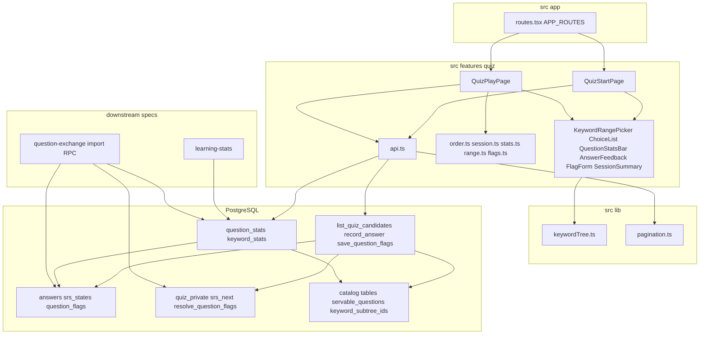
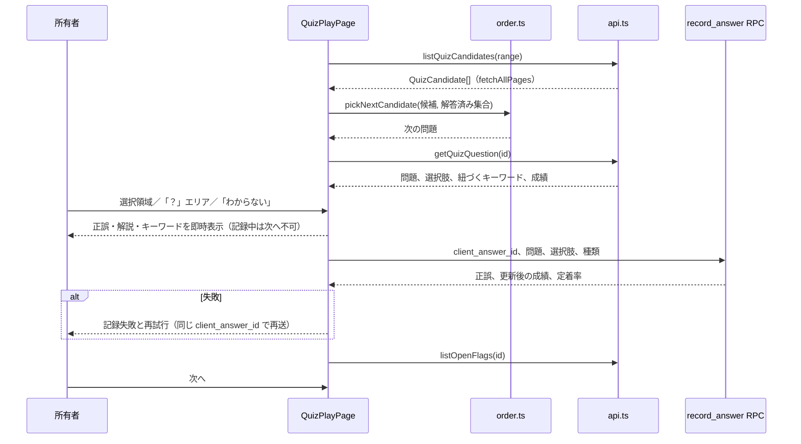
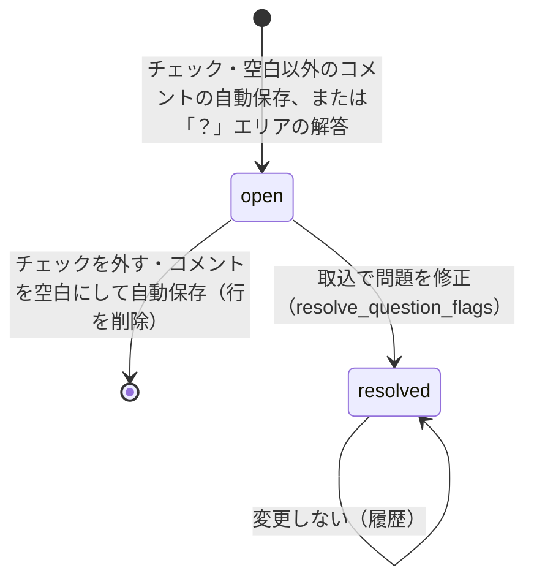
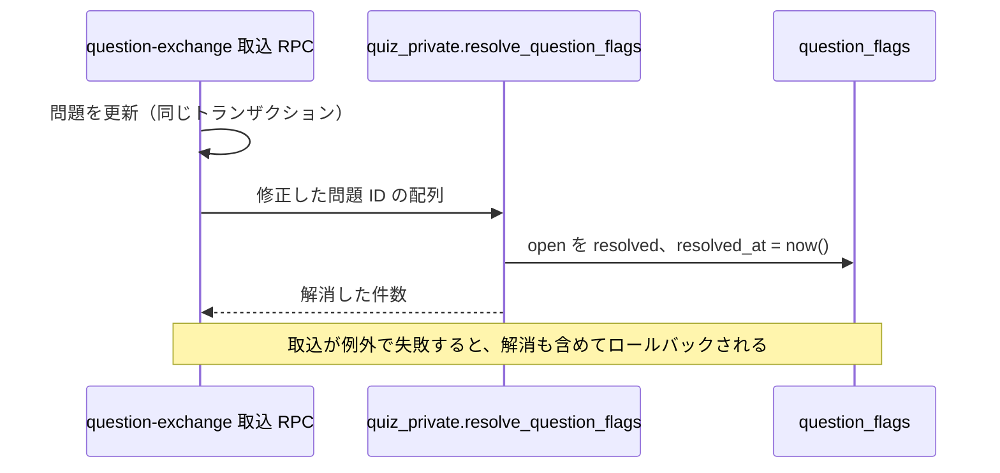
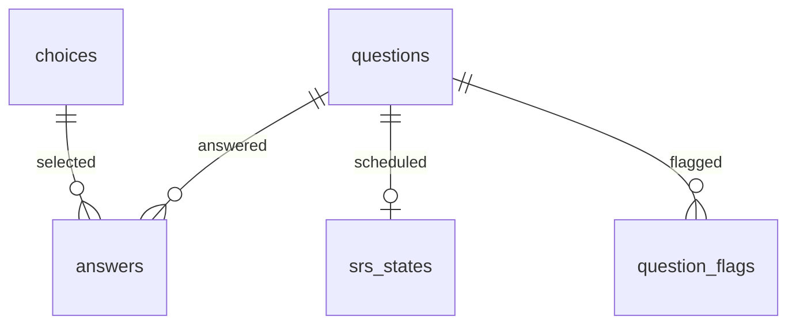

# Design Document

## Overview

**Purpose**: 所有者が出題範囲（科目とキーワードの部分木）を選び、SRS に基づく順で問題を解き、正誤・解説・キーワード階層を確認し、問題フラグを残せる「出題セッション」を提供する。あわせて、下流の learning-stats と question-exchange が参照する解答の集計ビュー、問題フラグ、定着率、フラグ解消の内部 SQL 関数を契約として確定する。

**Users**: 所有者はスマートフォン（PC も可）で出題範囲を選び、解答画面で解く。下流 spec の開発者は本 spec のテーブル、ビュー、内部 SQL 関数、TS の定数を契約として利用する。

**Impact**: app-foundation と subject-catalog の上に、出題用の migration と `src/features/quiz/` を追加し、`APP_ROUTES` に学習区分の行を足す。上流のテーブル・ビュー・関数は変更しない。

### Goals

- 解答の記録、SRS 状態の更新、「？」エリアによる `guessable` の付与が1トランザクションで行われ、再試行でも二重に記録されない
- 出題順が「未出題 → 定着率が低い順」で決定的に決まり、定着率が1つの数値として下流から参照できる
- 判定後に、選択と正誤を1つの選択肢内で同時に示し、解説とキーワード階層をモバイルで読める
- 問題ごと・キーワードごと（部分木を含む）の集計が、無効・削除の問題を除いて DB 側で算出される

### Non-Goals

- ヒストグラムなどの統計画面（learning-stats）
- フラグ・集計・定着率の出力、交換用 JSON、取込 RPC（question-exchange）
- 問題・選択肢・キーワードの作成・編集・無効化・削除（subject-catalog）
- 出題セッションの中断・再開、期日（due）による出題の制限

## Boundary Commitments

### This Spec Owns

- テーブル `answers`（解答履歴）、`srs_states`（問題単位の SRS 状態）、`question_flags`（問題フラグと状態）と、その制約・index・RLS・トリガー
- ビュー `question_stats`（問題ごとの集計と定着率）、`keyword_stats`（キーワードごと、部分木を含む集計）
- 定着率の定義と公開値 `question_stats.retention`
- フラグ識別子の TS 定数 `QUESTION_FLAGS` と型 `QuestionFlagId`、`QuestionFlagStatus`（`src/features/quiz/flags.ts`。識別子と表示名の正本は `product.md`）
- RPC: `list_quiz_candidates`、`record_answer`、`save_question_flags`
- 内部 SQL 関数: `quiz_private.srs_next`（SRS の更新計算）、`quiz_private.resolve_question_flags`（フラグの解消。他の RPC の内部からだけ呼ぶ）、`quiz_private.guard_direct_write`（トリガー関数）
- 出題順・セッション進行の純粋関数（`src/features/quiz/order.ts`、`session.ts`）
- 出題範囲の選択画面、解答画面と、`APP_ROUTES` に追加する行

### Out of Boundary

- subject-catalog のテーブル・`servable_questions`・`keyword_subtree_ids`・`keywordTree.ts`・`validateQuestion` の定義と変更（本 spec は参照のみ）
- 取込 RPC 本体と、どの問題を「修正された」とみなすかの判定（question-exchange が決め、`quiz_private.resolve_question_flags` を呼ぶ）
- フラグ・集計の出力形式（question-exchange）、ヒストグラムのビン分け（learning-stats）
- app-foundation の契約（`AppRoute`、`fetchAllPages`、`AppLayout`、テーマトークン、共通 class、`supabase` client）の変更

### Allowed Dependencies

- app-foundation: `APP_ROUTES`／`AppRoute`（行の追加のみ、`nav.group = 'learn'`）、`fetchAllPages`、`supabase`（`@/lib/supabase`）、`useAuth`、テーマトークン `--c-correct`／`--c-incorrect` と共通 class `.choice-selected`、`.mark-correct`、`.mark-incorrect`、`.focus-ring`、`.tap-target`
- subject-catalog: テーブル `subjects`、`keywords`、`questions`、`choices`、`question_keywords`（読み取りと外部キー参照のみ）、ビュー `servable_questions`、SQL 関数 `keyword_subtree_ids`、TS の `buildKeywordTree`、`keywordPath`、型 `KeywordNode`（`@/lib/keywordTree`）、型 `Subject`、`Keyword`、`QuestionKind`（`@/features/catalog/types`）
- npm パッケージ: 上流が導入済みのもののみ（追加なし）
- 依存方向: `src/features/quiz` → `src/lib`／`src/components`／`@/features/catalog/types`。catalog は quiz を import しない。下流 feature は `@/features/quiz/flags` と、本 spec のビュー・テーブル・`quiz_private.resolve_question_flags` を参照してよい

### Revalidation Triggers

- `answers`、`srs_states`、`question_flags` の列・制約・状態値の変更
- `question_stats`、`keyword_stats` の列名・型・意味（特に `retention`、`correct_rate`、除外条件）の変更
- 定着率の計算式・値域・null の意味の変更
- フラグ識別子の追加・変更（`product.md` の変更を含む）
- `quiz_private.resolve_question_flags` の引数・返り値・権限・配置スキーマの変更、`supabase/config.toml` の `[api] schemas` への `quiz_private` の追加
- 直接書き込みの拒否方式（`quiz.write_via_rpc` 設定）の変更（取込 RPC がフラグを書く場合に影響する）
- 上流の `servable_questions` の条件、`keyword_subtree_ids` の返り値の変更（本 spec の集計に波及する）

## Architecture

### Architecture Pattern & Boundary Map



**Architecture Integration**:

- Selected pattern: クライアント SPA + feature-first。正誤判定・記録・SRS 更新は DB の RPC、出題順とセッション進行は TS の純粋関数
- Domain/feature boundaries: 画面と API は `src/features/quiz`、永続化と集計は migration。階層計算は上流の `src/lib/keywordTree.ts` を再利用する
- Existing patterns preserved: `APP_ROUTES` への行追加、`fetchAllPages`、`api.ts` での `snake_case` → `camelCase` 変換、日本語の `Error`、`*_private` スキーマによる内部関数の隠蔽
- New components rationale: 各コンポーネントは要件の1領域（範囲選択、選択肢、成績、判定後表示、フラグ、終了）に対応する
- Steering compliance: `owner_id` + RLS（`USING` と `WITH CHECK`）、RPC は `SECURITY INVOKER` と `search_path = ''`、複数テーブル更新は RPC の単一トランザクション、件数・集計は DB 側

### Technology Stack

| Layer | Choice / Version | Role in Feature | Notes |
| ------- | ------------------ | ----------------- | ------- |
| Frontend | React 19、React Router 7、TypeScript 5.9 | 範囲選択、解答画面、セッション状態 | 検索パラメータで範囲を保持 |
| UI | Tailwind CSS 4、lucide-react | レイアウト、印のアイコン（`Circle`、`X`、`HelpCircle`） | app-foundation のトークンと共通 class |
| Data | Supabase JS 2、PostgreSQL 17 | テーブル、RLS、RPC、ビュー | `crypto.randomUUID()` で冪等キー |
| Test | Vitest 3、Testing Library、Playwright | 純粋関数、コンポーネント、E2E・RLS・SQL 関数 | ローカル Supabase、直列 |

## File Structure Plan

### Directory Structure

```text
supabase/migrations/
├── 20261105000000_quiz_schema.sql        # quiz_private スキーマ、複合型、answers・srs_states・question_flags、制約、index、RLS、guard_direct_write
├── 20261105000100_quiz_views.sql         # question_stats、keyword_stats、権限
└── 20261105000200_quiz_functions.sql     # srs_next、resolve_question_flags、record_answer、save_question_flags、list_quiz_candidates、権限（ビューを参照するため後に適用）
src/features/quiz/
├── types.ts                              # AnswerKind、QuestionStats、QuizCandidate、QuizQuestion、AnswerResult
├── flags.ts                              # QUESTION_FLAGS、QuestionFlagId、QuestionFlagStatus、CHECKBOX_FLAG_IDS、normalizeComment（下流が参照）
├── flags.test.ts
├── order.ts                              # compareCandidates、pickNextCandidate、countCandidates（出題順、純粋関数）
├── order.test.ts
├── session.ts                            # sessionReducer（解答済み集合、判定・記録状態、成績、集計）
├── session.test.ts
├── stats.ts                              # applyAnswerToStats、formatCorrectRate、formatRetention（表示用の純粋関数）
├── stats.test.ts
├── range.ts                              # QuizRange と URL 検索パラメータの相互変換
├── range.test.ts
├── api.ts                                # Supabase 呼び出し、行変換、日本語エラー
├── api.test.ts                           # 行変換とエラー変換
├── QuizStartPage.tsx                     # 科目選択、範囲選択、件数表示、開始
├── QuizPlayPage.tsx                      # 出題・解答・記録・次へ・終了のオーケストレーション
├── KeywordRangePicker.tsx                # 科目のキーワード木から範囲を1つ選ぶ
├── ChoiceList.tsx                        # 選択肢（選択領域と「？」エリア）、「わからない」、判定後の表示、choiceDisplayState
├── QuestionStatsBar.tsx                  # 出題中の問題の正答数・出題数・正答率
├── AnswerFeedback.tsx                    # 問題の解説、紐づくキーワードの階層パス
├── FlagForm.tsx                          # フラグのチェックボックス、自由入力、自動保存の状態表示
├── flagAutosave.ts                       # フラグの自動保存キュー（直列化・最新値への集約・flush）
└── SessionSummary.tsx                    # 終了表示（解答数・正答数）
e2e/
├── quiz.spec.ts                          # 範囲選択から解答・判定表示・フラグ・終了までの経路、レスポンシブ
└── quiz-db.spec.ts                       # RLS、直接書き込みの拒否、冪等性、SRS 計算、集計ビュー、フラグ解消関数の権限
```

単体テスト `flagAutosave.test.ts` は `flagAutosave.ts` の隣に置く。コンポーネントテスト（`ChoiceList.test.tsx`、`FlagForm.test.tsx`、`QuestionStatsBar.test.tsx`）は各コンポーネントの隣に置く。

### Modified Files

- `src/app/routes.tsx` — `quiz`（nav: 「出題」、`group: 'learn'`、`icon: GraduationCap`、`order: 1`）と `quiz/play`（nav なし）の2行を追加する
- 2026-11-05 の要件変更（4.3、5.9、7.2、7.4、7.5、7.9、7.10）で変更するファイル（DB・RPC の変更なし）:
  - `src/features/quiz/ChoiceList.tsx` — 判定後は「？」エリアを描画せず、同じ位置に ○／× の印の列を置く（4.3、5.9）
  - `src/features/quiz/FlagForm.tsx` — 保存ボタンを廃止し、チェックの変更と自由入力の blur で自動保存を要求する（7.2、7.4〜7.6、7.9、7.10）
  - `src/features/quiz/flagAutosave.ts`（新規）— 自動保存キュー
  - `src/features/quiz/QuizPlayPage.tsx` — 問題ごとに自動保存キューを持ち、「次へ」「終了」の前に `flush` する
  - `src/features/quiz/ChoiceList.test.tsx`、`FlagForm.test.tsx`、`QuizPlayPage.test.tsx`、`flagAutosave.test.ts`（新規）、`e2e/quiz.spec.ts` — テストの更新
- 2026-11-07 の要件変更（5.10、5.11）で変更するファイル（DB・RPC・共通レイアウトの変更なし）:
  - `src/features/quiz/QuizPlayPage.tsx` — 判定後の「次へ」を画面右下に固定し、判定中は末尾にスペーサーを置く（5.10、5.11）
  - `src/features/quiz/QuizPlayPage.test.tsx`、`e2e/quiz.spec.ts` — テストの追加
- `supabase/seed.sql` — E2E 用に、出題対象・無効・削除の問題と途中ノードへの紐づけを含む科目と、1,050 問・1,200 キーワードの大量データ用科目を追加する（ローカル専用）

## System Flows

### 出題と解答



- 正誤はクライアントが読み込んだ選択肢の `isCorrect` で即時に表示し、`record_answer` が DB 上で同じ判定を行う。両者が食い違った場合は RPC の結果（`isCorrect`、`correctChoiceId`）で表示を置き換える（3.1、5.1〜5.3）。
- 記録が成功するまで、選択肢は操作不可（判定後の状態）で、「次へ」は `disabled` にする（3.5、5.8）。
- 記録成功後に未解消フラグを取得して `FlagForm` の初期値にする（7.3、7.7）。

### 問題フラグの状態



### フラグの解消（下流からの呼び出し）



## Requirements Traceability

| Requirement | Summary | Components | Interfaces | Flows |
| ------------- | --------- | ------------ | ------------ | ------- |
| 1.1 | 科目一覧 | QuizStartPage、api.ts | `listQuizSubjects` | — |
| 1.2 | キーワード木で範囲選択 | KeywordRangePicker、keywordTree.ts | `listSubjectKeywords`、`buildKeywordTree` | — |
| 1.3 | 部分木に紐づく問題 | list_quiz_candidates | `keyword_subtree_ids` | 出題と解答 |
| 1.4 | 科目全体 | list_quiz_candidates | `p_keyword_id = null` | 出題と解答 |
| 1.5 | 開始前の件数 | QuizStartPage、order.ts | `countCandidates` | — |
| 1.6 | 0件で開始不可 | QuizStartPage | — | — |
| 1.7 | 開始で最初の問題 | QuizStartPage、QuizPlayPage、range.ts | `toRangeParams` | 出題と解答 |
| 1.8 | 無効・削除を除外 | list_quiz_candidates | `servable_questions` | — |
| 1.9 | モバイルで横スクロールなし | QuizStartPage、KeywordRangePicker | `min-w-0` | — |
| 2.1 | 未出題が先 | order.ts | `compareCandidates` | 出題と解答 |
| 2.2 | 定着率の低い順 | order.ts、question_stats | `retention` | 出題と解答 |
| 2.3 | 決定的な順序 | order.ts | 同値時の `lastAnsweredAt`、`questionId` | — |
| 2.4 | 直前の結果を反映 | session.ts、order.ts | `recordSucceeded` | 出題と解答 |
| 2.5 | 1回ずつで終了 | session.ts、SessionSummary | `answeredIds`、`summary` | — |
| 2.6 | 定着率の公開 | question_stats | `retention` | — |
| 2.7 | 未出題は値なし | question_stats、stats.ts | `retention is null`、`formatRetention` | — |
| 3.1 | 判定・履歴・SRS 更新 | record_answer、srs_next | `recordAnswer` | 出題と解答 |
| 3.2 | 一体の更新 | record_answer、guard_direct_write | 単一トランザクション | 出題と解答 |
| 3.3 | 記録失敗の表示 | QuizPlayPage、session.ts | `recordStatus = 'failed'` | 出題と解答 |
| 3.4 | 再試行で1回だけ | record_answer、answers | `client_answer_id` | 出題と解答 |
| 3.5 | 記録中の操作抑止 | QuizPlayPage、ChoiceList、session.ts | `recordStatus = 'saving'` | 出題と解答 |
| 3.6 | 所有者限定 | quiz_schema（RLS） | ポリシー | — |
| 3.7 | 履歴の保持 | quiz_schema | FK `on delete restrict`、上流の論理削除 | — |
| 4.1 | 固定の「わからない」 | ChoiceList | — | — |
| 4.2 | わからないの記録 | record_answer、srs_next | `answer_kind = 'unknown'`、評価 `blackout` | — |
| 4.3 | 判定前だけの「？」エリア | ChoiceList | `judged` で描画を切り替え | — |
| 4.4 | ？の記録と guessable | record_answer | `answer_kind = 'guess'` | — |
| 4.5 | ？は SRS 不変 | record_answer | — | — |
| 4.6 | 操作領域と境界 | ChoiceList | `.tap-target`、境界線と間隔 | — |
| 4.7 | わからないに「？」なし | ChoiceList | — | — |
| 5.1 | 選択と正誤の同時表示 | ChoiceList | `.choice-selected`、`.mark-*` | — |
| 5.2 | 正解時 | ChoiceList | `choiceDisplayState` | — |
| 5.3 | 誤答時 | ChoiceList | `choiceDisplayState` | — |
| 5.4 | 共通色と印 | ChoiceList | `--c-correct`、`--c-incorrect`、○／× | — |
| 5.5 | 解説の表示 | AnswerFeedback、ChoiceList | — | — |
| 5.6 | キーワードの階層パス | AnswerFeedback、keywordTree.ts | `keywordPath` | — |
| 5.7 | 判定前は非表示 | ChoiceList、AnswerFeedback | `phase = 'answering'` | — |
| 5.8 | 判定後の再選択不可と次へ | ChoiceList、QuizPlayPage | `phase = 'judged'` | — |
| 5.9 | 判定後の「？」位置の ○／× | ChoiceList | `choiceDisplayState`、`MarkCell` | — |
| 5.10 | 判定後の「次へ」を画面右下に固定表示 | QuizPlayPage | `NEXT_DOCK` の class（`position: fixed`） | — |
| 5.11 | 固定した「次へ」が内容と下部導線に重ならない | QuizPlayPage | 判定中の末尾スペーサー、モバイルの下部導線分のオフセット | — |
| 6.1 | 解答中の成績 | QuestionStatsBar、question_stats | `QuestionStats` | — |
| 6.2 | 判定後の即時反映 | stats.ts、session.ts、record_answer | `applyAnswerToStats`、返り値 | 出題と解答 |
| 6.3 | 0件は「未出題」 | stats.ts | `formatCorrectRate` | — |
| 6.4 | 3種類を数える | question_stats、stats.ts | `answers` の全種類 | — |
| 7.1 | フラグの入力欄 | FlagForm、flags.ts | `QUESTION_FLAGS` | — |
| 7.2 | チェックで即時記録 | FlagForm、flagAutosave.ts、save_question_flags | `onChangeFlags`、`FlagSaver.setFlags` | — |
| 7.3 | 重複なしと選択済み表示 | save_question_flags、FlagForm | 部分 unique index、`listOpenFlags` | — |
| 7.4 | チェックを外すと即時に外す | FlagForm、flagAutosave.ts、save_question_flags | 未解消行の削除 | フラグの状態 |
| 7.5 | blur で変更時だけコメントを記録 | FlagForm、flagAutosave.ts、flags.ts | `onCommitComment`、`normalizeComment`、保存済みとの比較 | — |
| 7.6 | 保存失敗と再試行 | FlagForm、flagAutosave.ts、QuizPlayPage | `status = 'failed'`、`retry`、`flush` | — |
| 7.7 | ？で選択済み | FlagForm、record_answer | `listOpenFlags` | 出題と解答 |
| 7.8 | 所有者限定 | quiz_schema（RLS） | ポリシー | — |
| 7.9 | 空白の blur でコメントを外す | FlagForm、flagAutosave.ts、save_question_flags | `p_comment = null` で未解消の `comment` 行を削除 | フラグの状態 |
| 7.10 | 保存ボタンなし | FlagForm | submit を持たない | — |
| 8.1 | 取込で解消 | resolve_question_flags | 内部 SQL 関数 | フラグの解消 |
| 8.2 | 解消済みを保持 | question_flags | `status = 'resolved'` | フラグの状態 |
| 8.3 | 失敗時は不変 | resolve_question_flags | 呼び出し元トランザクション | フラグの解消 |
| 8.4 | 直接実行を拒否 | quiz_private スキーマ、guard_direct_write | PostgREST 非公開 | — |
| 8.5 | 状態の判別 | question_flags、flags.ts | `status`、`resolved_at`、`QuestionFlagStatus` | — |
| 9.1 | 問題ごとの集計 | question_stats | ビュー | — |
| 9.2 | キーワードごとの集計 | keyword_stats | ビュー、`keyword_subtree_ids` | — |
| 9.3 | 問題を1回だけ数える | keyword_stats | `distinct question_id` | — |
| 9.4 | 無効・削除を除外 | question_stats、keyword_stats | `servable_questions` | — |
| 9.5 | 0件の値 | question_stats、keyword_stats | `coalesce`、`nullif` | — |
| 9.6 | 所有者限定 | ビュー（`security_invoker`） | RLS | — |
| 9.7 | 1,000件超で欠落なし | ビュー、list_quiz_candidates、api.ts | 一意キー順、`fetchAllPages` | — |
| 10.1 | 学習区分と保護 | routes.tsx | `AppRoute.nav.group = 'learn'` | — |
| 10.2 | モバイル・PC | QuizPlayPage、ChoiceList | 1列レイアウト | — |
| 10.3 | キーボードとフォーカス | 全 UI | `.focus-ring` | — |
| 10.4 | 両テーマのコントラスト | ChoiceList | テーマトークン | — |
| 10.5 | 取得失敗と再試行 | QuizStartPage、QuizPlayPage、api.ts | `toQuizErrorMessage` | — |
| 10.6 | 終了で範囲選択へ | QuizPlayPage、range.ts | `toRangeParams` | — |

## Components and Interfaces

| Component | Domain/Layer | Intent | Req Coverage | Key Dependencies | Contracts |
| ----------- | -------------- | -------- | -------------- | ------------------ | ----------- |
| quiz_schema migration | DB | テーブル、制約、RLS、直接書き込みの拒否 | 3.2, 3.6, 3.7, 7.3, 7.8, 8.2, 8.5 | catalog テーブル (P0) | State |
| quiz_functions migration | DB | SRS 計算、記録、フラグ保存・解消、候補取得 | 1.3, 1.4, 1.8, 3.1, 3.2, 3.4, 4.2, 4.4, 4.5, 7.2–7.5, 8.1, 8.3, 8.4 | quiz_schema (P0)、`servable_questions` (P0)、`keyword_subtree_ids` (P0) | API |
| quiz_views migration | DB | 集計と定着率 | 2.6, 2.7, 6.1, 6.4, 9.1–9.7 | quiz_schema (P0)、`servable_questions` (P0) | State |
| types.ts | quiz | ドメイン型 | 3.1, 6.1 | catalog types (P1) | — |
| flags.ts | quiz | フラグ識別子と表示名 | 7.1, 7.5, 8.5 | — | Service |
| order.ts | quiz | 出題順 | 1.5, 2.1–2.4 | types.ts (P0) | Service |
| session.ts | quiz | セッション進行 | 2.4, 2.5, 3.3, 3.5, 5.7, 5.8, 6.2 | order.ts (P0)、stats.ts (P0) | State |
| stats.ts | quiz | 成績の表示値 | 2.7, 6.2–6.4 | — | Service |
| range.ts | quiz | 範囲の URL 表現 | 1.7, 10.6 | — | Service |
| api.ts | quiz | DB 呼び出しと変換 | 1.1–1.4, 3.1, 3.4, 7.2–7.6, 9.7, 10.5 | supabase (P0)、pagination (P0) | Service |
| QuizStartPage / KeywordRangePicker | quiz UI | 範囲選択と開始 | 1.1–1.7, 1.9, 10.5 | api.ts (P0)、keywordTree.ts (P0) | — |
| QuizPlayPage | quiz UI | 出題のオーケストレーション | 1.7, 2.4, 2.5, 3.3, 3.5, 5.8, 5.10, 5.11, 10.2, 10.5, 10.6 | session.ts (P0)、api.ts (P0) | State |
| ChoiceList | quiz UI | 選択肢・「？」・わからない・正誤表示 | 4.1, 4.3, 4.6, 4.7, 5.1–5.5, 5.7–5.9, 10.3, 10.4 | 共通 class (P0) | — |
| QuestionStatsBar | quiz UI | 成績表示 | 6.1–6.3 | stats.ts (P0) | — |
| AnswerFeedback | quiz UI | 解説・階層パス | 5.5–5.7 | keywordTree.ts (P0) | — |
| FlagForm | quiz UI | フラグ入力と自動保存の状態表示 | 7.1–7.7, 7.9, 7.10 | flags.ts (P0)、flagAutosave.ts (P0) | State |
| flagAutosave.ts | quiz | 自動保存の直列化と集約 | 7.2, 7.4–7.6, 7.9 | api.ts (P0) | Service |
| SessionSummary | quiz UI | 終了表示 | 2.5 | — | — |
| routes.tsx（変更） | app | 導線と保護 | 10.1 | APP_ROUTES (P0) | — |

### DB

#### quiz_schema migration

##### Responsibilities & Constraints

- 全テーブルに `owner_id uuid not null default auth.uid() references auth.users(id) on delete cascade` を持たせ、RLS を有効化する。ポリシーは `for all to authenticated using (owner_id = (select auth.uid())) with check (owner_id = (select auth.uid()))`（3.6、7.8）。
- RPC は `SECURITY INVOKER` のため、`authenticated` にテーブルの `select`、`insert`、`update`、`delete` を付与する。そのうえで、PostgREST からの直接書き込み（解答履歴・SRS 状態・フラグの改ざん）を防ぐため、3テーブルに `before insert or update or delete` のトリガー `quiz_private.guard_direct_write()` を置く。トリガーは `current_setting('quiz.write_via_rpc', true)` が `'on'` でなければ例外 `direct_write_forbidden` を出す。本 spec の書き込み関数と、`resolve_question_flags` は先頭で `perform set_config('quiz.write_via_rpc', 'on', true)`（トランザクション内のみ有効）を実行する（3.2）。この GUC 名と値はローカル seed 用途に限って許可する契約であり（learning-stats の seed が解答履歴の挿入に依存する）、名称を変更する場合は learning-stats の seed の更新が必要になる。
- `question_flags` の未解消の一意性は部分 unique index `(question_id, flag) where status = 'open'`（7.3）。解消済みの行の `update`／`delete` は、トリガーで `resolved_flag_immutable` として拒否する（8.2）。
- 問題・選択肢への外部キーは `on delete restrict`。上流は問題・選択肢を物理削除しないため、無効化・削除の後も履歴は残る（3.7）。
- `quiz_private` スキーマを作成し、`authenticated` に `usage` を付与し、`anon` と `public` には与えない。`supabase/config.toml` の `[api] schemas` には追加しない（8.4）。
- 複合型 `public.srs_input`、`public.quiz_candidate`、`public.answer_result` を定義する（列は下記）。

#### quiz_functions migration

すべて `set search_path = ''`、スキーマ修飾付き、`security invoker`。`public` の RPC は `authenticated` に `execute` を付与し、`anon` と `public` から取り消す。

| 関数 | Request | Response | Errors（例外メッセージ） |
| ------ | --------- | ---------- | -------------------------- |
| `public.list_quiz_candidates(p_subject_id uuid, p_keyword_id uuid)` | `p_keyword_id` が null なら科目全体 | `setof public.quiz_candidate`（`question_id uuid, created_at timestamptz, attempt_count integer, correct_count integer, correct_rate double precision, retention double precision, last_answered_at timestamptz`） | — |
| `public.record_answer(p_client_answer_id uuid, p_question_id uuid, p_choice_id uuid, p_kind text)` | `p_kind` は `normal`／`guess`／`unknown`。`unknown` は `p_choice_id` が null | `public.answer_result`（`answer_id uuid, is_correct boolean, correct_choice_id uuid, attempt_count integer, correct_count integer, correct_rate double precision, retention double precision, last_answered_at timestamptz, already_recorded boolean`） | `question_not_servable`、`choice_not_in_question`、`invalid_answer_kind` |
| `public.save_question_flags(p_question_id uuid, p_flags text[], p_comment text)` | `p_flags` はチェック済みの識別子（`comment` を含めない） | `void` | `question_not_found`、`invalid_flag` |
| `quiz_private.srs_next(p_state public.srs_input, p_grade text, p_elapsed_days double precision)` | 状態は null 可（初回） | `public.srs_input` | `invalid_grade` |
| `quiz_private.resolve_question_flags(p_question_ids uuid[])` | 修正した問題の ID | `integer`（解消した件数） | — |

- `public.srs_input` の列: `stability_days double precision, ease double precision, review_count integer, lapse_count integer`。
- `list_quiz_candidates`（`language sql stable`）: `servable_questions` のうち `subject_id = p_subject_id`。`p_keyword_id` があれば `exists (select 1 from public.question_keywords qk where qk.question_id = q.id and qk.keyword_id in (select public.keyword_subtree_ids(p_keyword_id)))`。`question_stats` と結合し、`order by created_at, question_id` で返す（1.3、1.4、1.8、9.7）。
- `record_answer`（`language plpgsql`、3.1、3.2、3.4、4.2、4.4、4.5）:
  1. `answers` に `(owner_id, client_answer_id)` の行があれば、その行と現在の `question_stats` から `already_recorded = true` の結果を返し、何も変更しない
  2. 問題が `servable_questions` にあることを確認する（なければ `question_not_servable`）
  3. `normal`／`guess` は `choices` の `id = p_choice_id and question_id = p_question_id and removed_at is null` を確認し（なければ `choice_not_in_question`）、その `is_correct` を採る。`unknown` は `p_choice_id` が null であることを確認し、`is_correct = false` とする。それ以外の種類は `invalid_answer_kind`
  4. `answers` に挿入する（`choice_id`、`answer_kind`、`is_correct`、`client_answer_id`、`answered_at = now()`）
  5. `normal` は評価 `good`（正解）／`again`（誤答）、`unknown` は `blackout` とし、`srs_states` の行を `for update` で読み、経過日数（`now() - last_reviewed_at`、初回は 0）とともに `quiz_private.srs_next` を呼び、結果を upsert して `last_reviewed_at = now()`、`updated_at = now()` にする。`guess` は `srs_states` を変更しない
  6. `guess` は `question_flags` に `(question_id, 'guessable', 'open')` を `on conflict do nothing` で挿入する
  7. 更新後の `question_stats` の行と、正解の選択肢 ID を返す
- 同じ `client_answer_id` の同時実行で unique 違反（`23505`）が起きた場合は、それを捕捉して手順1と同じ結果を返す。
- `save_question_flags`（`language plpgsql`、7.2〜7.5）: 問題が所有者の未削除の問題であることを確認する（なければ `question_not_found`。無効の問題も可）。`p_flags` の各値が `guessable`、`low_value`、`needs_explanation`、`defective` のいずれかでなければ `invalid_flag`。未解消のチェック型フラグのうち `p_flags` にない行を削除し、ない識別子を挿入する。`btrim(p_comment)` が空なら未解消の `comment` 行を削除し、空でなければ未解消の `comment` 行の `note` を更新するか挿入する。
- `srs_next`（`language plpgsql immutable`。不正な評価で `invalid_grade` を raise するため）の規則。状態が null のときは `stability_days = null`、`ease = 2.5`、回数 0 とみなす:

| 評価 | `stability_days` | `ease` | `review_count` | `lapse_count` |
| ------ | ------------------ | -------- | ---------------- | --------------- |
| `good` | null なら `1.0`。`p_elapsed_days >= stability_days * 0.5` なら `stability_days * ease`、そうでなければ据え置き | `least(3.0, ease + 0.05)` | +1 | 据え置き |
| `again` | `greatest(0.2, coalesce(stability_days, 0.4) * 0.5)` | `greatest(1.3, ease - 0.2)` | +1 | +1 |
| `blackout` | `0.2` | `greatest(1.3, ease - 0.3)` | +1 | +1 |

- `resolve_question_flags`（`language plpgsql volatile`、8.1〜8.4）: `quiz.write_via_rpc` を `on` にしてから、`update public.question_flags set status = 'resolved', resolved_at = now() where question_id = any(p_question_ids) and status = 'open'` を実行し、更新件数を返す。RLS により呼び出し元の所有者の行だけが対象になる。呼び出し元のトランザクションに参加するため、取込が失敗すればロールバックされる（8.3）。`execute` は `authenticated` に付与し（`SECURITY INVOKER` の取込 RPC から呼ぶため）、`anon` と `public` から取り消す。`quiz_private` は PostgREST が公開しないため、クライアントからは直接呼べない（8.4）。
- `srs_next` と `guard_direct_write` も `quiz_private` に置き、`srs_next` の `execute` は `authenticated` に付与する（`record_answer` から呼ぶため）。

#### quiz_views migration

両ビューとも `with (security_invoker = true)` とし、`authenticated` に `select` を付与する。基になるテーブルの RLS により所有者の行だけを返す（9.6）。

`public.question_stats`（2.6、2.7、6.1、6.4、9.1、9.4、9.5）:

| 列 | 型 | 意味 |
| ---- | ---- | ------ |
| `question_id` | `uuid` | `servable_questions.id`（一意） |
| `subject_id` | `uuid` | 問題の科目 |
| `attempt_count` | `integer` | 出題数。`answers` の全種類（`normal`、`guess`、`unknown`）の件数。0 以上 |
| `correct_count` | `integer` | 正答数。`is_correct` が真の件数（`unknown` は常に誤答） |
| `correct_rate` | `double precision null` | `correct_count / attempt_count`。出題数 0 は null |
| `last_answered_at` | `timestamptz null` | 最後の解答日時 |
| `review_count` | `integer` | SRS に反映した回数（`normal` と `unknown`）。状態なしは 0 |
| `retention` | `double precision null` | 定着率（0〜1）。下記の式。SRS 状態がない（未出題、または「？」エリアの解答のみ）場合は null |

- 定着率の式: `power(0.9, greatest(0, extract(epoch from (now() - s.last_reviewed_at)) / 86400.0) / s.stability_days)`。経過日数が安定度と等しいとき 0.9 になる。値は参照した時刻で変わり、保存しない。

`public.keyword_stats`（9.2〜9.5）:

| 列 | 型 | 意味 |
| ---- | ---- | ------ |
| `keyword_id` | `uuid` | `keywords.id`（一意） |
| `subject_id` | `uuid` | キーワードの科目 |
| `question_count` | `integer` | 部分木に紐づく出題対象の問題数（重複なし） |
| `attempt_count` | `integer` | 該当問題の `question_stats.attempt_count` の合計 |
| `correct_count` | `integer` | 該当問題の `question_stats.correct_count` の合計 |
| `correct_rate` | `double precision null` | `correct_count / attempt_count`。出題数 0 は null |

- 定義: 各 `keywords` 行 `k` に対し、`lateral (select distinct qk.question_id from public.question_keywords qk where qk.keyword_id in (select public.keyword_subtree_ids(k.id)))` を `question_stats` と内部結合して集計し、該当なしは `coalesce` で 0 にする。`distinct` により、同じ部分木の複数のキーワードに紐づく問題を1回だけ数える（9.3）。`question_stats` は出題対象だけを含むため、無効・削除の問題は除外される（9.4）。
- 全件取得の順序: `question_stats` は `order by question_id`、`keyword_stats` は `order by keyword_id` で `fetchAllPages` により取得する（9.7）。

### quiz

#### types.ts

```typescript
import type { QuestionKind } from '@/features/catalog/types';

export type AnswerKind = 'normal' | 'guess' | 'unknown';

export type QuestionStats = {
  attemptCount: number;
  correctCount: number;
  correctRate: number | null;     // 出題数 0 は null
  retention: number | null;       // 0〜1、SRS 状態なしは null
  lastAnsweredAt: string | null;
};

export type QuizCandidate = QuestionStats & { questionId: string; createdAt: string };

export type QuizChoice = { id: string; body: string; explanation: string; isCorrect: boolean };

export type QuizQuestion = {
  id: string;
  subjectId: string;
  kind: QuestionKind;
  stem: string;
  explanation: string;
  keywordIds: string[];
  choices: QuizChoice[];          // position 順、removed_at の行は除く
  stats: QuestionStats;
};

export type AnswerResult = QuestionStats & {
  answerId: string;
  isCorrect: boolean;
  correctChoiceId: string;
  alreadyRecorded: boolean;
};
```

#### flags.ts

```typescript
export const QUESTION_FLAGS = [
  { id: 'guessable', label: '知識がなくても推測で解ける', input: 'checkbox' },
  { id: 'low_value', label: '問う価値が低い', input: 'checkbox' },
  { id: 'needs_explanation', label: '解説の内容を追加する', input: 'checkbox' },
  { id: 'defective', label: '問題不備（正解・問題文の誤り、正解が一つに決まらない）', input: 'checkbox' },
  { id: 'comment', label: '疑義の内容（自由入力）', input: 'text' },
] as const;

export type QuestionFlagId = (typeof QUESTION_FLAGS)[number]['id'];
export type CheckboxFlagId = Exclude<QuestionFlagId, 'comment'>;
export type QuestionFlagStatus = 'open' | 'resolved';

export const CHECKBOX_FLAG_IDS: readonly CheckboxFlagId[];
export function normalizeComment(text: string): string | null;  // 前後空白を除いて空なら null
```

- 識別子と表示名は `product.md` の「問題フラグ」と一致させ、DB の check 制約と同じ集合にする（`flags.test.ts` で集合を固定する）（7.1、8.5）。

#### order.ts

```typescript
export function compareCandidates(a: QuizCandidate, b: QuizCandidate): number;
export function pickNextCandidate(
  candidates: readonly QuizCandidate[],
  answeredIds: ReadonlySet<string>,
): QuizCandidate | null;
export function countCandidates(candidates: readonly QuizCandidate[]): { total: number; unseen: number };
```

- 優先順位（2.1〜2.3）: (1) `attemptCount = 0`（未出題）を先に、`createdAt` 昇順、`questionId` 昇順。(2) 出題済みは `retention` 昇順。`retention` が null（「？」エリアの解答のみ）は定着率 0 とみなす。(3) 同値は `lastAnsweredAt` 昇順、`questionId` 昇順。
- `pickNextCandidate` は `answeredIds` を除いた最小の要素を返し、なければ null（2.5）。副作用なし、入力を変更しない。
- `countCandidates` の `unseen` は `attemptCount = 0` の件数（1.5）。

#### session.ts

```typescript
export type SessionPhase = 'loading' | 'answering' | 'judged' | 'finished' | 'error';
export type RecordStatus = 'idle' | 'saving' | 'saved' | 'failed';

export type SessionState = {
  candidates: QuizCandidate[];
  answeredIds: ReadonlySet<string>;
  current: QuizQuestion | null;
  phase: SessionPhase;
  selection: { kind: AnswerKind; choiceId: string | null; clientAnswerId: string } | null;
  correctChoiceId: string | null;         // 判定前は null
  recordStatus: RecordStatus;
  stats: QuestionStats | null;            // 出題中の問題の成績
  summary: { answered: number; correct: number };
};

export type SessionAction =
  | { type: 'candidatesLoaded'; candidates: QuizCandidate[] }
  | { type: 'questionLoaded'; question: QuizQuestion }
  | { type: 'answered'; kind: AnswerKind; choiceId: string | null; clientAnswerId: string }
  | { type: 'recordSucceeded'; result: AnswerResult }
  | { type: 'recordFailed' }
  | { type: 'retryRecord' }
  | { type: 'skipUnservable' }
  | { type: 'next' }
  | { type: 'loadFailed' };

export function createInitialSession(): SessionState;
export function sessionReducer(state: SessionState, action: SessionAction): SessionState;
```

- `answered` は `phase = 'answering'` のときだけ受け付け、`phase = 'judged'`、`recordStatus = 'saving'` にし、読み込み済みの選択肢から `correctChoiceId` を設定し、`stats` を `applyAnswerToStats` で即時更新する（3.5、5.8、6.2）。
- `recordSucceeded` は RPC の値で `stats`、`correctChoiceId`、候補の該当行を置き換え、`answeredIds` に加え、`summary` を更新する（2.4、6.2）。
- `next` は `recordStatus = 'saved'` のときだけ受け付ける。`pickNextCandidate` が null なら `finished`、そうでなければ `loading`（2.5、3.5）。
- `retryRecord` は同じ `clientAnswerId` のまま `saving` に戻す（3.4）。
- `skipUnservable` は現在の問題を解答済みに加え（`summary` は変えない）、`next` と同じ遷移をする（Error Handling 参照）。

#### stats.ts

```typescript
export function applyAnswerToStats(stats: QuestionStats, isCorrect: boolean): QuestionStats;     // 表示用の即時反映
export function formatCorrectRate(stats: Pick<QuestionStats, 'attemptCount' | 'correctRate'>): string; // '未出題' または '67%'
export function formatRetention(retention: number | null, attemptCount: number): string;        // '未出題'／'未評価'／'81%'
```

- `applyAnswerToStats` は `attemptCount` を +1、正解なら `correctCount` を +1 し、`correctRate` を再計算する。種類（`normal`、`guess`、`unknown`）を問わず数える（6.4）。

#### range.ts

```typescript
export type QuizRange = { subjectId: string; keywordId: string | null };
export function toRangeParams(range: QuizRange): URLSearchParams;            // subject、keyword
export function parseRangeParams(params: URLSearchParams): QuizRange | null; // UUID 形式でない値は null
```

- 解答画面の URL は `quiz/play?subject=<id>&keyword=<id>`。終了時は同じ範囲を付けて `quiz` に戻る（1.7、10.6）。

#### api.ts

```typescript
export function listQuizSubjects(): Promise<Subject[]>;                              // deleted_at is null、name 順
export function listSubjectKeywords(subjectId: string): Promise<Keyword[]>;          // fetchAllPages、sort_order, id 順
export function listQuizCandidates(range: QuizRange): Promise<QuizCandidate[]>;      // fetchAllPages
export function getQuizQuestion(id: string): Promise<QuizQuestion | null>;           // 出題対象外は null
export function recordAnswer(input: {
  clientAnswerId: string; questionId: string; choiceId: string | null; kind: AnswerKind;
}): Promise<AnswerResult>;
export function listOpenFlags(questionId: string): Promise<{ flags: CheckboxFlagId[]; comment: string | null }>;
export function saveQuestionFlags(questionId: string, flags: readonly CheckboxFlagId[], comment: string): Promise<void>;
export function toQuizErrorMessage(context: string, error: { code?: string; message: string }): string;
```

- `getQuizQuestion` は `servable_questions`、有効な選択肢（`position` 順）、紐づけ、`question_stats` を `Promise.all` で並列取得する。
- `toQuizErrorMessage`: `question_not_servable` →「この問題は出題対象ではなくなりました」、`choice_not_in_question` →「選択肢が見つかりません。問題を読み込み直してください」、その他 →「{context}に失敗しました: {message}」（3.3、7.6、10.5）。

### quiz UI

#### QuizStartPage / KeywordRangePicker

- URL `quiz`。科目一覧を表示し（1.1）、科目を選ぶと `KeywordRangePicker` で木を表示する。「科目全体」または任意のノードを1つ選ぶ（`role="tree"`、`aria-selected`、矢印キーで移動・展開）（1.2、1.4、10.3）。検索パラメータ `subject`、`keyword` があれば初期選択にする。
- 範囲が決まると `listQuizCandidates` を取得し、`countCandidates` で「出題対象 N 問（未出題 M 問）」を表示する（1.5）。0 件なら「この範囲には出題できる問題がありません」と表示し、開始ボタンを `disabled` にする（1.6）。開始で `quiz/play?…` へ遷移する（1.7）。
- 取得失敗は `role="alert"` と「再試行」（10.5）。各要素は `min-w-0` と折り返しで横スクロールを防ぐ（1.9）。

#### QuizPlayPage

- `parseRangeParams` が null なら `quiz` へ置換遷移する。候補を取得し、`sessionReducer` で進行する（1.7）。
- 選択時に `crypto.randomUUID()` で `clientAnswerId` を作り、`recordAnswer` を呼ぶ。失敗時は判定表示を保ったまま `role="alert"` で「解答を記録できませんでした」と「再試行」を表示する（3.3、3.4）。
- 「終了」ボタンで `quiz?subject=…&keyword=…` へ戻る（10.6）。`finished` で `SessionSummary` を表示する（2.5）。
- 1列のレイアウト（最大幅 `40rem`、中央寄せ）で、モバイルと PC で同じ操作にする。上から `QuestionStatsBar`、問題文、`ChoiceList`、判定後に `AnswerFeedback`、`FlagForm`、「次へ」（10.2）。
- 判定後の「次へ」の固定表示（5.10、5.11、2026-11-07）:
  - 位置: 「次へ」を包む `div` に、判定後（`phase = 'judged'`）だけ `position: fixed` の class を付ける。`sticky` は採らない（`section` の中でしか効かず、内容が短いと右下に来ない。`main` の `flex-1` に依存する）。
  - オフセット: モバイル（`lg` 未満）は `right: 1rem`、`bottom: calc(4rem + env(safe-area-inset-bottom))`。下部導線（`AppLayout` の `fixed bottom-0 z-20 lg:hidden`、高さは `tap-target` の 44px と上ボーダー 4px と区切り線 1px で約 49px、その下に `pb-[env(safe-area-inset-bottom)]`）の上に 15px 前後の間隔を空ける。PC（`lg` 以上）は下部導線がないため `right: 1.5rem`、`bottom: 1.5rem`。Tailwind の任意値 class（例: `fixed right-4 bottom-[calc(4rem+env(safe-area-inset-bottom))] z-10 lg:right-6 lg:bottom-6`）で書き、共通レイアウトは変更しない。下部導線を表示しない場合（学習区分の導線が0件）もモバイルのオフセットは同じとする（余白が増えるだけで重ならない）。
  - 重なり: 判定中は `section` の末尾に `aria-hidden` の空の `div`（高さ `h-20`、80px）を置く。`main` の下余白（モバイル `pb-24`、PC `pb-4`）と合わせ、最下部までスクロールしたとき最後の内容（`FlagForm` と状態表示）が「次へ」の上端より上に来る（モバイル: 96px + 80px ≥ 64px + 44px + 余白、PC: 16px + 80px ≥ 24px + 44px + 余白）。判定前は「次へ」とスペーサーを描画しない（5.8）。判定直後、解答の記録が終わるまでは「次へ」を非活性にする。
  - 重なり順: `z-10`。ヘッダー（`sticky top-0 z-20`、モバイルのメニューを含む）と下部導線（`z-20`）より下にし、メニューを開いたときに覆わない。確認ダイアログは `<dialog>` のモーダル（top layer）なので影響しない。
  - 見た目と操作: 既存の `BUTTON`（`tap-target` で 44×44px 以上、`focus-ring` の 2px アウトライン）と `bg-primary` の不透明な背景を維持し、固定の親に `overflow` を付けずフォーカスリングを切らない。ライト・ダークとも `--c-primary` と `--c-bg` の組み合わせのまま。
  - フォーカス順: DOM の位置（`FlagForm` の後）は変えず、CSS の配置だけを変える。Tab 順は 10.3 のまま。「終了」ボタンの位置、「次へ」を判定後にだけ出す規則、`leaveAfterFlush` の動作は変えない。

#### ChoiceList

```typescript
export type ChoiceDisplayState = { selected: boolean; mark: 'correct' | 'incorrect' | null };
export function choiceDisplayState(
  choiceId: string | null,                    // null は「わからない」
  selection: { choiceId: string | null } | null,
  correctChoiceId: string | null,             // 判定前は null
): ChoiceDisplayState;
```

- 各選択肢は1行に「選択領域」（本文のボタン、行幅の残り全体）と右端の列を持つ。判定前の右端の列は「？」エリア（独立したボタン、`aria-label="推測で解答: <本文>"`、`HelpCircle` アイコン、最小 44×44px、左側の境界線と 8px 以上の間隔）（4.3、4.6）。
- 判定後は「？」エリアを描画せず、同じ右端の列に `MarkCell`（ボタンではない `span`、最小幅 44px、左側の境界線を維持）を置く。`mark = 'correct'` は ○（`Circle`）と視覚的に隠した「正解」、`'incorrect'` は ×（`X`）と「不正解」、`null` は空の列（幅は保つ）。「わからない」の行は判定前は右端の列を持たず、判定後に選んでいた場合だけ同じ幅の `MarkCell` に × を出す（4.7、5.9）。列の幅を判定前後で揃え、本文の折り返し位置を変えない。
- 末尾に固定の「わからない」ボタンを置き、「？」エリアを持たない（4.1、4.7）。
- 判定後の表示（5.1〜5.4、5.9）: 選んだ選択肢に `.choice-selected`。正解の選択肢に `.mark-correct` と右端の ○。選んだ不正解（「わからない」を含む）に `.mark-incorrect` と右端の ×。それ以外は印なし。選んだ選択肢には視覚的に隠した「選択した解答」を本文側に付ける（現行の本文横の `Marks` は廃止し、印は右端の列に一本化する）。色は `--c-correct`／`--c-incorrect` だけを使い、`--c-warn` を使わない。
- 判定後は各選択肢の枠内に選択肢の解説を表示する（5.5）。判定前は解説・印を描画しない（5.7）。判定後はボタンを `disabled` にする（5.8）。
- 選択（太枠）と正誤（色＋記号）を別の形状で示し、ライト／ダークの判別は app-foundation のトークンに従う（10.4）。

#### QuestionStatsBar / AnswerFeedback / SessionSummary

- `QuestionStatsBar`: 「正答 3 / 出題 5（60%）」の形式。出題数 0 は「未出題」。判定後は `session.stats` の更新値を表示する（6.1〜6.3）。
- `AnswerFeedback`: 判定後に問題の解説と、紐づく各キーワードの `keywordPath` を「 / 」で連結した階層パスを表示する（5.5、5.6）。判定前は描画しない（5.7）。
- `SessionSummary`: 「N 問解答、正答 M 問」と、範囲選択へ戻る導線（2.5）。

#### FlagForm

- 判定後かつ記録成功後に表示する。`listOpenFlags` の結果でチェックボックス（`QUESTION_FLAGS` の表示名）と自由入力を初期化する（7.1、7.3、7.7）。

```typescript
type Props = {
  initialFlags: readonly CheckboxFlagId[];
  initialComment: string | null;
  status: FlagSaveStatus;                           // flagAutosave の状態
  onChangeFlags: (flags: CheckboxFlagId[]) => void; // チェックの変更ごとに呼ぶ
  onCommitComment: (text: string) => void;          // textarea の blur で呼ぶ
  onRetry: () => void;
};
```

- チェックボックスの `onChange` で表示を即時に切り替え、変更後の集合で `onChangeFlags` を呼ぶ。保存中でもチェックボックスは操作可能にし、要求は `flagAutosave` が集約する（7.2、7.4）。
- 自由入力は入力中は保存しない。`onBlur` で `onCommitComment(text)` を呼び、変更有無の判定（正規化後に最後に保存したコメントと比較）は `flagAutosave` が行う。空白だけなら `null` として送り、未解消の `comment` 行を外す（7.5、7.9）。
- 保存ボタンと `form` の submit を持たない（Enter で送信しない）（7.10）。
- 状態表示: `role="status"`（`aria-live="polite"`）の1行に、`saving` は「保存中…」、`saved` は「保存しました」、`idle` は空。`failed` は `role="alert"` にエラー文と「再試行」ボタン（`onRetry`）。失敗中も入力（チェック・テキスト）は保持し、表示は利用者の最新の入力のままにする（7.6）。
- 各チェックボックスは `label` 付きで 44px の操作領域を持つ（10.3）。

#### flagAutosave.ts

```typescript
export type FlagSnapshot = { flags: CheckboxFlagId[]; comment: string | null }; // comment は正規化済み
export type FlagSaveStatus = { kind: 'idle' | 'saving' | 'saved' } | { kind: 'failed'; message: string };
export type FlagSaver = {
  setFlags(flags: CheckboxFlagId[]): void;
  commitComment(text: string): void; // normalizeComment 後、保存済みと同じなら何もしない
  retry(): void;
  flush(): Promise<boolean>;         // 実行中と未送信の要求が終わるまで待つ。成功なら true
  getStatus(): FlagSaveStatus;
  subscribe(listener: () => void): () => void;
};
export function createFlagSaver(
  initial: FlagSnapshot,
  save: (s: FlagSnapshot) => Promise<void>, // saveQuestionFlags(questionId, …) を束ねたもの
): FlagSaver;
```

- 既存の `save_question_flags`（集合全体を送ると未解消行をその集合に揃える冪等な RPC）をそのまま使い、DB・RPC は変更しない。変更1件ごとの RPC を新設しない。
- 「最新の希望値（desired）」と「最後に保存に成功した値（saved）」を持つ。同時に実行する RPC は1件だけにし、実行中に変更が来たら desired を上書きするだけにする。実行完了時に desired と送った値が違えば最新の desired を1回送る（直列化と集約。古い要求が後から届いて新しい状態を上書きすることがない）。
- チェックの保存では comment に blur で確定した値を送り、入力途中のテキストを保存しない（7.5）。
- 失敗時は `failed` にして自動再送しない。`retry` は最新の desired を送る（7.6）。失敗中に新しい変更が来た場合も最新の desired で再送する。
- 単体で検証できるよう React に依存しない（`QuizPlayPage` が `useSyncExternalStore` で状態を読む）。

#### QuizPlayPage（フラグの自動保存の追加分）

- `listOpenFlags` の取得後、問題ごとに `createFlagSaver` を1つ作り、`key={current.id}` の `FlagForm` に状態とコールバックを渡す。保存処理は `saveQuestionFlags(current.id, …)`。
- 「次へ」「終了」のクリック時は `await saver.flush()` してから遷移する。textarea にフォーカスがある状態でこれらを押すと `blur` が `click` より先に発火するため、コメントの要求は `flush` の前にキューに入る。`flush` が `false`（失敗）の場合は遷移せず、`FlagForm` の失敗表示と再試行を残す（7.6）。待機中のボタンは `disabled` にせず二重クリックを無視する（blur 直後の click を失わないため）。
- ページを閉じる・再読み込みする場合の未送信分は保証しない（チェックと blur は即時に送るため、失われうるのは実行中の要求に限られる）。

#### routes.tsx（変更）

- `{ path: 'quiz', element: <QuizStartPage />, nav: { label: '出題', group: 'learn', icon: GraduationCap, order: 1 } }` と `{ path: 'quiz/play', element: <QuizPlayPage /> }` を追加する。`public` を指定しないため保護ルートになる（10.1）。

## Data Models

### Domain Model



- 集約: 1件の解答（`answers` の行、`srs_states` の更新、`guessable` の付与）を `record_answer` で一体として更新する。
- 不変条件: `srs_states.review_count` は当該問題の `normal`／`unknown` の解答数と一致する。未解消の同じフラグは1つ。解消済みの行は変更しない。

### Physical Data Model

| テーブル | 列 | 制約・index |
| ---------- | ---- | ------------- |
| `answers` | `id uuid pk default gen_random_uuid()`、`owner_id`、`question_id uuid fk questions on delete restrict`、`choice_id uuid null fk choices on delete restrict`、`answer_kind text check in ('normal','guess','unknown')`、`is_correct boolean`、`client_answer_id uuid`、`answered_at timestamptz default now()` | unique `(owner_id, client_answer_id)`、index `(question_id, answered_at)`、check `(answer_kind = 'unknown') = (choice_id is null)`、check `answer_kind <> 'unknown' or not is_correct` |
| `srs_states` | `question_id uuid pk fk questions on delete restrict`、`owner_id`、`stability_days double precision check > 0`、`ease double precision check between 1.3 and 3.0`、`review_count integer check >= 1`、`lapse_count integer check >= 0`、`last_reviewed_at timestamptz`、`updated_at timestamptz` | — |
| `question_flags` | `id uuid pk default gen_random_uuid()`、`owner_id`、`question_id uuid fk questions on delete restrict`、`flag text check in ('guessable','low_value','needs_explanation','defective','comment')`、`note text null`、`status text check in ('open','resolved') default 'open'`、`created_at timestamptz default now()`、`resolved_at timestamptz null` | unique `(question_id, flag) where status = 'open'`、index `(question_id, status)`、check `(flag = 'comment') = (note is not null and length(btrim(note)) > 0)`、check `(status = 'resolved') = (resolved_at is not null)` |

### Data Contracts & Integration

- learning-stats: `question_stats` と `keyword_stats` を `select` で参照する（列は上表のとおり）。ヒストグラムのビン分けは learning-stats の責務。
- question-exchange:
  - 出力: `question_flags`（`question_id`、`flag`、`note`、`status`、`created_at`、`resolved_at`）、`question_stats`（`retention` を含む）、`keyword_stats` を参照する。フラグ識別子は `@/features/quiz/flags` の `QuestionFlagId` と `QuestionFlagStatus` を使う
  - 取込: 取込 RPC（`SECURITY INVOKER`）の中で、修正した問題 ID の配列を渡して `quiz_private.resolve_question_flags(p_question_ids uuid[])` を呼ぶ。「修正」の判定は question-exchange が行う。取込 RPC が `question_flags` に直接書き込むことはしない
- 定着率の意味: 前回の SRS 反映（通常の解答・わからない）からの経過時間に基づく想起確率の推定値（0〜1）。値が小さいほど優先して出題する。null は SRS 状態がないこと（`attempt_count = 0` なら未出題、1 以上なら「？」エリアの解答のみ）を表す。

## Error Handling

### Error Strategy

- 解答の記録失敗: 判定結果の表示を保ち、同じ `clientAnswerId` で再試行する。冪等のため二重記録されない（3.3、3.4）。
- 出題中に問題が無効化・削除された（`question_not_servable`）: 日本語のメッセージを表示し、「次へ」で `skipUnservable` を実行する。
- 取得失敗（科目、キーワード、候補、問題）: `role="alert"` と再試行（10.5）。
- フラグの保存失敗: 入力を保持して再試行（7.6）。自動保存のため、失敗中は「次へ」「終了」で遷移せず失敗表示を残す。
- 直接書き込み（`direct_write_forbidden`）、解消済みフラグの変更（`resolved_flag_immutable`）、内部関数の直接呼び出しは拒否され、UI からは発生しない（3.2、8.2、8.4）。

### Monitoring

個人用途のため外部監視は持たない。元のエラーを `console.error` に残す。

## Testing Strategy

### Unit Tests

- `order.test.ts`: 未出題が先（作成日時・ID 順）、定着率の低い順、`retention` が null（「？」のみ）を定着率 0 として扱う、同値時の決定的順序、解答済みの除外と全件解答で null、`countCandidates` の未出題数、入力不変（1.5、2.1〜2.5）
- `session.test.ts`: 判定前は `answered` 以外で判定状態にならない、`saving` 中の `next` と2回目の `answered` を無視、`recordFailed` → `retryRecord` で同じ `clientAnswerId`、`recordSucceeded` で成績と集計の置き換え、最後の問題で `finished`、`skipUnservable`（2.4、2.5、3.3〜3.5、5.7、5.8、6.2）
- `stats.test.ts`: 正解・誤答の即時反映、出題数 0 で「未出題」、`formatRetention` の3分岐（2.7、6.2〜6.4）
- `flags.test.ts`: 識別子と表示名の集合が `product.md` の表と一致、`CHECKBOX_FLAG_IDS` に `comment` を含まない、`normalizeComment` の空白処理（7.1、7.5、8.5）
- `range.test.ts`: URL との往復、不正値で null（1.7、10.6）
- `flagAutosave.test.ts`: 実行中の変更が集約され最後の値が1回だけ送られる、送信が直列で古い値が後に送られない、blur で保存済みと同じコメント（前後の空白の差だけを含む）は送らない、空白の blur で `comment = null` を送る、チェックの保存は確定済みのコメントを送る、失敗で `failed` になり自動再送しない、`retry` で最新値を送る、`flush` が実行中・未送信の完了を待ち結果を返す（7.2、7.4〜7.6、7.9）
- `api.test.ts`: 行変換（`correct_rate`・`retention` の null）、`toQuizErrorMessage` の各分岐（3.3、7.6、10.5）

### Component Tests

- `ChoiceList.test.tsx`: 末尾の「わからない」に「？」がない、判定前に解説・印がなく「？」がある、判定後に「？」ボタンがなくなり、正解の行に「正解」、選んだ不正解と選んだ「わからない」の行に「不正解」、それ以外の行に印がない（4.3、5.9）、正解時は選択＋正解、誤答時は選択＋誤答と正解の選択肢に正解表示、「わからない」選択時の表示、判定後のボタン `disabled`、「？」の `aria-label`、`--c-warn` 系の class を使わない（4.1、4.3、4.7、5.1〜5.5、5.7、5.8）
- `FlagForm.test.tsx`: 未解消フラグの選択済み表示、`guessable` の初期チェック、チェックの変更で `onChangeFlags` が呼ばれる、入力中は `onCommitComment` が呼ばれず blur で呼ばれる、保存ボタンがなく Enter で送信しない、`saving`／`saved` の `role="status"` 表示、`failed` で入力保持と再試行（7.1〜7.7、7.9、7.10）
- `QuizPlayPage.test.tsx`（追加分）: 保存中に「次へ」を押すと完了後に遷移する、保存失敗中は遷移しない（7.6）。判定前は「次へ」とスペーサーがない、判定後は `fixed` の class とスペーサーが付き、「次へ」が DOM 上で `FlagForm` の後にある（5.10、5.11、10.3）
- `QuestionStatsBar.test.tsx`: 未出題の表示と判定後の更新（6.1〜6.3）

### E2E Tests（Playwright、ローカル Supabase、直列）

- `quiz.spec.ts`:
  - 科目選択 → 途中ノードを範囲に選ぶと、配下に紐づく問題を含む件数と未出題数が表示され、無効・削除の問題が含まれない。科目全体の件数も確認する（1.1〜1.5、1.8）
  - 出題対象 0 件の範囲で開始できない（1.6）
  - 開始 → 未出題の問題から出題され、全問解答で終了表示（解答数・正答数）（1.7、2.1、2.5）
  - 正解・誤答・「わからない」・「？」エリアそれぞれで、正誤表示、解説、キーワードの階層パス、成績の即時更新（4.2、4.4、5.1〜5.6、6.1〜6.4）
  - 判定後に「？」ボタンが消え、正解の行に ○、選んだ不正解・「わからない」の行に × が出る（4.3、5.9）
  - 「？」エリアの解答後に `guessable` が選択済み。保存ボタンがない、チェックだけで DB に未解消で記録され外すと消える、自由入力の blur で記録され同じ内容の再 blur では変わらない、空白にして blur でコメントが消える、textarea にフォーカスしたまま「次へ」を押してもコメントが記録される、再読み込み後の選択済み表示（7.1〜7.5、7.7、7.9、7.10）。既存の「フラグを保存」クリックの手順は、操作後に DB の値を `expect.poll` で待つ形へ置き換える
  - フラグ保存 RPC をネットワーク遮断で失敗させ、入力保持・再試行の表示、再試行で記録される（7.6）
  - 記録 RPC をネットワーク遮断で失敗させ、記録失敗の表示、「次へ」の無効、再試行で1件だけ記録される（3.3〜3.5）
  - 判定後の「次へ」の固定表示（5.10、5.11）: 390×844 と 1280×800 で、判定直後とページ最下部までスクロールした後の両方で、スクロールせずに「次へ」の `boundingBox` がビューポート内の右下にある。390×844 で「次へ」の下端が下部導線（`学習ナビゲーション`）の上端より上にある。最下部までスクロールした後、最後の内容（フラグの自由入力欄）の下端が「次へ」の上端より上にある。「次へ」の高さ・幅が 44px 以上。既存の「次へ」をクリックする手順は、固定表示でも操作できることを確かめるためそのまま使う（`scrollIntoViewIfNeeded` は不要になる）
  - 終了ボタンで範囲選択に戻り、記録済みの解答が成績に残る（10.6）
  - モバイル（390×844）で横スクロールなし、「？」エリアと選択領域が 44px 以上で重ならない、PC（1280×800）で同じ操作、Tab で全操作に到達できフォーカスが見える、学習区分の導線と未ログイン時のリダイレクト、ダークテーマ（`colorScheme: 'dark'`）での表示（1.9、4.6、10.1〜10.4）
  - 候補の取得をネットワーク遮断で失敗させ、エラーと再試行（10.5）
- `quiz-db.spec.ts`:
  - `other@example.com` のセッションで所有者の `answers`、`srs_states`、`question_flags`、`question_stats`、`keyword_stats` が0件（3.6、7.8、9.6）
  - `answers`・`srs_states`・`question_flags` への直接の insert／update／delete が `direct_write_forbidden` で拒否される（3.2）
  - `srs_next` の規則表の各行（初回、早すぎる正解、誤答、わからない、上下限）（3.1、4.2）
  - `record_answer`: 正解・誤答で `srs_states` が更新される、`guess` で `srs_states` が変わらず `guessable` が1件、同じ `client_answer_id` の2回呼び出しで1件、他の問題の選択肢で `choice_not_in_question` かつ何も記録されない、無効化後に `question_not_servable`（3.1、3.2、3.4、4.4、4.5）
  - 問題を無効化・削除しても `answers` が残り、`question_stats` と `keyword_stats` から除外される（3.7、9.4）
  - `question_stats` の各列と、`keyword_stats` で途中ノードが配下の問題を含む、同じ部分木の2キーワードに紐づく問題を1回だけ数える、出題数 0 で `correct_rate` が null（2.6、2.7、9.1〜9.3、9.5）
  - 1,050 問・1,200 キーワードの seed で `list_quiz_candidates`、`question_stats`、`keyword_stats` を `fetchAllPages` で全件取得して欠落・重複がない（9.7）
  - クライアントから `rpc('resolve_question_flags')` と `schema('quiz_private').rpc('resolve_question_flags')` が失敗する。テスト用の SQL 接続（`set role authenticated` と JWT クレームの設定）で、例外で終わるトランザクション内の呼び出しがロールバックされ、成功時は `open` だけが `resolved` になって `resolved_at` が記録され、解消済みの行が残り、変更できない（8.1〜8.5）

## Security Considerations

- RLS は全テーブルで `USING` と `WITH CHECK` の両方を `owner_id = (select auth.uid())` に制限する。ビューは `security_invoker = true` で RLS を引き継ぐ。
- 履歴・SRS・フラグの書き込みは RPC と内部関数に限り、`guard_direct_write` トリガーで PostgREST からの直接書き込みを拒否する（解答履歴と定着率の改ざん防止）。
- 正誤判定は DB 側で行い、クライアントが送る正誤は信用しない。
- `quiz_private` は PostgREST の公開スキーマに含めない。`resolve_question_flags` は `SECURITY INVOKER` のため、呼び出し元の所有者の行しか解消できない。

## Performance & Scalability

- 候補と集計は DB 側で算出し、全件取得は `fetchAllPages`（1,000 件ずつ、一意キー順）で行う。
- `answers(question_id, answered_at)` で問題ごとの集計、`question_flags(question_id, status)` でフラグの取得を支える。`keyword_stats` は `keyword_subtree_ids` と上流の `keywords(parent_id)`、`question_keywords(keyword_id)` の index を使う。性能問題が測定された場合は、閉包テーブルを別の migration で追加する（`research.md` 参照）。
