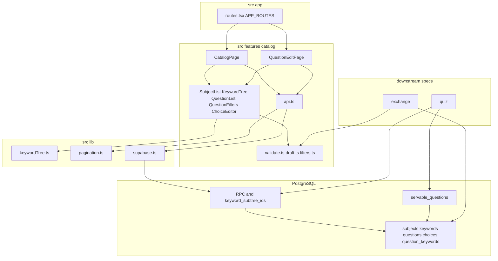
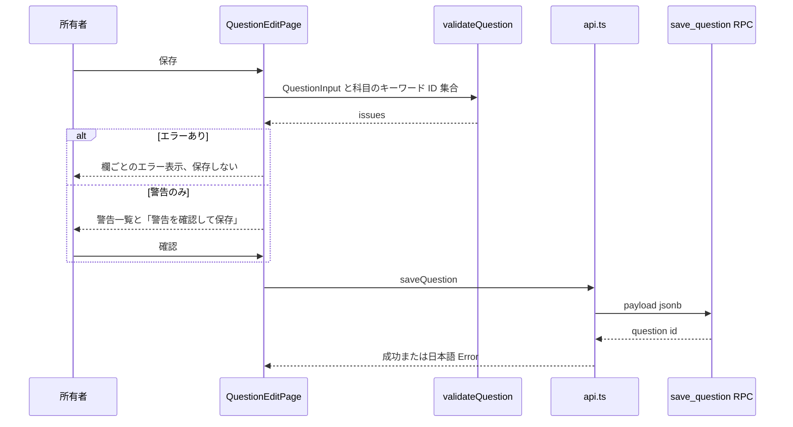
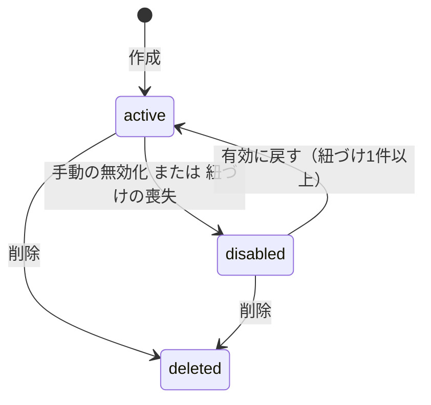
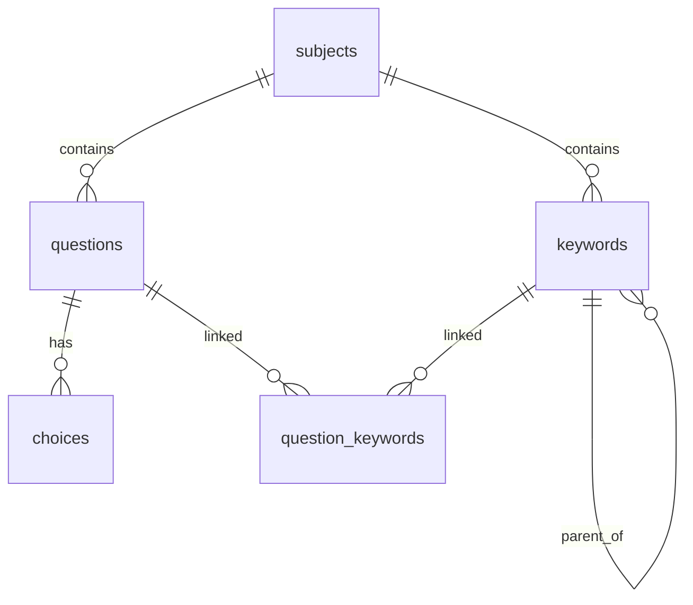

# Design Document

## Overview

**Purpose**: 所有者が科目・キーワード階層・選択問題を管理する「問題カタログ」と、出題（quiz-session）・取込（question-exchange）・統計（learning-stats）が共通で使う安定したスキーマ、作問ルールの検証関数、キーワード階層の共通関数を提供する。

**Users**: 所有者は PC（モバイル対応あり）の管理画面で科目、キーワードの木、問題を整備する。下流 spec の開発者は本 spec のテーブル、ビュー、SQL 関数、TS の純粋関数を契約として利用する。

**Impact**: app-foundation の上に、最初の業務 migration、`src/features/catalog/`、`src/lib/keywordTree.ts` を追加し、ルート登録表 `APP_ROUTES` に管理区分の行を足す。

### Goals

- 科目・キーワード・問題・選択肢が `owner_id` と RLS で所有者に限定され、移動・改名で変わらない UUID を持つ
- 問題・選択肢・紐づけの保存が1トランザクションで行われ、DB 制約が正解1つ・同一科目・循環なしを保証する
- 作問ルールの検証が副作用のない TS 関数として、手動編集と取込で共有できる
- 無効化・削除の状態が、出題・集計から除外すべき問題として下流に一意に判別できる

### Non-Goals

- 出題、解答履歴、SRS、問題フラグ、集計ビュー（quiz-session が所有）
- JSON 交換フォーマット、出力、取込 RPC（question-exchange が所有）
- 統計画面（learning-stats が所有）
- 問題の物理削除、科目の復元 UI

## Boundary Commitments

### This Spec Owns

- テーブル `subjects`、`keywords`、`questions`、`choices`、`question_keywords` と、その制約・index・RLS・トリガー
- 問題の状態の定義（有効／無効／削除）と、出題・集計対象を表すビュー `servable_questions`
- RPC: `save_question`、`move_keyword`、`reorder_keywords`、`preview_keyword_deletion`、`delete_keyword`、`delete_subject`、`set_question_disabled`、`search_questions`、`keyword_subtree_ids`
- 作問ルールの検証関数 `validateQuestion`（`src/features/catalog/validate.ts`）と、その入力型 `QuestionInput`
- キーワード階層の共通関数 `buildKeywordTree`、`keywordPath`、`keywordSubtreeIds`（`src/lib/keywordTree.ts`）
- 管理画面（科目一覧、キーワード木、問題一覧、問題編集）と、`APP_ROUTES` に追加する行

### Out of Boundary

- 解答履歴・SRS 状態・フラグのテーブル（quiz-session）。本 spec はそれらから参照される側であり、参照する列を持たない
- 取込時の差分計算、一時キーの解決、取込 RPC（question-exchange）。取込 RPC は問題を `public.save_question` で、キーワード追加は `keywords` への直接 insert（`sort_order` null で末尾トリガー）で書き込み、移動は `move_keyword`、無効化は `set_question_disabled` を使う。`validateQuestion` をクライアント側で使う
- 正答数・出題数などの集計（quiz-session のビュー）
- app-foundation の契約（`AppRoute`、`fetchAllPages`、`AppLayout`、テーマトークン、`supabase` client）の変更

### Allowed Dependencies

- app-foundation: `APP_ROUTES`／`AppRoute`（行の追加のみ）、`fetchAllPages`、`supabase`（`@/lib/supabase`）、`useAuth`、`AppLayout` のナビゲーション区分 `manage`、テーマトークン（`--c-correct`、`--c-warn` など）と共通 class（`.focus-ring`、`.tap-target`、`.mark-correct`）
- PostgreSQL 拡張: `pgcrypto`（`gen_random_uuid`、PostgreSQL 17 標準）、`pg_trgm`（部分一致検索の index）
- npm パッケージ: app-foundation が導入済みのもののみ（追加なし）
- 依存方向: `src/features/catalog` → `src/lib`／`src/components`。`src/lib/keywordTree.ts` は feature を import しない。下流 feature は `@/features/catalog/validate` と `@/lib/keywordTree` を import してよい

### Revalidation Triggers

- テーブル・列・制約の変更（特に `questions.disabled_at`／`deleted_at`、`choices.removed_at`、`question_keywords`）
- `servable_questions` の条件の変更
- `keyword_subtree_ids` の引数・返り値の変更
- `validateQuestion` の規則・重大度・返り値の型の変更
- `QuestionKind` の値（`keyword`／`feature`）の追加・変更
- キーワード削除時の紐づけ・無効化の扱いの変更

## Architecture

### Architecture Pattern & Boundary Map



**Architecture Integration**:

- Selected pattern: クライアント SPA + feature-first。DB 制約が最低限の整合性を、TS の純粋関数が作問ルールを担う二層検証
- Domain/feature boundaries: 画面と API は `src/features/catalog`、複数 feature が使う階層計算は `src/lib/keywordTree.ts`、永続化の規則は migration
- Existing patterns preserved: `APP_ROUTES` への行追加、`fetchAllPages`、`api.ts` での `snake_case` → `camelCase` 変換、日本語の `Error`
- New components rationale: 各コンポーネントは要件の1領域（科目、木、一覧、編集、検証）に対応する
- Steering compliance: `owner_id` + RLS（`USING` と `WITH CHECK`）、RPC は `SECURITY INVOKER` と `search_path = ''`、複数テーブル更新は RPC の単一トランザクション

### Technology Stack

| Layer | Choice / Version | Role in Feature | Notes |
| ------- | ------------------ | ----------------- | ------- |
| Frontend | React 19、React Router 7、TypeScript 5.9 | 管理画面、未保存変更の確認 | `useBlocker` を使用 |
| UI | Tailwind CSS 4、lucide-react | レイアウト、アイコン | app-foundation のトークン |
| Data | Supabase JS 2、PostgreSQL 17 | テーブル、RLS、RPC、再帰 CTE | `pg_trgm` を有効化 |
| Test | Vitest 3、Testing Library、Playwright | 純粋関数、コンポーネント、E2E・RLS | ローカル Supabase |

## File Structure Plan

### Directory Structure

```text
supabase/migrations/
├── 20261104000000_catalog_schema.sql     # 拡張、テーブル、制約、index、トリガー、RLS、ビュー
└── 20261104000100_catalog_rpc.sql        # RPC と keyword_subtree_ids、権限
src/lib/
├── keywordTree.ts                        # KeywordNode、buildKeywordTree、keywordPath、keywordSubtreeIds
└── keywordTree.test.ts
src/features/catalog/
├── types.ts                              # Subject、Keyword、Question、Choice、QuestionKind、QuestionStatus、QuestionInput
├── validate.ts                           # validateQuestion（作問ルール、純粋関数）
├── validate.test.ts
├── draft.ts                              # 編集中の問題の初期化と選択肢操作（純粋関数）
├── draft.test.ts
├── filters.ts                            # 一覧の絞り込み条件と URL 検索パラメータの相互変換
├── filters.test.ts
├── api.ts                                # Supabase 呼び出し、行変換、日本語エラー
├── api.test.ts                           # 行変換とエラー変換
├── CatalogPage.tsx                       # 科目選択、木と一覧の配置（PC 並列、モバイル切替）
├── QuestionEditPage.tsx                  # 問題の作成・編集、検証表示、保存、未保存確認
├── SubjectList.tsx                       # 科目の作成・改名・削除
├── KeywordTree.tsx                       # 木の表示、追加・改名・並べ替え・移動・削除
├── KeywordPicker.tsx                     # 編集画面で紐づくキーワードを選ぶ木
├── QuestionList.tsx                      # 一覧、件数、ページ送り、無効化・削除
├── QuestionFilters.tsx                   # 種別、状態、語、キーワードの条件
├── ChoiceEditor.tsx                      # 選択肢の本文・解説・正解・並べ替え
└── ConfirmDialog.tsx                     # 削除・破棄の確認（catalog 内のみで使用）
e2e/
├── catalog.spec.ts                       # 科目・木・問題の操作経路、レスポンシブ
└── catalog-rls.spec.ts                   # 別所有者からの不可視・変更拒否、DB 制約
```

コンポーネントテスト（`ChoiceEditor.test.tsx`、`QuestionList.test.tsx`、`KeywordTree.test.tsx`）は各コンポーネントの隣に置く。

### Modified Files

- `src/app/routes.tsx` — `catalog`（nav: 「カタログ」、`group: 'manage'`、`icon: FolderTree`、`order: 1`）、`catalog/:subjectId`、`catalog/:subjectId/questions/new`、`catalog/:subjectId/questions/:questionId` の4行を追加する
- `supabase/seed.sql` — RLS 検証用に2人目のローカル専用アカウント（`other@example.com`）を追加する

## System Flows

### 問題の保存



- 送信中は保存ボタンを `disabled` にする（4.8）。失敗時は入力を保持し `role="alert"` で表示する（4.7）。
- `save_question` は問題・選択肢・紐づけを1トランザクションで更新し、遅延制約トリガーがコミット時に正解1つを検査する（4.6、5.10）。

### 問題の状態



- `deleted` は終端で、UI からは戻せない（6.3、6.6）。`servable_questions` は `active` だけを返す（6.5）。

## Requirements Traceability

| Requirement | Summary | Components | Interfaces | Flows |
| ------------- | --------- | ------------ | ------------ | ------- |
| 1.1 | 所有者だけが閲覧・変更 | catalog_schema（RLS） | 各テーブルのポリシー | — |
| 1.2 | 他者は不可視・拒否 | catalog_schema（RLS）、catalog-rls.spec | — | — |
| 1.3 | 一意の識別子 | catalog_schema | `uuid default gen_random_uuid()` | — |
| 1.4 | 識別子の不変 | save_question、move_keyword | 既存 ID の upsert | 問題の保存 |
| 2.1 | 科目の作成 | SubjectList、api.ts | `createSubject` | — |
| 2.2 | 科目の改名 | SubjectList、api.ts | `renameSubject` | — |
| 2.3 | 空・重複名のエラー | SubjectList、catalog_schema | 部分 unique index、`toCatalogErrorMessage` | — |
| 2.4 | 削除の確認と件数 | SubjectList、ConfirmDialog、api.ts | `countSubjectContents` | — |
| 2.5 | 科目の削除 | delete_subject | `deleteSubject` | — |
| 3.1 | キーワードの追加 | KeywordTree、api.ts | `createKeyword` | — |
| 3.2 | 木の表示と展開 | KeywordTree、keywordTree.ts | `buildKeywordTree` | — |
| 3.3 | 改名で紐づけ維持 | KeywordTree、api.ts | `renameKeyword` | — |
| 3.4 | 空・兄弟重複のエラー | KeywordTree、catalog_schema | unique（nulls not distinct） | — |
| 3.5 | 兄弟の並べ替え | KeywordTree、reorder_keywords | `reorderKeywords` | — |
| 3.6 | 部分木の移動 | KeywordTree、move_keyword | `moveKeyword` | — |
| 3.7 | 自己・配下への移動拒否 | move_keyword、keywords トリガー、keywordTree.ts | `keywordSubtreeIds` | — |
| 3.8 | 削除の確認と件数 | KeywordTree、preview_keyword_deletion | `previewKeywordDeletion` | — |
| 3.9 | 部分木の削除と紐づけ解除 | delete_keyword | `deleteKeyword` | — |
| 3.10 | 紐づけ喪失で無効化 | delete_keyword | `disabled_reason = 'no_keyword'` | 問題の状態 |
| 4.1 | 問題の保持項目 | catalog_schema、types.ts | `Question`、`QuestionInput` | — |
| 4.2 | 選択肢の保持項目 | catalog_schema、types.ts | `Choice` | — |
| 4.3 | 葉・途中・複数の紐づけ | question_keywords、KeywordPicker | — | — |
| 4.4 | 種別ごとの初期選択肢数 | draft.ts | `createDraft`、`EXPECTED_CHOICE_COUNT` | — |
| 4.5 | 選択肢の追加・削除・並べ替え | ChoiceEditor、draft.ts | `addChoice`、`removeChoice`、`moveChoice` | — |
| 4.6 | 一括保存 | save_question | `saveQuestion` | 問題の保存 |
| 4.7 | 保存失敗の表示と入力保持 | QuestionEditPage、api.ts | `toCatalogErrorMessage` | 問題の保存 |
| 4.8 | 二重保存防止 | QuestionEditPage | — | 問題の保存 |
| 4.9 | 「わからない」を持たない | types.ts、ChoiceEditor | — | — |
| 5.1 | 共有の検証規則 | validate.ts | `validateQuestion`、`ValidationIssue` | 問題の保存 |
| 5.2 | 正解1つ | validate.ts | `correct_count` | — |
| 5.3 | 空欄 | validate.ts | `required` | — |
| 5.4 | 2個未満・重複 | validate.ts | `too_few_choices`、`duplicate_choice`、`duplicate_choice_id` | — |
| 5.5 | 紐づけなし・他科目 | validate.ts | `no_keyword`、`foreign_keyword` | — |
| 5.6 | 原則の選択肢数 | validate.ts | `choice_count_below`、`choice_count_above` | — |
| 5.7 | 略語の解説 | validate.ts | `abbreviation_unexplained` | — |
| 5.8 | エラーで保存しない | QuestionEditPage | — | 問題の保存 |
| 5.9 | 警告の確認後に保存 | QuestionEditPage | — | 問題の保存 |
| 5.10 | DB 制約 | catalog_schema トリガー | `check_one_correct`、`check_link_subject`、`check_keyword_parent` | 問題の保存 |
| 6.1 | 無効化の記録 | set_question_disabled、QuestionList | `setQuestionDisabled` | 問題の状態 |
| 6.2 | 有効に戻す | set_question_disabled | — | 問題の状態 |
| 6.3 | 削除状態 | QuestionList、api.ts | `deleteQuestion` | 問題の状態 |
| 6.4 | 削除後も保持 | catalog_schema | `deleted_at`、`choices.removed_at` | — |
| 6.5 | 対象外の判別 | servable_questions | ビュー | 問題の状態 |
| 6.6 | 削除の確認 | ConfirmDialog | — | — |
| 7.1 | 一覧の表示項目 | QuestionList、search_questions | `searchQuestions` | — |
| 7.2 | キーワード配下で絞り込み | search_questions、keyword_subtree_ids | `QuestionFilter.keywordId` | — |
| 7.3 | 種別・状態・語 | search_questions、QuestionFilters、filters.ts | `QuestionFilter` | — |
| 7.4 | 件数と50件ページ | QuestionList、api.ts | `count: 'exact'`、`range` | — |
| 7.5 | 安定順序 | search_questions | `created_at desc, id desc` | — |
| 7.6 | 該当なし | QuestionList | — | — |
| 7.7 | 取得失敗と再試行 | QuestionList、api.ts | — | — |
| 8.1 | 階層パス | keywordTree.ts | `keywordPath` | — |
| 8.2 | 配下の取得 | keywordTree.ts、keyword_subtree_ids | `keywordSubtreeIds` | — |
| 8.3 | 存在しない ID | keywordTree.ts、keyword_subtree_ids | 空配列／0 行 | — |
| 8.4 | 欠落・重複なし | keywordTree.ts、keyword_subtree_ids、api.ts | `fetchAllPages` | — |
| 8.5 | パスの表示 | QuestionList、KeywordPicker | `keywordPath` | — |
| 9.1 | 管理区分の導線と保護 | routes.tsx | `AppRoute.nav.group = 'manage'` | — |
| 9.2 | PC で並列表示 | CatalogPage | `lg` 以上で2列 | — |
| 9.3 | モバイルで切替 | CatalogPage | タブ切替 | — |
| 9.4 | キーボード・44px・フォーカス | 全 UI | `.focus-ring`、`.tap-target` | — |
| 9.5 | 正解の共通色と印 | ChoiceEditor | `.mark-correct`、`--c-correct` | — |
| 9.6 | 未保存の確認 | QuestionEditPage | `useBlocker`、`beforeunload` | — |

## Components and Interfaces

| Component | Domain/Layer | Intent | Req Coverage | Key Dependencies | Contracts |
| ----------- | -------------- | -------- | -------------- | ------------------ | ----------- |
| catalog_schema migration | DB | テーブル、制約、RLS、ビュー | 1.1–1.4, 2.3, 3.4, 4.1–4.3, 5.10, 6.4, 6.5 | PostgreSQL (P0) | State |
| catalog_rpc migration | DB | 原子的な更新、検索、部分木 | 1.4, 2.5, 3.5–3.10, 4.6, 6.1, 6.2, 7.1–7.5, 8.2–8.4 | catalog_schema (P0) | API |
| keywordTree.ts | lib | 木の構築、パス、部分木 | 3.2, 3.7, 8.1–8.5 | — | Service |
| types.ts | catalog | ドメイン型 | 4.1, 4.2, 4.9 | — | — |
| validate.ts | catalog | 作問ルールの検証 | 5.1–5.7 | types.ts (P0) | Service |
| draft.ts | catalog | 編集中の問題の操作 | 4.4, 4.5 | types.ts (P0) | Service |
| filters.ts | catalog | 絞り込み条件の変換 | 7.3 | — | Service |
| api.ts | catalog | DB 呼び出しと変換 | 2.1–2.5, 3.1–3.10, 4.6, 4.7, 6.1–6.3, 7.1–7.7 | supabase (P0)、pagination (P0) | Service |
| CatalogPage | catalog UI | 科目・木・一覧の配置 | 9.2, 9.3 | api.ts (P0) | State |
| SubjectList | catalog UI | 科目の操作 | 2.1–2.5 | api.ts (P0) | — |
| KeywordTree | catalog UI | 木の操作 | 3.1–3.9 | keywordTree.ts (P0) | — |
| QuestionList / QuestionFilters | catalog UI | 一覧・絞り込み・状態操作 | 6.1–6.3, 6.6, 7.1–7.7, 8.5 | api.ts (P0)、filters.ts (P0) | — |
| QuestionEditPage | catalog UI | 編集、検証、保存 | 4.4–4.8, 5.8, 5.9, 9.6 | validate.ts (P0)、draft.ts (P0)、api.ts (P0) | State |
| ChoiceEditor / KeywordPicker | catalog UI | 選択肢と紐づけの入力 | 4.3, 4.5, 4.9, 8.5, 9.5 | draft.ts (P0)、keywordTree.ts (P0) | — |
| ConfirmDialog | catalog UI | 確認ダイアログ | 2.4, 3.8, 6.6, 9.6 | — | — |
| routes.tsx（変更） | app | 導線と保護 | 9.1 | APP_ROUTES (P0) | — |

### DB

#### catalog_schema migration

##### Responsibilities & Constraints

- 全テーブルに `owner_id uuid not null default auth.uid() references auth.users(id) on delete cascade` を持たせ、RLS を有効化する。ポリシーは `for all to authenticated using (owner_id = (select auth.uid())) with check (owner_id = (select auth.uid()))`（1.1、1.2）。
- 科目は論理削除（`deleted_at`）とする。問題が `subject_id` を保持し続けるため（2.5、6.4）。科目名の一意性は `deleted_at is null` の部分 unique index で担保する（2.3）。
- `keywords` は物理削除。`parent_id` は `on delete cascade` で部分木ごと消える。兄弟名の一意性は `unique nulls not distinct (subject_id, parent_id, name)`（3.4）。
- トリガー `check_keyword_parent`（`before insert or update of parent_id, subject_id`）: 親が同じ科目に属すこと、親の祖先に自分が含まれないこと（再帰 CTE）を検査し、違反時は `errcode = 'P0001'`、メッセージ `keyword_cycle` または `keyword_subject_mismatch` で例外にする（3.7、5.10）。
- `choices` は編集で外された選択肢も行を残し `removed_at` を設定する（6.4）。表示順の一意性は `removed_at is null` の部分 unique index `(question_id, position)`。正解は部分 unique index `(question_id) where is_correct and removed_at is null` で最大1つ、遅延制約トリガー `check_one_correct`（`deferrable initially deferred`、`choices` の挿入・更新・削除後）でちょうど1つを保証する（5.10）。
- トリガー `check_link_subject`（`question_keywords` の挿入・更新前）: キーワードと問題の `subject_id` が一致することを検査する（5.10）。
- 名前・本文の空文字は `check (length(btrim(x)) > 0)`（2.3、3.4、5.3 の DB 側の最低限）。

#### catalog_rpc migration

- 外部キー検査は RLS を経由しないため、本 migration で `questions` と `keywords` のポリシーを作り直し、`WITH CHECK` に `exists (select 1 from public.subjects s where s.id = subject_id and s.owner_id = (select auth.uid()))` を加える（他人の科目への作成・付け替えを拒否、1.2）。
- `save_question` は `keywordIds` が空なら `no_keyword`、同じ選択肢 ID の重複指定は `duplicate_choice_id` で拒否する。

すべて `language plpgsql`（`keyword_subtree_ids` は `language sql stable`）、`security invoker`、`set search_path = ''`、スキーマ修飾付き。`authenticated` に `execute` を付与し、`anon` と `public` からは取り消す。

| RPC | Request | Response | Errors（例外メッセージ） |
| ----- | --------- | ---------- | -------------------------- |
| `save_question(p jsonb)` | `QuestionInput` と同じ camelCase キーの JSON（`id`、`subjectId`、`kind`、`stem`、`explanation`、`keywordIds`、`choices`。`choices` の各要素は `ChoiceInput` と同じ `id`、`body`、`explanation`、`isCorrect`） | `uuid` | `question_not_found`、`choice_not_in_question`、`duplicate_choice_id`、`no_keyword`、`one_correct_required`、`keyword_subject_mismatch` |
| `move_keyword(p_keyword_id uuid, p_new_parent_id uuid)` | 移動先 null は科目直下 | `void` | `keyword_not_found`、`keyword_cycle`、`keyword_subject_mismatch`、`duplicate_sibling` |
| `reorder_keywords(p_subject_id uuid, p_parent_id uuid, p_ordered_ids uuid[])` | 兄弟全件の新しい順序 | `void` | `sibling_set_mismatch` |
| `preview_keyword_deletion(p_keyword_id uuid)` | — | `{ keyword_count, unlinked_question_count, disabled_question_count }` | — |
| `delete_keyword(p_keyword_id uuid)` | — | 同上（実際の件数） | — |
| `delete_subject(p_subject_id uuid)` | — | `void` | `subject_not_found` |
| `set_question_disabled(p_question_id uuid, p_disabled boolean, p_reason text)` | — | `void` | `no_keyword`、`question_deleted` |
| `search_questions(p_subject_id uuid, p_keyword_id uuid, p_kind text, p_status text, p_text text)` | 未指定は null | `setof public.question_list_row` | — |
| `keyword_subtree_ids(p_keyword_id uuid)` | — | `setof uuid`（自身を含む） | — |

- `save_question`: `p.id` が null なら新規作成、ある場合は既存行を更新する（ID 不変、1.4）。選択肢は `id` 付きを更新、`id` なしを挿入、入力にない既存選択肢へ `removed_at = now()` を設定する。`position` の一時衝突を避けるため、先に対象の有効な選択肢の `position` を負値へ退避してから書き込む。紐づけは入力の集合に置き換える。`updated_at` を更新する（4.6）。
- `move_keyword`: 移動先の兄弟の最大 `sort_order + 1` を設定する（3.6）。循環はトリガーで拒否される（3.7）。
- `reorder_keywords`: `p_ordered_ids` が当該親の兄弟集合と一致しなければ拒否し、配列の順で `sort_order = 0..n-1` を設定する（3.5）。
- `delete_keyword`: 部分木 ID を `keyword_subtree_ids` で集め、紐づけが部分木外に残らない未削除の問題を `disabled_at = now()`、`disabled_reason = 'no_keyword'` にしてから、ルートのキーワードを削除する（紐づけは cascade で消える）（3.9、3.10）。`preview_keyword_deletion` は同じ集計を変更なしで返す（3.8）。`unlinked_question_count` は部分木に紐づく未削除の問題数、`disabled_question_count` はそのうち新たに無効化される問題数（すでに無効の問題は数えず、理由も変えない）。
- `delete_subject`: 科目に `deleted_at`、配下の未削除の問題に `deleted_at` を設定し、配下のキーワードを削除する（2.5）。
- `set_question_disabled`: 無効化は `disabled_at = now()`、`disabled_reason = p_reason`（空なら null）。有効化は紐づけが0件なら `no_keyword` で拒否し、両列を null にする（6.1、6.2）。
- `search_questions`: `deleted_at is null` かつ `subject_id = p_subject_id`。`p_keyword_id` があれば `keyword_subtree_ids` のいずれかに紐づく問題（`exists`）、`p_status` は `active`／`disabled`、`p_text` は問題文・解説・有効な選択肢の本文と解説への `ilike '%' || 語 || '%'`（`%`・`_` はエスケープ）。`order by created_at desc, id desc`（7.2、7.3、7.5）。返り値の複合型 `question_list_row` は `id, kind, stem, created_at, disabled_at, keyword_ids uuid[]`。
- `keyword_subtree_ids`: `with recursive` で自身から子を辿る。`union`（重複除去）を使い、存在しない ID は0行（8.2〜8.4）。下流の DB ビューもこの関数を使う。

### lib

#### keywordTree.ts

```typescript
export type KeywordNode = { id: string; parentId: string | null; name: string; sortOrder: number };
export type KeywordTreeNode = KeywordNode & { children: KeywordTreeNode[] };

export function buildKeywordTree(nodes: readonly KeywordNode[]): KeywordTreeNode[];
export function keywordPath(nodes: readonly KeywordNode[], id: string): KeywordNode[];
export function keywordSubtreeIds(nodes: readonly KeywordNode[], id: string): string[];
```

- `buildKeywordTree`: 親ごとに `sortOrder`、同値は `id` で並べた木を返す。親が見つからないノードは根として扱う（3.2）。
- `keywordPath`: 根から `id` までを順に返す。存在しない `id` は `[]`。循環データに対しては訪問済み集合で打ち切る（8.1、8.3）。
- `keywordSubtreeIds`: 自身を先頭に幅優先で配下の ID を重複なく返す。存在しない `id` は `[]`（8.2〜8.4）。移動先候補の除外にも使う（3.7）。
- 入力は科目のキーワード全件（`fetchAllPages` で取得、`order by sort_order, id`）。

### catalog

#### types.ts

```typescript
export type QuestionKind = 'keyword' | 'feature';
export type QuestionStatus = 'active' | 'disabled';

export type Subject = { id: string; name: string; createdAt: string };
export type Keyword = KeywordNode & { subjectId: string };

export type ChoiceInput = { id: string | null; body: string; explanation: string; isCorrect: boolean };
export type QuestionInput = {
  id: string | null;
  subjectId: string;
  kind: QuestionKind;
  stem: string;
  explanation: string;
  keywordIds: string[];
  choices: ChoiceInput[];            // 配列順が表示順
};

export type Question = Omit<QuestionInput, 'id' | 'choices'> & {
  id: string;
  choices: (ChoiceInput & { id: string })[];
  status: QuestionStatus;
  disabledReason: string | null;
  createdAt: string;
  updatedAt: string;
};

export type QuestionListItem = {
  id: string; kind: QuestionKind; stem: string; status: QuestionStatus;
  keywordIds: string[]; createdAt: string;
};
```

- 「わからない」は型にも DB にも存在しない（4.9）。`QuestionInput` は question-exchange が取込行を検証するときの入力型でもある。

#### validate.ts

```typescript
export const EXPECTED_CHOICE_COUNT: Record<QuestionKind, number> = { keyword: 6, feature: 4 };

export type ValidationCode =
  | 'correct_count' | 'required' | 'too_few_choices' | 'duplicate_choice' | 'duplicate_choice_id'
  | 'no_keyword' | 'foreign_keyword' | 'choice_count_below' | 'choice_count_above'
  | 'abbreviation_unexplained';

export type ValidationTarget =
  | { field: 'stem' | 'explanation' | 'keywords' | 'choices' }
  | { field: 'choiceBody' | 'choiceExplanation'; index: number };

export type ValidationIssue = {
  code: ValidationCode;
  severity: 'error' | 'warning';
  target: ValidationTarget;
  message: string;                 // 日本語
};

export function validateQuestion(
  input: QuestionInput,
  context: { subjectKeywordIds: ReadonlySet<string> },
): ValidationIssue[];
```

| 規則 | code | 重大度 | Req |
| ------ | ------ | -------- | ----- |
| 正解の数が1でない | `correct_count` | error | 5.2 |
| 問題文・解説・選択肢本文・選択肢解説が空白のみ | `required` | error | 5.3 |
| 選択肢が2個未満 | `too_few_choices` | error | 5.4 |
| 前後空白を除いて同じ本文の選択肢がある | `duplicate_choice` | error | 5.4 |
| 同じ（null でない）選択肢 ID が複数ある（保存 RPC と同じ条件） | `duplicate_choice_id` | error | 5.4 |
| 紐づけが0件 | `no_keyword` | error | 5.5 |
| `subjectKeywordIds` にない紐づけ | `foreign_keyword` | error | 5.5 |
| 選択肢数が原則未満（2以上） | `choice_count_below` | warning | 5.6 |
| 選択肢数が原則超過 | `choice_count_above` | error | 5.6 |
| 問題文・選択肢の `\b[A-Z][A-Z0-9]{1,}\b` の語が、問題解説・選択肢解説のどこにも現れない | `abbreviation_unexplained` | warning | 5.7 |

- 副作用なし、入力を変更しない。結果は規則表の順、同じ規則内は対象の順（5.1）。
- 「1問1情報」は機械的に判定できないため検証しない（生成 skill と人のレビューの責務）。

#### draft.ts

```typescript
export function createDraft(subjectId: string, kind: QuestionKind): QuestionInput; // 空欄の選択肢を EXPECTED_CHOICE_COUNT 個
export function fromQuestion(q: Question): QuestionInput;
export function addChoice(d: QuestionInput): QuestionInput;
export function removeChoice(d: QuestionInput, index: number): QuestionInput;
export function moveChoice(d: QuestionInput, from: number, to: number): QuestionInput;
export function setCorrect(d: QuestionInput, index: number): QuestionInput;      // 他を false にする
export function isDirty(original: QuestionInput, current: QuestionInput): boolean;
```

- 種別を変えても既存の選択肢は消さない（件数の差は検証の警告・エラーで示す）（4.4、4.5）。

#### filters.ts

```typescript
export type QuestionFilter = {
  keywordId: string | null; kind: QuestionKind | null; status: QuestionStatus | null; text: string; page: number;
};
export function parseFilter(params: URLSearchParams): QuestionFilter;   // 不正値は既定値
export function toSearchParams(filter: QuestionFilter): URLSearchParams;
export const DEFAULT_FILTER: QuestionFilter;
export type SearchQuestionsArgs = { p_subject_id: string; p_keyword_id: string | null; p_kind: QuestionKind | null; p_status: QuestionStatus | null; p_text: string | null };
export function toSearchArgs(subjectId: string, filter: QuestionFilter): SearchQuestionsArgs;   // 未指定・空文字は null、page は含めない
```

- 絞り込み条件は URL に保持し、編集画面から戻ったとき同じ一覧に戻れるようにする（7.3）。
- URL のキーは `keyword`、`kind`、`status`、`q`（検索語）、`page` とし、既定値の項目は URL に含めない。`toSearchArgs` は `search_questions` の引数に対応させ、ページは api.ts の range で扱う。

#### api.ts

```typescript
export const QUESTION_PAGE_SIZE = 50;

export function listSubjects(): Promise<Subject[]>;
export function createSubject(name: string): Promise<Subject>;
export function renameSubject(id: string, name: string): Promise<void>;
export function countSubjectContents(id: string): Promise<{ keywordCount: number; questionCount: number }>;
export function deleteSubject(id: string): Promise<void>;

export function listKeywords(subjectId: string): Promise<Keyword[]>;     // fetchAllPages
export function createKeyword(subjectId: string, parentId: string | null, name: string): Promise<Keyword>;
export function renameKeyword(id: string, name: string): Promise<void>;
export function moveKeyword(id: string, newParentId: string | null): Promise<void>;
export function reorderKeywords(subjectId: string, parentId: string | null, orderedIds: string[]): Promise<void>;
export type KeywordDeletionImpact = { keywordCount: number; unlinkedQuestionCount: number; disabledQuestionCount: number };
export function previewKeywordDeletion(id: string): Promise<KeywordDeletionImpact>;
export function deleteKeyword(id: string): Promise<KeywordDeletionImpact>;

export function searchQuestions(subjectId: string, filter: QuestionFilter): Promise<{ items: QuestionListItem[]; total: number }>;
export function getQuestion(id: string): Promise<Question | null>;      // 削除済みは null
export function saveQuestion(input: QuestionInput): Promise<string>;
export function setQuestionDisabled(id: string, disabled: boolean, reason?: string): Promise<void>;
export function deleteQuestion(id: string): Promise<void>;

export function toCatalogErrorMessage(context: string, error: { code?: string; message: string }): string;
```

- `createKeyword` は兄弟の最大 `sort_order + 1` をクライアントで計算せず、`sort_order` の既定値を DB 側のトリガーで末尾に設定する（3.1）。
- `searchQuestions` は `supabase.rpc('search_questions', …, { count: 'exact' }).range(from, from + 49)`（7.4）。
- `getQuestion` は問題、有効な選択肢（`position` 順）、紐づけを `Promise.all` で並列取得する。
- `toCatalogErrorMessage`: unique 違反（`23505`）→「同じ名前がすでにあります」、`keyword_cycle` →「キーワードを自分自身または配下へは移動できません」、`no_keyword` →「紐づくキーワードがないため有効にできません」、`one_correct_required` →「正解は1つにしてください」、その他 →「{context}に失敗しました: {message}」（2.3、3.4、3.7、4.7、6.2、7.7）。

### catalog UI

#### CatalogPage

- URL `catalog` で科目一覧、`catalog/:subjectId` で木と一覧を表示する。PC 幅（`lg` 以上）は左に `KeywordTree`、右に `QuestionFilters` + `QuestionList` の2列（9.2）。モバイル幅は「キーワード」「問題」のタブで切り替え、各要素に `min-w-0` と折り返しを付ける（9.3）。
- 木でキーワードを選ぶと `filter.keywordId` を設定する（7.2）。

#### SubjectList / KeywordTree

- `KeywordTree` は `role="tree"`／`treeitem`、`aria-expanded`、矢印キーでの移動と展開を持つ（3.2、9.4）。各ノードの操作（子の追加、改名、上へ／下へ、移動先の選択、削除）は、木で選択したキーワードに対する操作パネル（木の下に置くボタン・入力欄・移動先の `<select>`）で行い、木の roving tabindex に操作ボタンを含めない。ドラッグ操作は必須にせず、削除の確認だけ `ConfirmDialog` を使う（3.5、3.6、9.4）。移動先の候補から `keywordSubtreeIds` の結果を除外する（3.7）。
- 削除前に件数取得 API の結果を `ConfirmDialog` に表示する（2.4、3.8）。

#### QuestionList / QuestionFilters

- 行に問題文の冒頭（80文字）、種別、状態、紐づくキーワードの階層パス（`keywordPath` を「 / 」で連結）を表示する（7.1、8.5）。件数、前へ／次へ、ページ番号を表示する（7.4）。0件は「条件に一致する問題はありません」（7.6）、失敗時は `role="alert"` と「再試行」ボタン（7.7）。
- 行の操作: 編集、無効化（理由の任意入力）／有効に戻す、削除（`ConfirmDialog` に「削除すると一覧から消え、元に戻せません」）（6.1〜6.3、6.6）。

#### QuestionEditPage / ChoiceEditor / KeywordPicker

- 新規は `createDraft`、既存は `getQuestion` → `fromQuestion`。入力のたびに `validateQuestion` を再計算し、保存ボタン押下後に各欄の近くへ `aria-describedby` で結び付けたメッセージを表示する（5.8）。エラーが1件でもあれば保存しない。警告のみなら警告一覧と「警告を確認して保存」を表示する（5.9）。
- 保存中は `saving` 状態で保存ボタンを `disabled` にする（4.8）。
- `ChoiceEditor`: 各選択肢に本文、解説、正解のラジオ（グループ内で1つ）、上へ／下へ／削除ボタン。正解の選択肢に `.mark-correct` と ○ の印を付ける（`--c-warn` は使わない）（4.5、9.5）。
- `KeywordPicker`: 科目の木をチェックボックス付きで表示し、葉・途中のどちらも選べる。選択済みは階層パスで一覧表示する（4.3、8.5）。
- `isDirty` が真の間、`useBlocker` で画面内遷移を `ConfirmDialog` で確認し、`beforeunload` でブラウザの離脱も確認する（9.6）。

#### ConfirmDialog

- `<dialog>` 要素で実装し、開いたときに確定以外のボタンへフォーカスし、Esc で閉じる（9.4）。危険操作の確定ボタンに `--c-warn` を使う。

## Data Models

### Domain Model



- 集約: 問題（問題・選択肢・紐づけ）は `save_question` で一体として更新する。キーワードの木は科目単位。
- 不変条件: 有効な選択肢の正解はちょうど1つ、紐づけ先は同じ科目、キーワードの親は同じ科目かつ循環なし。

### Physical Data Model

| テーブル | 列 | 制約・index |
| ---------- | ---- | ------------- |
| `subjects` | `id uuid pk`、`owner_id`、`name text`、`created_at timestamptz default now()`、`updated_at`、`deleted_at timestamptz null` | unique `(owner_id, name) where deleted_at is null` |
| `keywords` | `id uuid pk`、`owner_id`、`subject_id uuid fk subjects`、`parent_id uuid null fk keywords on delete cascade`、`name text`、`sort_order int`、`created_at`、`updated_at` | `unique nulls not distinct (subject_id, parent_id, name)`、index `(subject_id, parent_id, sort_order)`、index `(parent_id)` |
| `questions` | `id uuid pk`、`owner_id`、`subject_id uuid fk subjects`、`kind text check in ('keyword','feature')`、`stem text`、`explanation text`、`disabled_at timestamptz null`、`disabled_reason text null`、`deleted_at timestamptz null`、`created_at`、`updated_at` | index `(subject_id, created_at desc, id desc) where deleted_at is null`、GIN trigram `(stem)`、`(explanation)` |
| `choices` | `id uuid pk`、`owner_id`、`question_id uuid fk questions on delete cascade`、`position int`、`body text`、`explanation text`、`is_correct boolean`、`removed_at timestamptz null`、`created_at`、`updated_at` | unique `(question_id, position) where removed_at is null`、unique `(question_id) where is_correct and removed_at is null`、GIN trigram `(body)` |
| `question_keywords` | `question_id uuid fk questions on delete cascade`、`keyword_id uuid fk keywords on delete cascade`、`owner_id`、`created_at` | pk `(question_id, keyword_id)`、index `(keyword_id)` |

- ビュー `public.servable_questions`（`with (security_invoker = true)`）: `questions where disabled_at is null and deleted_at is null`。出題・集計対象の唯一の定義（6.5）。
- `updated_at` は共通トリガー関数 `catalog_private.touch_updated_at` で更新する（`catalog_private` スキーマは `authenticated` に `usage` を与えず、クライアントから呼べない）。トリガー関数 `check_*` も同スキーマに置く。
- `keywords.sort_order` は挿入時に null なら兄弟の最大値 + 1 をトリガーで設定する。

### Data Contracts & Integration

- question-exchange: 既存要素は `questions.id`、`choices.id`、`keywords.id` で参照する。取込 RPC は問題を `public.save_question` で、キーワード追加は `keywords` への直接 insert（`sort_order` null で末尾トリガー）で書き込み、移動は `move_keyword`、無効化は `set_question_disabled` を使う。いずれも本 spec のテーブル制約（遅延の正解検査を含む）の下で動作し、外された選択肢には `removed_at` を設定する規則に従う。
- quiz-session: 解答履歴は `questions.id` と `choices.id` を外部キーで参照してよい（行は物理削除されない。キーワード削除・科目削除でも問題と選択肢は残る）。出題候補は `servable_questions` から選ぶ。キーワード単位の集計範囲は `keyword_subtree_ids` を使う。

## Error Handling

### Error Strategy

- 入力起因（空、重複、正解数など）: 保存前に `validateQuestion` と画面の入力検査で止め、欄の近くに日本語で表示する。DB 制約違反は `toCatalogErrorMessage` で同じ文言に変換する。
- 状態の衝突（循環移動、紐づけなしの有効化、兄弟集合の不一致）: RPC の例外メッセージを日本語に変換し、`role="alert"` で表示し、画面のデータを再取得する。
- 通信・サーバーの失敗: 「{操作}に失敗しました」と再試行ボタン。編集中の入力は保持する。
- 存在しない・削除済みの問題を編集 URL で開いた場合: 「問題が見つかりません」と一覧への導線を表示する。

### Monitoring

個人用途のため外部監視は持たない。元のエラーを `console.error` に残す。

## Testing Strategy

### Unit Tests

- `keywordTree.test.ts`: 兄弟順と同値時の ID 順、深さ5のパス、存在しない ID で `[]`、配下取得の欠落・重複なし（1,500 ノード）、循環データでの停止（3.2、8.1〜8.4）
- `validate.test.ts`: 規則表の各 code の発生と非発生、重大度、6個／4個の境界、5個（警告）と7個（エラー）、略語が解説にある場合とない場合、入力が変更されないこと（5.1〜5.7）
- `draft.test.ts`: 種別ごとの初期選択肢数、追加・削除・並べ替え・正解の単一化、`isDirty`（4.4、4.5）
- `filters.test.ts`: URL との往復、不正値の既定値化（7.3）
- `api.test.ts`: 行変換（`disabled_at` → `status`）、`toCatalogErrorMessage` の各分岐（2.3、3.7、4.7、6.2、7.7）

### Component Tests

- `ChoiceEditor.test.tsx`: 正解の選択が1つに限られる、正解に印と `mark-correct`、「わからない」が存在しない（4.5、4.9、9.5）
- `QuestionList.test.tsx`: 階層パスの表示、0件表示、エラーと再試行（7.1、7.6、7.7、8.5）
- `KeywordTree.test.tsx`: 矢印キーでの展開とフォーカス移動、移動先候補から自分と配下が除外される（3.2、3.7、9.4）

### E2E Tests（Playwright、ローカル Supabase、直列）

- `catalog.spec.ts`:
  - 科目の作成・改名・重複名エラー・削除（件数の確認表示）（2.1〜2.5）
  - キーワードの追加、兄弟重複エラー、並べ替えの再読込後の維持、部分木の移動、配下への移動拒否（3.1〜3.7）
  - キーワード削除の確認件数と、唯一の紐づけを失った問題が無効になること（3.8〜3.10）
  - 問題の作成（初期6個／4個）、警告のみでの確認保存、エラーで保存されないこと、再編集で ID が変わらないこと（1.4、4.4〜4.8、5.8、5.9）
  - 無効化・有効化・削除と一覧からの消失（6.1〜6.3、6.6）
  - 途中ノードでの絞り込みで配下に紐づく問題が出ること、種別・状態・語の絞り込み、1,050件の seed で全ページを辿って欠落・重複がないこと（7.2〜7.5）
  - 未保存の変更がある編集画面から離れる確認（9.6）
  - モバイル（390×844）でタブ切替・横スクロールなし、PC（1280×800）で2列表示、管理区分の導線（9.1〜9.3）
- `catalog-rls.spec.ts`:
  - `other@example.com` のセッションで所有者の科目・問題が0件、更新・削除が0行・拒否（1.1、1.2）
  - 正解0個・2個の選択肢を直接挿入するとコミットで失敗、他科目のキーワードへの紐づけが失敗、循環する親の設定が失敗（5.10）
  - 削除状態の問題の選択肢が残り、`servable_questions` に無効・削除の問題が含まれないこと（6.4、6.5）
  - `keyword_subtree_ids` が深さ10・兄弟1,200件の木で全件を重複なく返し、存在しない ID で0行（8.2〜8.4）

## Security Considerations

- RLS は全テーブルで `USING` と `WITH CHECK` の両方を `owner_id = (select auth.uid())` に制限する。`question_keywords` と `choices` も `owner_id` を持ち、親とは独立に制限する。
- RPC は `SECURITY INVOKER` のため RLS がそのまま適用される。トリガー関数は `catalog_private` スキーマに置き、`EXECUTE` を与えない。
- `search_questions` の部分一致語は `%`、`_`、`\` をエスケープして連結し、SQL を組み立てない。

## Performance & Scalability

- 一覧は DB 側で絞り込み・件数・ページングを行い、1回の応答は50件。キーワード全件は `fetchAllPages` で取得する（1,000 件上限への対応）。
- 部分一致は `pg_trgm` の GIN index、キーワード配下の絞り込みは `question_keywords(keyword_id)` と再帰 CTE の `keywords(parent_id)` index を使う。
